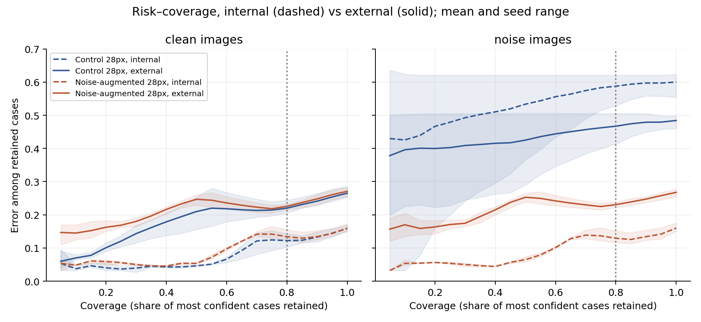

# Medical AI Reliability Lab

**Explorative Studie, Stand 10. November 2026.** Wie gut erkennt ein medizinischer Bildklassifikator seine eigenen Fehler unter Bildstörungen? Ein beobachteter Mechanismus ist der Kollaps des letzten Merkmalsvektors: Bei `h = 0` bleibt nur der Bias-Logit übrig. Nichtleere Merkmalsvektoren garantieren umgekehrt keine zuverlässigen Vorhersagen.


Links: derselbe Testfall und Nullvektor-Anteile. Mitte: der Bias-bedingte Konfidenz-Spike. Rechts: Fehler unter akzeptierten Vorhersagen; Spannweiten zeigen Minimum–Maximum über drei Seeds, keine Konfidenzintervalle. [PDF](reports/figures/overview_figure.pdf)

Wir vergleichen kleine CNNs auf PneumoniaMNIST mit und ohne Rauschaugmentation, inzwischen mit fünf gepaarten Seeds und gleichem Trainingsbudget. Nach Pixel-Deduplizierung sind Training, Modellwahl und Kalibrierung getrennt; die abschließenden Vergleiche verwenden 262 Kalibrierungsfälle und 621 Testrepräsentanten. Code, Gewichte und Vorhersagen sind versioniert; Tests und Prüfsummen sichern die Nachrechnung ab.

| Interner Vergleich, fünf Seeds | Ohne Augmentation | Mit Rauschaugmentation |
|---|---:|---:|
| Accuracy, Original | 83.9% | 84.0% |
| Accuracy, Rauschen | 41.0% | 83.4% |
| Fehler unter akzeptierten Rauschfällen | 54.2% | 11.5% |
| Akzeptanz unter Rauschen | 84.3% | 76.9% |

Primärer Kontrast (Unterschied des Rauschen-minus-Original-Fehleranstiegs unter akzeptierten Fällen, Augmentation minus Kontrolle): **-43.7 pp**. Approximatives 95%-Intervall über fünf Seed-Paare: [-56.7; -30.6] pp. Separater Bild-Bootstrap bei festen Modellen: [-49.0; -38.0] pp. Das sind verschiedene Unsicherheitsquellen; Patientenunabhängigkeit ist nicht belegt. [Alle Seed-Ergebnisse und Risk-Coverage-Kurven](reports/five_seed/README.md) · [Historischer Drei-Seed-Vergleich](reports/augmentation/primary.json).

**Wahrscheinlichkeitskalibrierung:** Temperature Scaling auf internen Kalibrierungsdaten verschlechtert die Test-NLL bei den angepassten Temperaturen in allen vier Bedingungen. Bei zusätzlicher Variation des Temperatur-Fits umfasst der NLL-Differenzbereich der Kontrolle auch null. [Kalibrierungsanalyse](reports/temperature_scaling/README.md). [**Forschungsbericht, 6 Seiten (PDF)**](reports/followup/research_report.pdf) · [Textfassung](reports/followup/research_report.md).

## Auflösungsprüfung: 224×224

Die bisherigen 28px-Befunde betreffen einen Niedrigauflösungs-Benchmark; sie belegen keine diagnostische Eignung. Ein neuer kontrollierter Vergleich nutzt jetzt das **offizielle 224px-Archiv** und denselben eingefrorenen ResNet-18-Encoder für 224px-Information versus auf 28px reduzierte Information. AUROC: **0.980 vs. 0.960**, gepaarte Differenz **+0.019 [+0.009; +0.032]**. Kein End-to-End-Training und noch kein externer Test dieser neuen Modelle. [Methoden, Bildvergleich und Ergebnisse](reports/high_resolution/README.md).

**Robustheit bei 224px:** Eingangsrauschen erhöht die akzeptierte Fehlerrate des eingefrorenen 224px-Modells von 4,2 % auf 35,6 %, während die Akzeptanz von 73,3 % auf 96,8 % steigt. Der primäre Vergleich des Risikoanstiegs bei gleicher 80%-Abdeckung zeigt keinen eindeutigen Unterschied zwischen den Auflösungen: −0,28 pp [−4,07; +2,21]. [Störungsanalyse mit Kontrolle der Rauschposition](reports/high_resolution/robustness/README.md).

## Externer Test: RSNA

Die eingefrorenen Modelle wurden auf 2.000 externen Thoraxaufnahmen geprüft (1.000 `Lung Opacity`, 1.000 `Normal`; überwiegend Erwachsene). Training und Annahmeschwellen bleiben unverändert. Bei der 28px-Kontrolle sinkt die Accuracy von **84,1 % auf 73,5 %**, während der Fehler unter akzeptierten Fällen von **11,2 % auf 20,6 % [18,7; 22,5]** steigt. Rauschaugmentation hilft extern gegen Rauschen, verbessert den primären Vergleich auf unveränderten Bildern aber nicht: **+1,2 Prozentpunkte akzeptierte Fehler [+0,4; +1,9]** gegenüber der Kontrolle. Intervalle: gepaarter Bild-Bootstrap, bedingt auf feste Modelle und Schwellen.



Mittel und Minimum–Maximum über drei Seeds, keine Konfidenzbänder. [Protokoll, ECE, Reliability Diagrams und Ergebnisse](reports/external/README.md) · [AP/PA-Auswertung](reports/external/README.md#aufnahmeart-appa)

**Grenzen:** Historische Hauptversuche mit 28×28 Pixeln, externe Kontrolle mit 64px; ergänzender eingefrorener Encoder bei 224px, weiterhin unter Originalauflösung; fünf Seeds intern und drei extern, künstliche Störungen und ein wiederholt untersuchter interner Benchmark. Der externe Datensatz- und Populationswechsel umfasst Alter, Aufnahmeart und Labeldefinition; sein Effekt lässt sich nicht allein dem Alter zuordnen. Aufnahmeart und Label sind stark verknüpft. Unabhängige Patienten über verschiedene RSNA-IDs sind nicht nachgewiesen; die Weitergaberechte des verwendeten Datenspiegels sind ungeklärt. Kein klinischer Anspruch.

## Eigenleistung & Werkzeuge

Die neuen Auswertungsskripte, Tests und der Forschungsbericht wurden mit Codex-Unterstützung erstellt und ausgeführt. Die Fortführung und Forschungsausrichtung wurden vom Projektverantwortlichen beauftragt. Frühere persönliche Methodenentscheidungen und Prüfungen sind damit nicht automatisch belegt; eine vollständige individuelle Beitragsbeschreibung bleibt zu ergänzen.

## Reproduzieren

Voraussetzung: Python 3.12, Abhängigkeiten aus `requirements.txt` und CPU-PyTorch 2.5.1. Die drei Befehle prüfen die Daten, reproduzieren die Übersicht aus gespeicherten Vorhersagen und führen die Tests aus; kein neues Training. Für Wiederholungen einen neuen Ausgabeordner wählen.

```bash
python scripts/fetch_data.py
python scripts/make_overview.py --output /tmp/medical-ai-overview
python -m unittest discover -s tests -v
```

[Dokumentation und archivierte Berichte](docs/README.md) · [Roadmap](ROADMAP.md) · [Code- und Datenlizenzen](docs/LICENSING.md)
