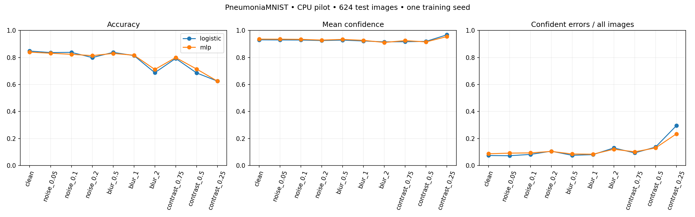
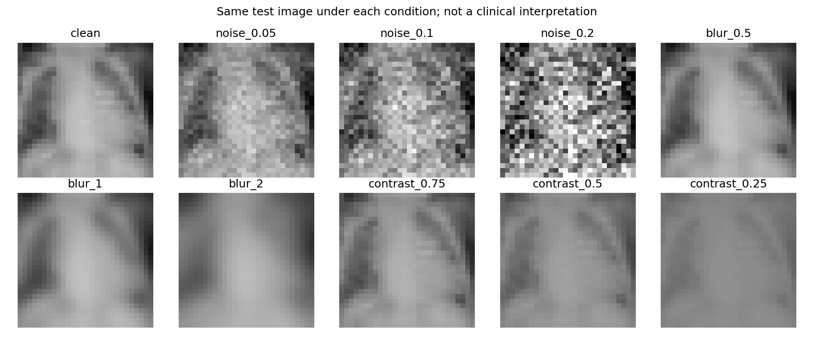

<div align="center">

# Medical AI Reliability Lab
### When image quality drops, does model confidence follow?

**Medical imaging · Robustness · Calibration · Reproducible research**

A research project investigating confident errors in chest X-ray classification.

[First results](docs/research/PILOT.md) · [Methods](docs/PROTOCOL.md) · [Explore the data](https://colab.research.google.com/github/paploooov/medical-ai-reliability-lab/blob/main/notebooks/01_data_exploration.ipynb) · [Model card](models/README.md)

</div>



## The question

A classifier can become less accurate without becoming less confident. This project studies that gap under controlled noise, blur and contrast changes, using public medical imaging benchmarks.

## First experiment

A small neural network and a logistic baseline have been trained and evaluated on PneumoniaMNIST. The neural model achieves **84.0% clean test accuracy**. Under the strongest contrast reduction, accuracy falls to **62.5%**, while mean confidence rises to **95.5%**. It predicts pneumonia for every image in that condition, with zero specificity.

These are **pilot results**, not evidence of clinical readiness. The neural model does not outperform the linear baseline on clean accuracy. Read the [full report](docs/research/PILOT.md) for denominators, uncertainty and limitations.



## Reproduce

Python 3.12; CPU sufficient. No API key, paid server or GPU required.

```bash
python3 -m venv .venv
source .venv/bin/activate
python -m pip install -r requirements.txt
python scripts/inspect_data.py
OPENBLAS_NUM_THREADS=2 OMP_NUM_THREADS=2 python experiments/train.py
python -m unittest discover -s tests -v
```

The official ~4 MB archive is downloaded and checksum-verified. Training uses 4,708 images, validation uses 524, and final evaluation uses 624. Re-running replaces generated reports and weights. Raw data and virtual environments are excluded from Git. The Colab notebook covers data exploration; model training is available through the command above.

## Project map

```text
configs/                  Frozen experiment settings
experiments/              Training and evaluation
models/                   Numeric weights and model card
notebooks/                Explained data exploration
scripts/                  Dataset inspection
reports/
  figures/                Visual comparisons
  metrics/                Predictions, results and provenance
docs/
  research/               Research reports
  PROTOCOL.md             Methods and endpoints
tests/                    Metric correctness checks
```

## Research direction

- [x] Verified public data and official splits
- [x] Train linear and neural baselines
- [x] Evaluate nine corruption conditions and clean control
- [x] Publish predictions, weights and paired uncertainty estimates
- [ ] Compare related research and select a higher-resolution dataset
- [ ] Multiple seeds, convolutional baseline and calibration
- [ ] External validation
- [ ] Local Core ML / SwiftUI demonstration

## Scope and sources

This project currently concerns low-resolution **pediatric chest X-rays**. Synthetic perturbations do not demonstrate transfer across hospitals or scanners. Patient independence cannot be independently verified from the distributed arrays. No clinical diagnosis or treatment use is intended.

Data: [MedMNIST](https://medmnist.com/) · [Official metadata](https://github.com/MedMNIST/MedMNIST) · [Archive](https://zenodo.org/records/10519652). PneumoniaMNIST is listed as **CC BY 4.0** by its maintainers; displayed samples and transformed examples derive from that dataset. See Yang et al., *MedMNIST v2*, Scientific Data (2023), [DOI](https://doi.org/10.1038/s41597-022-01721-8), and the underlying pediatric X-ray source described there.
