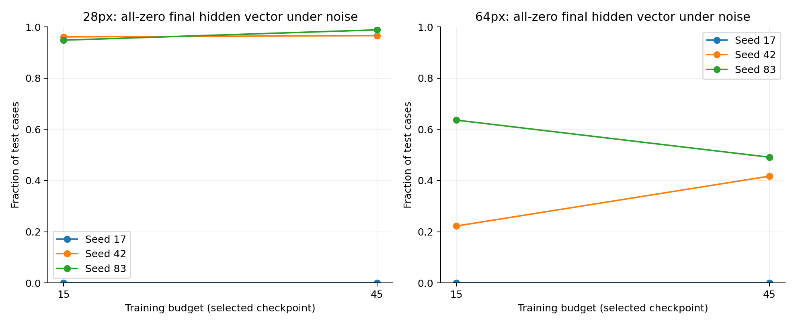
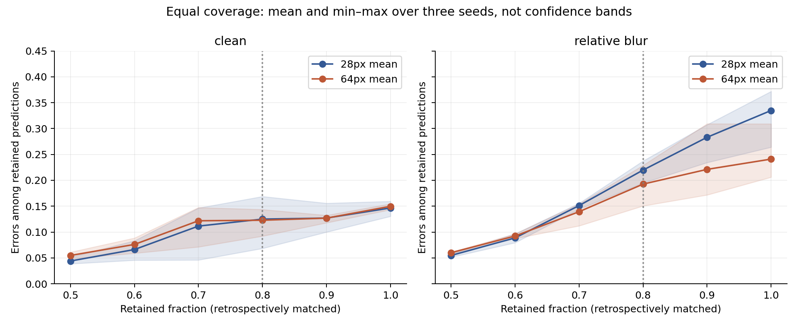
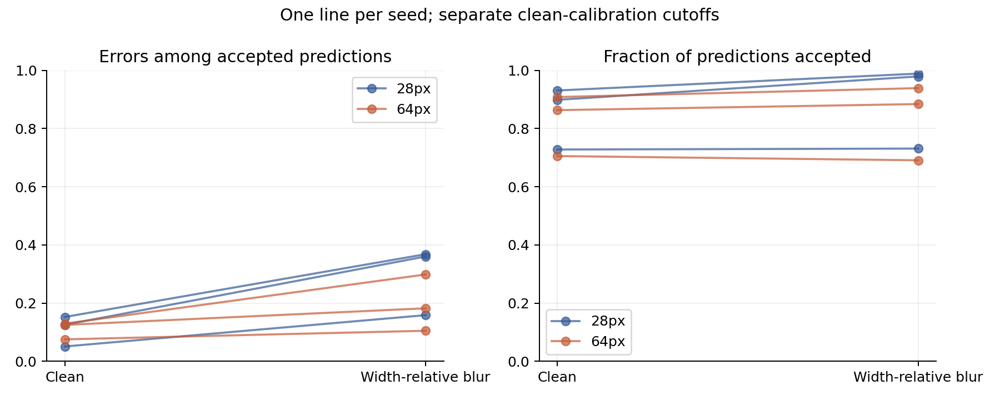

<div align="center">

# Medical AI Reliability Lab
### Erkennt medizinische KI, wenn ihre Vorhersagen unzuverlässig werden?

**Thorax-Röntgenbilder · Bildqualität · Fehlererkennung · Reproduzierbare Forschung**

[Aktuelle Ergebnisse](docs/research/BUDGET_STUDY.md) · [Alle Untersuchungen](docs/research/EXPERIMENTS.md) · [Methoden](docs/research/RESOLUTION_PROTOCOL.md) · [Projektumfang](docs/research/PROJECT_SCOPE.md)

</div>

## Aktueller Stand: Versuch 06 – Längeres Training behebt den Rauschfehler nicht

**9. November 2026.** Sechs erneute Trainingsläufe mit 45 statt 15 Epochen zeigen: Mehr Training allein löst die beobachteten Robustheitsprobleme nicht. Unter dem getesteten Rauschen bleibt die mittlere Accuracy bei 28×28 ungefähr bei **40 %**; bei 64×64 sinkt sie von **76,1 auf 65,6 %**.

Die interne Diagnose zeigt bei mehreren Modellen vollständig leere letzte Merkmalsvektoren. Dann bestimmt nur noch der feste Bias die Ausgabe. Diese Fälle werden von der Annahmeregel häufig weiterhin akzeptiert.



[**Vergleich, Lernkurven und Grenzen →**](docs/research/BUDGET_STUDY.md) · [Sechs Rauschstärken](reports/budget/noise_severity.png) · [Prüfnachweis](reports/budget/verification.json)

## Versuch 05 – Vergleich bei gleicher Akzeptanzrate

**Nachanalyse, kein neues Training.** Im letzten Versuch hielt 64×64 mehr Vorhersagen zurück. Jetzt vergleichen wir beide Auflösungen bei jeweils **80 % akzeptierten Vorhersagen**.

| Auflösung | Fehler bei Originalbildern | Fehler bei definierter Unschärfe |
|---|---:|---:|
| 28×28 | 12,5 % | 22,0 % |
| 64×64 | 12,3 % | 19,3 % |

Mittelwerte über drei Seeds. Der Unterschied im Fehleranstieg beträgt etwa **2,5 Prozentpunkte** zugunsten von 64×64 – deutlich weniger als beim vorherigen Vergleich mit unterschiedlichen Akzeptanzraten. Die rückblickend angeglichene Akzeptanzrate ist keine klinisch einsatzbereite Regel.



[**Neue Auswertung, konkrete Fehlfälle und Grenzen →**](docs/research/SELECTIVE_REVIEW.md) · [Alle Bedingungen einschließlich Rauschen](reports/selective_review/all_conditions.png) · [Externe Daten: Machbarkeit](docs/research/EXTERNAL_DATA.md)

## Versuch 04 – Grundlage: Auflösung und Fehlererkennung

**Stand: 8. November 2026.** Wir vergleichen dieselben Röntgenfälle in **28×28 und 64×64 Pixeln**. Sechs Modelle wurden trainiert: drei Zufallsinitialisierungen pro Auflösung, jeweils 15 Epochen. Die Architektur ist identisch und hat jeweils 21.249 Parameter.

Pixelidentische Wiederholungen wurden für diesen Versuch gruppiert. Die Daten für Training, Modellwahl, Kalibrierung und Auswertung sind bezüglich dieser Gruppen getrennt. Das ersetzt keine Prüfung der Patientenidentität.

### Was ist herausgekommen?

Das Modell darf unsichere Vorhersagen zurückhalten. Wir prüfen, **wie viele Fehler unter den akzeptierten Vorhersagen übrig bleiben** und wie viele Fälle überhaupt akzeptiert werden.

| Auflösung | Bildzustand | Fehler unter akzeptierten Vorhersagen | Anteil akzeptierter Vorhersagen |
|---|---|---:|---:|
| 28×28 | Original | 11,0 % | 85,2 % |
| 28×28 | Definierte Unschärfe | 29,6 % | 90,0 % |
| 64×64 | Original | 11,0 % | 82,6 % |
| 64×64 | Definierte Unschärfe | 19,5 % | 83,8 % |

Mittelwerte über drei Trainingsläufe. Die Unschärfe wird relativ zur Bildbreite festgelegt. Die Schwelle zum Zurückhalten stammt ausschließlich aus separaten Kalibrierungsdaten.

**Einordnung:** Bei diesem Versuch steigt der Fehleranteil mit 64×64 weniger stark. Allerdings werden auch weniger Vorhersagen akzeptiert. Das belegt weder zuverlässige automatische Fehlererkennung noch klinische Sicherheit.



Jede Linie zeigt einen Trainingslauf. Links: Fehler unter akzeptierten Vorhersagen. Rechts: Anteil akzeptierter Vorhersagen. Beide Größen müssen gemeinsam betrachtet werden.

[**Vollständiger Bericht mit Unsicherheitsintervallen und Grenzen →**](docs/research/RESOLUTION_STUDY.md)

[Lernkurven](reports/resolution/learning_curves.png) · [Diagramm als PDF](reports/resolution/risk_coverage.pdf) · [Ergebnistabelle](reports/resolution/results.csv) · [Technische Nachprüfung](reports/resolution/verification.json)

## Welche Untersuchungen gibt es bisher?

| Schritt | Frage | Status und Dokumentation |
|---|---|---|
| 01 – Erste Baselines | Was passiert bei Rauschen, Unschärfe und Kontrastverlust? | Abgeschlossen als Vorversuch: [Bericht](docs/research/PILOT.md) |
| 02 – Fehlererkennung | Hilft Unsicherheit, falsche Vorhersagen zu markieren? | Abgeschlossene Nachanalyse: [Bericht](docs/research/ERROR_DETECTION.md) |
| 03 – CNN und Kalibrierung | Wie stabil sind drei Trainingsläufe, und hilft eine Wahrscheinlichkeitskorrektur? | Abgeschlossener Vorversuch: [Bericht](docs/research/CNN_STUDY.md) |
| Datenprüfung | Stimmen Zahlen und Datentrennung? | Zahlen geprüft; Duplikate gefunden: [Prüfbericht](docs/research/AUDIT.md) |
| 04 – Auflösung und getrennte Kalibrierung | Ändert höhere Auflösung das Verhalten beim Zurückhalten unsicherer Vorhersagen? | Abgeschlossen: [Bericht](docs/research/RESOLUTION_STUDY.md) |
| **05 – Gleiche Akzeptanzrate** | Bleibt der Unterschied bestehen, wenn beide Auflösungen gleich viele Vorhersagen akzeptieren? | Abgeschlossen: [Bericht](docs/research/SELECTIVE_REVIEW.md) |
| **06 – Trainingsbudget und Rauschfehler** | Hilft längeres Training, und wo gehen die Bildmerkmale verloren? | **Aktuell:** [Bericht](docs/research/BUDGET_STUDY.md) |

Die alten Berichte bleiben erhalten, damit Entscheidungen und Änderungen nachvollziehbar sind. Ihre Ergebnisse sind **nicht direkt mit Versuch 04 gleichzusetzen**: Datenaufteilung, Architektur und Trainingsbudget unterscheiden sich. [Das Versuchsverzeichnis](docs/research/EXPERIMENTS.md) erklärt die Unterschiede und verlinkt die Belege.

## Was ist belegt – und was fehlt?

- Trainierte Modelle, Gewichte, Datenindizes, Vorhersagen und Lernverläufe sind gespeichert.
- Für Versuch 04 wurden alle 30 Ergebniszeilen, sechs gespeicherten Modelle und sechs Kalibrierungsschwellen nachgeprüft. Aktuell bestehen 20 Softwaretests.
- Die Daten stammen aus einem bekannten pädiatrischen Benchmark. Es gibt noch **keine unabhängige klinische Validierung**.
- Pixelgleichheit ist keine Patientenidentität. Synthetische Bildstörungen entsprechen nicht automatisch einem Geräte- oder Krankenhauswechsel.
- Ein gezielter [Literaturüberblick](docs/research/LITERATURE.md) liegt vor; wissenschaftliche Neuheit ist nicht nachgewiesen.

## Aktuellen Versuch reproduzieren

Python 3.12 und CPU reichen aus. Kein API-Schlüssel und kein kostenpflichtiger Dienst erforderlich.

```bash
python3 -m venv .venv
source .venv/bin/activate
python -m pip install -r requirements.txt
python -m pip install --index-url https://download.pytorch.org/whl/cpu torch==2.5.1
python scripts/inspect_data.py
python scripts/compare_resolutions.py
OPENBLAS_NUM_THREADS=2 OMP_NUM_THREADS=2 python experiments/resolution_study.py
python experiments/resolution_analysis.py
python experiments/verify_resolution.py
python experiments/selective_review.py
python experiments/verify_selective_review.py
python -m unittest discover -s tests -v
```

Die beiden Datenskripte laden und prüfen die offiziellen Archive. Das Training verwendet das bereits gespeicherte Gruppen- und Indexverzeichnis `configs/resolution_manifest.json`: 4.682 Trainingsfälle, je 262 Fälle für Modellwahl und Kalibrierung, 621 eindeutige Testrepräsentanten. Ein erneuter Lauf ersetzt die erzeugten Gewichte und Ergebnisse dieses Versuchs. Rohdaten und virtuelle Umgebung bleiben außerhalb von Git.

Das [Colab-Notebook](https://colab.research.google.com/github/paploooov/medical-ai-reliability-lab/blob/main/notebooks/01_data_exploration.ipynb) zeigt bisher nur den Dateneinstieg, nicht die aktuelle Trainingsstudie.

## Orientierung im Repository

- `docs/research/`: Berichte, Methoden, Literatur und Versuchsverzeichnis.
- `experiments/`: Training, Auswertung und Nachprüfung.
- `configs/`: festgelegte Einstellungen und Datenindizes.
- `reports/selective_review/`: aktuelle Nachanalyse; `reports/resolution/`: zugrunde liegende Trainingsstudie mit Ergebnissen, Diagrammen, Vorhersagen und Protokollen.
- `reports/cnn/`, `reports/metrics/`: frühere Versuche.
- `models/resolution/`: aktuelle Modellgewichte; `tests/`: Softwareprüfungen.

## Daten, Nutzung und Lizenz

Öffentliche pädiatrische Thorax-Röntgenbilder aus [MedMNIST](https://medmnist.com/) / [MedMNIST+](https://github.com/MedMNIST/MedMNIST/blob/main/on_medmnist_plus.md). PneumoniaMNIST wird von den Herausgebern unter **CC BY 4.0** geführt; die gezeigten Bildbeispiele sind daraus abgeleitet. Quelle: Yang et al., *MedMNIST v2*, Scientific Data (2023), [DOI](https://doi.org/10.1038/s41597-022-01721-8), sowie die dort dokumentierte Originaldatenquelle.

Forschungsprojekt, keine Anwendung zur Diagnose oder Behandlung. Eine Softwarelizenz wurde noch nicht vergeben; [Daten- und Softwarerechte sind getrennt](docs/LICENSING.md).
