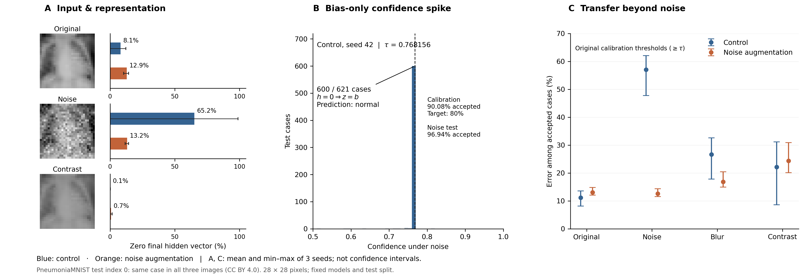

# Medical AI Reliability Lab

Wie zuverlässig erkennt ein medizinischer Bildklassifikator seine Fehler, wenn sich die Bildqualität verändert? Wir untersuchen kleine CNNs auf PneumoniaMNIST mit kontrollierten Störungen und getrennten Daten für Training, Modellwahl und Annahmeschwellen. Ein kollabierter Merkmalsvektor erklärt konstante, teils falsche Vorhersagen — sein Ausbleiben garantiert umgekehrt keine Zuverlässigkeit.



**A:** Derselbe Testfall bei Original, Rauschen und Kontrastverlust; daneben Nullvektor-Anteile über den Testsatz. **B:** Kontrollmodell, Seed 42: 600/621 Rauschfälle erhalten denselben Bias-Logit; Kalibrierungs- und Testakzeptanz sind getrennt ausgewiesen. **C:** Akzeptierte Fehlerrate bei festen Original-Kalibrierungsschwellen. Punkte/Balken: Seed-Mittel; Spannweiten: Minimum–Maximum der drei Seeds, keine Konfidenzintervalle. [PDF](reports/figures/overview_figure.pdf)

## Drei Kernbefunde

1. **Konfidenz kann einen konstanten Output verdecken.** Bei `h = 0` gilt exakt `Logit = Bias`. Das erklärt alle 250 Modell-Fall-Paare auf den fünf betroffenen Kalibrierungsschwellen und 90–94 % Akzeptanz statt der anvisierten 80 %.
2. **Rauschaugmentation hilft gezielt.** Unter bekanntem Rauschen sinkt die akzeptierte Fehlerrate von 57,04 auf 12,58 %. Unter Kontrastverlust bleiben dagegen 24,35 % akzeptierte Fehler bei nur 0,70 % Nullvektoren.
3. **Nullvektoren herauszufiltern ist keine Fehlererkennung.** Die betroffenen Modelle sagen konstant „normal“ voraus. Das kann richtig sein; ihr Ausschluss entfernt deshalb auch korrekte Fälle und kann den verbleibenden Fehleranteil erhöhen.

| Bedingung | Modell | Accuracy | Nullvektoren | Akzeptanz | Akzeptierte Fehlerrate |
|---|---|---:|---:|---:|---:|
| Original | Basis | 84.11 | 8.11 | 78.53 | 11.16 |
| Original | Rauschaugmentation | 84.06 | 12.94 | 82.23 | 13.04 |
| Rauschen | Basis | 39.99 | 65.16 | 88.08 | 57.04 |
| Rauschen | Rauschaugmentation | 84.00 | 13.20 | 82.18 | 12.58 |
| Blur | Basis | 67.90 | 0.43 | 85.24 | 26.62 |
| Blur | Rauschaugmentation | 79.87 | 6.23 | 80.62 | 16.86 |
| Kontrast | Basis | 68.33 | 0.05 | 78.37 | 22.12 |
| Kontrast | Rauschaugmentation | 71.01 | 0.70 | 83.25 | 24.35 |

Alle Angaben in Prozent, Mittel über Seeds 17/42/83, auf zwei Dezimalstellen gerundet. Gleiche 621 Testrepräsentanten; Standardregel `confidence >= tau`, bestimmt auf 262 Original-Kalibrierungsfällen. Akzeptierte Fehlerrate = Fehler / akzeptierte Fälle, kein gepoolter Seed-Schätzer. [Einzelergebnisse](reports/transfer/results.csv) · [Grafikdaten](reports/figures/overview_summary.json)

## Quickstart / Reproduktion

Python 3.12, CPU. Lädt das geprüfte 28×28-Archiv und zeichnet die Übersicht aus versionierten Vorhersagen; kein Training. Für Wiederholungen einen neuen Ausgabeordner wählen.

```bash
python -m venv .venv
.venv/bin/pip install -r requirements.txt torch==2.5.1 --extra-index-url https://download.pytorch.org/whl/cpu
.venv/bin/python scripts/fetch_data.py
.venv/bin/python scripts/make_overview.py --output /tmp/medical-ai-overview
.venv/bin/python -m unittest discover -s tests -v
```

## Dokumentation

- [Hauptdokument: Setup, Mechanismus und Transfer](docs/PAPER_SUMMARY.md)
- [Dokumentationsübersicht](docs/README.md) · [Historische Berichte und Protokolle](docs/archive/EXPERIMENTS.md)
- [Abgeschlossene Studie v1.0.0](https://github.com/paploooov/medical-ai-reliability-lab/releases/tag/v1.0.0) · [Prüfung der Hauptgrafik](reports/figures/verification.json)
- [Code: MIT](LICENSE) · [Daten: PneumoniaMNIST / CC BY 4.0](docs/LICENSING.md)

*Explorative Studie auf einem bekannten, niedrig aufgelösten Benchmark; keine klinische Validierung.*
