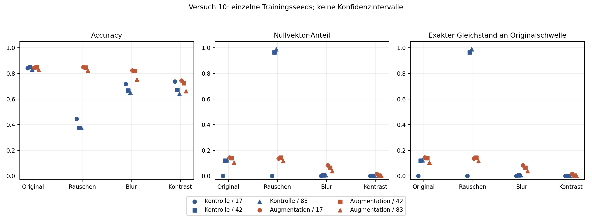
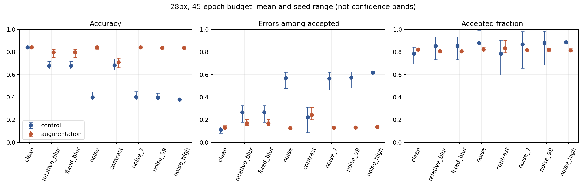

# Medical AI Reliability Lab

## Abstract (English)

This completed ten-experiment study examines confidence-based error detection in small CNNs on PneumoniaMNIST under synthetic image corruptions.
After initial baselines, exact-pixel deduplication and separate model-selection and calibration splits improved split hygiene, without establishing patient independence.
Frozen checkpoints, saved predictions, software tests and SHA-256 verification support reproducibility and preserve historical artifacts.
Zero final hidden vectors produce bias-only logits, explaining all observed calibration-boundary ties and a specific failure of quantile-based acceptance under noise.
Noise augmentation reduces this collapse, but nonzero representations do not guarantee reliable accepted predictions under other corruptions.
Rejecting zero vectors can discard correct constant-label predictions and increase the error rate among retained cases; the learned bias is not necessarily a majority-class predictor.
These findings concern a repeatedly examined low-resolution benchmark, not clinical safety or independent external validation.

## Abgeschlossene Studie: Versuche 01–10

**Konfidenz kann einen konstanten Bias-Output als verlässlich erscheinen lassen. Umgekehrt ist ein nichtleerer Merkmalsvektor kein Zuverlässigkeitsnachweis.** Das ist die gemeinsame Erkenntnis der zehn abgeschlossenen Versuche; Versuch 10 bildet ihren Abschluss, keinen neuen Studienbeginn.

Der nachvollziehbare mechanistische Zusammenhang lautet:

1. **Merkmalsverlust → konstanter Output → Gleichstände:** Bei `h = 0` folgt aus `Logit = wᵀh + b` exakt `Logit = b`. Dieser Mechanismus erklärt sämtliche 250 Modell-Fall-Paare auf den fünf betroffenen Kalibrierungsschwellen. Eine inklusive Quantilschwelle akzeptiert die gesamte Grenzgruppe: statt ungefähr 80 % werden 90–94 % der Kalibrierungsfälle angenommen. Unter Rauschen kann die Regel viele falsche Bias-Ausgaben akzeptieren; verschiebt sich die Schwelle über die Punktmasse, kann die Annahmemenge leer werden (Versuche 06, 08, 09).
2. **Kein Kollaps ≠ verlässliche Vorhersage:** Rauschaugmentation reduziert den massiven Kollaps, beseitigt aber nicht jede Nullaktivierung. Unter Kontrastreduktion haben die augmentierten Modelle nur 0–10 Nullvektoren, während 20,08–30,89 % ihrer nach Standardregel akzeptierten Vorhersagen falsch sind (Versuche 07, 10).
3. **Nullvektor-Ausschluss ≠ Fehlererkennung:** Ein konstanter Bias-Output kann das richtige Label treffen. Ihn herauszufiltern entfernt deshalb auch korrekte Vorhersagen und kann die Fehlerrate der verbleibenden Fälle erhöhen. Hier sagen die fünf betroffenen Modelle bei `h = 0` „normal“ voraus — **nicht die Mehrheitsklasse Pneumonie**. „Richtiges Label ohne Bildinformation“ bedeutet hier präzise: ohne zwischen diesen Fällen variierende Information im letzten Merkmalsvektor; das Bild bestimmt weiterhin, ob diese Aktivierungsregion erreicht wird.

Die mathematische Kette erklärt einen nachgewiesenen Mechanismus, nicht sämtliche Fehler oder die gesamte Entstehung des Kollapses im Training. Mit „Kalibrierung“ ist in diesem Zusammenhang die Bestimmung der Annahmeschwelle gemeint, kein allgemeiner Nachweis des Versagens aller Verfahren zur Wahrscheinlichkeitskalibrierung.

[**Gesamtsynthese →**](docs/research/RESEARCH_SUMMARY.md) · [Versuche 01–10](docs/research/EXPERIMENTS.md) · [Abschlussprüfung v1.0.0](docs/releases/v1.0.0/README.md) · [Modelle](models/README.md)

## Versuch 10 – Transfer auf Blur und Kontrastreduktion

Sechs unveränderte Modelle, keine neue Optimierung. Unter **Blur** erreichen die augmentierten Modelle bei allen drei Seeds eine höhere Accuracy als die Kontrollen, obwohl sie mehr Nullvektoren haben. Unter **Kontrastreduktion** sind Nullvektoren selten, während bei den augmentierten Modellen **20,08–30,89 % der akzeptierten Vorhersagen falsch** sind. Tie-Breaking plus Nullvektor-Ausschluss senkt diese Fehlerraten nicht allgemein.

Diese Störungen waren nicht im Augmentationstraining enthalten, wurden im Projekt aber bereits untersucht. Das ist eine explorative Transferdiagnose, keine unabhängige OOD-Validierung.



[**Versuch 10: Methoden, vollständige Ergebnisse und Grenzen →**](docs/research/TRANSFER_STUDY.md) · [Prüfnachweis](reports/transfer/verification.json) · [Alle Ergebniszeilen](reports/transfer/results.md)

## Versuch 09 – Woher kommen die Gleichstände?

Alle **250 Modell-Fall-Paare auf den fünf betroffenen Kalibrierungsschwellen** haben einen vollständig nullgesetzten letzten Merkmalsvektor: Das Modell gibt exakt seinen Bias-Logit aus. Float-Sättigung erklärt diese Gleichstände nicht.

Deterministisches Tie-Breaking erreicht bei allen sechs Modellen **209/262 = 79,77 %** Kalibrierungsakzeptanz; exakt 80 % sind mit binären Entscheidungen bei dieser Fallzahl unmöglich. Die 54 leeren Wiederziehungen aus Versuch 08 bleiben bestehen. Nullvektoren zurückzuhalten ist ebenfalls keine allgemeine Lösung: Bei einem Kontrollmodell bleiben unter Rauschen keine akzeptierten Fälle übrig, bei einem anderen zwei falsche.

[**Mechanistische Nachanalyse, Regeln und vollständige Ergebnisse →**](docs/research/MECHANISTIC_TIES.md) · [Prüfnachweis](reports/mechanistic_ties/verification.json)

## Versuch 08 – Wie stabil ist die Annahmeschwelle?

**9. November 2026 · Nachanalyse ohne neues Training.** Wir variieren jetzt auch die 262 Fälle, anhand derer die Modelle unsichere Vorhersagen zurückhalten sollen.

- Ziel: ungefähr **80 % Akzeptanz** auf den Kalibrierungsfällen.
- Beobachtung: Fünf der sechs Modelle akzeptieren dort tatsächlich **90–94 %**, weil viele Konfidenzwerte genau gleich sind.
- In **54 von 2.000 Wiederziehungen** ist der Hauptvergleich undefiniert: Bei einem Modell bleiben unter Rauschen keine akzeptierten Vorhersagen übrig.
- Unter den auswertbaren Ziehungen bleibt der Vorteil der Rauschaugmentation bestehen. Daraus folgt keine garantiert sichere Fehlerrate.


[**Vollständige Auswertung und Grenzen →**](docs/research/CALIBRATION_STUDY.md) · [Prüfnachweis](reports/calibration/verification.json) · [PDF](reports/calibration/bootstrap_sensitivity.pdf)

## Versuch 07 – Gezieltes Training gegen Rauschen

**Trainingsvergleich aus Versuch 07.** Nach der Diagnose eines Rauschfehlers vergleichen wir drei 28×28-Modelle mit und ohne Rauschaugmentation. Architektur, Datenaufteilung, Trainingsbudget und Seeds bleiben gleich. Modellwahl und Kalibrierung verwenden getrennte Originaldaten.

| Ergebnis, Mittel über drei Seeds | Ohne Rauschaugmentation | Mit Rauschaugmentation |
|---|---:|---:|
| Accuracy auf Originalbildern | 84,1 % | 84,1 % |
| Accuracy unter definiertem Rauschen | 40,0 % | 84,0 % |
| Fehler unter akzeptierten Rauschfällen | 57,0 % | 12,6 % |
| Akzeptierter Anteil der Rauschfälle | 88,1 % | 82,2 % |
| Fehler unter akzeptierten Originalfällen | 11,2 % | 13,0 % |

**Die Intervention hilft gegen diese Rauschstörung, verbessert aber nicht alles.** Unter den akzeptierten Originalfällen steigt die Fehlerrate leicht. Die Rauschfamilie und primäre Stärke sind absichtlich im Training enthalten; das ist kein Nachweis allgemeiner Robustheit oder klinischer Sicherheit.



Punkte: Mittelwerte der drei Trainingsläufe. Fehlerbalken: Minimum bis Maximum, keine Konfidenzintervalle. Mit nur drei Seeds ist die Verteilung der Trainingsvariabilität kaum abschätzbar; ein Intervall für den Seed-Mittelwert wäre stark von zusätzlichen Verteilungsannahmen abhängig. Die Spannweite beschreibt deshalb ausschließlich die drei beobachteten Läufe, keine 95%-Abdeckung und keine Patientenunsicherheit. Die Bildbedingungen sind getrennte Experimente, keine durchgehende Schweregradskala.

[**Bericht, Unsicherheitsintervalle und Grenzen →**](docs/research/AUGMENTATION_STUDY.md)

[PDF-Abbildung](reports/augmentation/comparison.pdf) · [48 Vergleichszeilen](reports/augmentation/comparison.csv) · [Lernkurven](reports/augmentation/learning_curves.png) · [Nachprüfung](reports/augmentation/verification.json)

## Was wurde davor herausgefunden?

| Versuch | Frage | Ergebnis und Belege |
|---|---|---|
| 01 – Erste Baselines | Bleibt Konfidenz hoch, obwohl Bilder schlechter werden? | Ja, in mehreren Störungsbedingungen. [Vorversuch](docs/research/PILOT.md) |
| 02 – Fehlererkennung | Kann Unsicherheit Fehler markieren? | Nur teilweise; auch richtige Fälle werden zurückgehalten. [Nachanalyse](docs/research/ERROR_DETECTION.md) |
| 03 – CNN und Kalibrierung | Helfen ein Bildmodell und korrigierte Wahrscheinlichkeiten? | Keine allgemeine Verbesserung; deutliche Grenzen. [Bericht](docs/research/CNN_STUDY.md) |
| Datenprüfung | Stimmen Berechnungen und Trennung der Daten? | Kennzahlen bestätigt, Pixelduplikate gefunden; Methode angepasst. [Audit](docs/research/AUDIT.md) |
| 04 – Auflösung | Wie unterscheiden sich 28×28 und 64×64? | Unterschied bei Unschärfe, aber auch andere Akzeptanzraten. [Bericht](docs/research/RESOLUTION_STUDY.md) |
| 05 – Gleiche Akzeptanz | Bleibt der Unterschied bei gleich vielen akzeptierten Fällen? | Er fällt deutlich kleiner aus. [Nachanalyse](docs/research/SELECTIVE_REVIEW.md) |
| 06 – Trainingsbudget | Behebt längeres Training den Rauschfehler? | Nein; der letzte Merkmalsvektor wird bei vielen Fällen null. [Bericht](docs/research/BUDGET_STUDY.md) |
| **07 – Rauschaugmentation** | Hilft gezieltes Training gegen diese Störung? | **Deutliche Verbesserung unter Rauschen, mit Grenzen und Nebenwirkungen.** [Bericht](docs/research/AUGMENTATION_STUDY.md) |
| **08 – Kalibrierungsstichprobe** | Wie stabil sind Annahmeschwellen aus 262 Fällen? | Gleichstände und leere Teilmengen begrenzen die Interpretation. [Bericht](docs/research/CALIBRATION_STUDY.md) |
| **09 – Mechanistische Nachanalyse** | Woher kommen Gleichstände, was ändern Gegenregeln? | Nullvektoren erklären die Grenzgruppe; Gegenregeln beheben die Fehlerrate nicht allgemein. [Bericht](docs/research/MECHANISTIC_TIES.md) |
| **10 – Störungstransfer** | Überträgt sich die Rauschaugmentation auf Blur und Kontrast? | Mehr Nullvektoren können mit höherer Accuracy einhergehen; wenige Nullvektoren garantieren keine verlässliche Annahme. [Bericht](docs/research/TRANSFER_STUDY.md) |

Die Folgeversuche verwenden denselben bereits untersuchten Benchmark. Sie sind keine unabhängigen klinischen Replikationen. Frühere Ergebnisse bleiben nachvollziehbar; verschiedene Architekturen und Datenaufteilungen dürfen nicht als einfache Bestenliste verglichen werden.

## Daten und Aussagekraft

Seit Versuch 04: **4.682 Trainingsfälle**, je **262 getrennte Fälle für Modellwahl und Kalibrierung**, **621 eindeutige Testrepräsentanten**. Gruppen pixelidentischer Bilder werden zusammen behandelt. Unbekannte Patientenüberschneidungen sind damit nicht ausgeschlossen.

Die Untersuchung betrifft öffentliche pädiatrische Röntgenbilder. **28×28 Pixel eliminieren radiologische Feinstrukturen.** Synthetisches Pixelrauschen auf 28×28 dient hier als kontrolliertes ML-Testbed für niedriges Signal-Rausch-Verhältnis (SNR), nicht als physikalisches Modell klinischer Röntgendegradation. Dosis, Detektorantwort und klinische Bildverarbeitung werden nicht simuliert. Synthetisches Rauschen und Unschärfe ersetzen keine externe Prüfung auf anderen Patienten oder Geräten. Höhere MedMNIST-Auflösungen liefern dieselben Fälle mit mehr Bildpunkten. [Externe Datenquellen](docs/research/EXTERNAL_DATA.md) sind vorgeprüft, aber noch nicht ausgewertet.

Die kleinen CNNs haben in den abschließenden Versuchen jeweils **21.249 Parameter**. Eigene trainierte Gewichte, etablierte Architektur – kein medizinisches Foundation-Modell. Die [Forschungsnotiz](docs/research/RESEARCH_SUMMARY.md) erklärt Fragestellung, methodische Änderungen, Befunde und verbleibende Grenzen zusammenhängend.

## Reproduzieren

Python 3.12, CPU, keine kostenpflichtigen Dienste. Die letzte Nachanalyse (Versuch 10) nutzt die bereits versionierten Modelle aus Versuch 06 und 07. Für ihre Reproduktion ist kein neues Training erforderlich.

```bash
python3 -m venv .venv
source .venv/bin/activate
python -m pip install -r requirements.txt
python -m pip install --index-url https://download.pytorch.org/whl/cpu torch==2.5.1
python scripts/inspect_data.py
python experiments/transfer_study.py --output /tmp/study10-new
python experiments/verify_transfer.py --output /tmp/study10-new
python -m unittest discover -s tests -v
```

Versuch 10 verlangt einen neuen Ausgabeordner und überschreibt keine bestehenden Ergebnisse. Für erneute Berechnungen ist ein neuer Ausgabeordner erforderlich. Gewichte und Ergebnisse früherer Versuche bleiben erhalten. Rohdaten werden heruntergeladen und geprüft; sie sind nicht in Git enthalten. Die Berichte enthalten die Befehle für frühere Versuche. Das [Colab-Notebook](https://colab.research.google.com/github/paploooov/medical-ai-reliability-lab/blob/main/notebooks/01_data_exploration.ipynb) zeigt bisher nur den Dateneinstieg.

**Abschlussprüfstand:** Alle 43 Softwaretests und Verifikationsskripte erneut bestanden; [Abschlussprotokolle](docs/releases/v1.0.0/README.md). Alle 193 vorhandenen Modell- und Ergebnisartefakte, einschließlich der zuvor gesicherten 166, bleiben unverändert. Historischer Prüfstand von Versuch 10: [Protokolle der vollständigen Projektprüfung](reports/transfer/project_checks/verification.json). Versuch 10 prüft 48 Ergebniszeilen separat, reproduziert 129 Arrays und vier Abbildungsdateien exakt und bestätigt 166 unveränderte frühere Artefakte. Versuch 09 prüft die Annahmeregeln separat und wiederholt die gesamte Berechnung deterministisch. Für Versuch 08 wurden 2.000 gepaarte Bootstrap-Ziehungen in beiden Varianten und 2.000 Teilmengen-Auswertungen separat nachgerechnet. Softwaretests sichern Berechnungen ab; sie belegen keine medizinische Sicherheit.

## Orientierung

- `docs/research/`: Berichte, Protokolle, Literatur und Versuchsverzeichnis.
- `configs/`: festgelegte Einstellungen und Datenindizes.
- `experiments/`: Training, Diagnose und Auswertung; `tests/`: Softwareprüfungen.
- `reports/transfer/`: abschließender Versuch 10; `reports/mechanistic_ties/`: Versuch 09; `reports/calibration/`: Versuch 08; `reports/augmentation/`, `models/augmentation/`: zugrunde liegende Trainingsstudie.
- Weitere Unterordner in `reports/` und `models/`: erhaltene frühere Versuche.

## Quellen und Nutzung

Daten: [MedMNIST](https://medmnist.com/) / [MedMNIST+](https://github.com/MedMNIST/MedMNIST/blob/main/on_medmnist_plus.md). PneumoniaMNIST wird unter **CC BY 4.0** geführt; gezeigte Bildbeispiele sind daraus abgeleitet. Quelle: Yang et al., *MedMNIST v2*, Scientific Data (2023), [DOI](https://doi.org/10.1038/s41597-022-01721-8), sowie die dort dokumentierte Originaldatenquelle. [Methodischer Literaturüberblick](docs/research/LITERATURE.md).

Forschungsprojekt, keine Anwendung zur Diagnose oder Behandlung. Eigener Quellcode: [MIT License](LICENSE). PneumoniaMNIST-Bilder: CC BY 4.0 mit Quellenangabe; [Daten- und Softwarerechte sind getrennt](docs/LICENSING.md).
