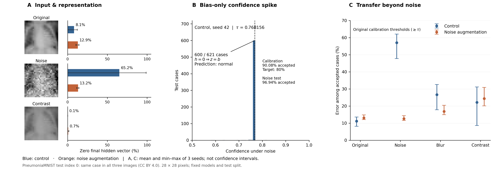

# Selective classification under representation collapse

## Fragestellung

Ein Klassifikator kann unter Bildstörungen sicher wirken und trotzdem häufig falsch liegen. Diese Studie untersucht, wann eine Konfidenzschwelle solche Fehler zurückhält, wie ein konkreter interner Fehlmechanismus entsteht und ob Rauschaugmentation auf andere Störungen überträgt. Die abgeschlossene Versuchsreihe verbindet Baselines, Daten-Audit, kontrollierte Trainingsvergleiche und Nachanalysen eingefrorener Modelle.

**Abbildung 1.** A: erster deduplizierter Testfall (Originalindex 0), unverändert und mit zwei Störungen; die Balken betreffen den gesamten Testsatz, nicht die Aktivierung dieses Einzelbilds. B: unter Rauschen bildet Kontrolle/Seed 42 eine Punktmasse mit 600/621 Nullvektoren. Die Konfidenz beträgt exakt 0,7681560516357422; die Histogramm-Bins dienen nur der Darstellung. C: Fehleranteil unter akzeptierten Vorhersagen, gleich gewichtete Seed-Mittel und beobachtete Spannweiten. [PDF](../reports/figures/overview_figure.pdf) · [Daten und Auswahlregeln](../scripts/make_overview.py).

## Setup

**Daten und Splits.** PneumoniaMNIST enthält pädiatrische Thoraxaufnahmen, zentral zugeschnitten und hier auf 28×28 Pixel verkleinert. Ein Audit fand acht pixelidentische Überschneidungen zwischen offiziellen Trainings- und Validierungsdaten. Die abschließenden Vergleiche verwenden deshalb gemeinsame Pixelgruppen über die geprüften Auflösungen: 4.682 Trainingsfälle, 262 Fälle zur Modellwahl, 262 getrennte Kalibrierungsfälle und 621 deduplizierte Testrepräsentanten. Die frühen offiziellen Split-Baselines bleiben im Archiv erhalten.

**Modelle.** Der Hauptvergleich umfasst sechs CNNs mit jeweils 21.249 Parametern: drei Seeds (17, 42, 83) ohne Augmentation und dieselben drei Seeds mit Gaußrauschaugmentation. Architektur, Splits und Trainingsbudget von 45 Epochen sind gleich. Die Augmentation betrifft 50 % der Trainingsbilder mit SD 0,1; der Auswahlverlust auf Originalbildern bestimmt den Checkpoint. Frühere Auflösungs- und Budgetvergleiche motivierten diesen Vergleich und sind keine weiteren unabhängigen Replikationen.

**Störungen.** Originalbilder werden durch 255 geteilt. Rauschen: additive Gaußwerte mit SD 0,1 und Seed 42, begrenzt auf [0,1]. Blur: Gaußfilter, Sigma 1 Pixel, reflektierte Ränder. Kontrast: `0.5 + 0.5 * (image - 0.5)`. Die beiden historischen Blur-Definitionen fallen bei 28×28 zusammen und werden einmal gezählt. Blur und Kontrast waren nicht Teil des Augmentationstrainings, aber bereits bekannte Testbedingungen.

**Selektive Vorhersage.** Aus `p = sigmoid(z)` folgt `confidence = max(p, 1-p)`. Die Standardregel akzeptiert Werte ab dem linear interpolierten 20%-Quantil der Original-Kalibrierungskonfidenzen. Gemessen werden Accuracy, Nullvektor-Anteil, Akzeptanz und Fehler unter akzeptierten Fällen. Letztere werden immer mit ihrer Annahmequote berichtet.

## Mechanismus des Repräsentations-Kollapses

Die letzte lineare Schicht berechnet `z = wᵀh + b`. Wird ihr 32-dimensionaler ReLU-Merkmalsvektor vollständig null, gilt unabhängig von Unterschieden zwischen diesen Fällen exakt `z = b`. Unter Rauschen passiert dies bei den Kontrollmodellen mit Seeds 42 und 83 in 600 beziehungsweise 614 von 621 Fällen. Der andere Kontrollseed hat keine Nullvektoren, aber ebenfalls viele Klassifikationsfehler.

Der Mechanismus erklärt sämtliche 250 Modell-Fall-Paare auf den fünf betroffenen Kalibrierungsschwellen. Die Bias-Werte dieser Modelle sind negativ: Der konstante Output lautet „normal“, nicht die Mehrheitsklasse Pneumonie. Float-Sättigung bei Konfidenz 1,0 kommt vereinzelt vor, verursacht diese Schwellen-Gleichstände aber nicht.

Die inklusive Regel `confidence >= tau` nimmt die gesamte Punktmasse an. Beim in der Hauptgrafik gezeigten Seed 42 werden dadurch **236/262 = 90,08 % der Kalibrierungsfälle** akzeptiert; unter Rauschen sind es **602/621 = 96,94 % der Testfälle**. Das sind verschiedene Populationen und keine austauschbaren Quoten. Über die fünf betroffenen Modelle liegt die Kalibrierungsakzeptanz bei 90–94 % statt ungefähr 80 %.

Eine Wiederziehung von Kalibrierungs- und Testfällen lässt den Hauptvergleich in 54 von 2.000 Ziehungen undefiniert: Beim Kontrollmodell mit Seed 83 liegt die neu bestimmte Schwelle dann über allen Rauschkonfidenzen. Eine leere akzeptierte Menge ist kein Nullfehler-Ergebnis. Dieser Befund betrifft die untersuchte Quantil-Annahmeregel; er ist keine Aussage über sämtliche Verfahren zur Wahrscheinlichkeitskalibrierung.

## Grenzen von Augmentation und Kalibrierung

Rauschaugmentation erhöht im Hauptvergleich die Accuracy unter bekanntem Rauschen von 39,99 auf 84,00 % und senkt die akzeptierte Fehlerrate von 57,04 auf 12,58 %. Der Nullvektor-Anteil sinkt von 65,16 auf 13,20 %; der Kollaps wird reduziert, nicht vollständig verhindert.

Unter Blur erreichen die augmentierten Modelle trotz mehr Nullvektoren eine höhere Accuracy. Unter Kontrastreduktion bleiben nur 0,70 % Nullvektoren, während 24,35 % ihrer akzeptierten Vorhersagen falsch sind. Alle Zahlen sind Mittel über die drei Seeds. Die Entstehung einer nichtleeren Repräsentation ist somit kein Nachweis zuverlässiger Fehlererkennung.

Eine deterministische Hash-Reihenfolge löst exakte Gleichstände auf und akzeptiert 209/262 Kalibrierungsfälle (79,77 %); exakt 80 % sind mit binären Entscheidungen bei dieser Fallzahl unmöglich. Die daraus bestimmte Grenze wird auf Testfälle übertragen. Ein zusätzlicher Nullvektor-Ausschluss verändert die Fallauswahl, stellt aber keine verlorenen Merkmale wieder her: Unter Rauschen bleiben beim Kontrollseed 42 zwei falsche Fälle, bei Seed 83 keine akzeptierten Fälle.

Auch korrekte Vorhersagen können aus einem konstanten Bias-Output entstehen. Das Modell unterscheidet innerhalb der Nullvektorgruppe nicht zwischen Bildern, kann aber deren Label treffen. Ein pauschaler Ausschluss entfernt dann korrekte Fälle und erhöht teilweise den verbleibenden Fehleranteil. Das Bild bestimmt weiterhin, ob diese Aktivierungsregion erreicht wird; vollständige Bildunabhängigkeit des Netzes wird nicht behauptet.

## Einordnung und Nachprüfbarkeit

Die Befunde identifizieren einen konkreten Mechanismus, kein allgemeines Verfahren zur Absicherung medizinischer KI. Drei Seeds beschreiben begrenzt die Trainingsstreuung; die Abbildung zeigt deshalb Minimum–Maximum statt angenommener Konfidenzintervalle. Ohne Patienten-IDs kann Pixel-Deduplizierung patientenbezogene Überschneidungen nicht ausschließen. Der bekannte Testsatz wurde wiederholt untersucht. 28×28 Pixel eliminieren radiologische Feinstrukturen; die synthetischen Störungen bilden keine physikalische Röntgenaufnahme ab.

Die Hauptgrafik wird ausschließlich aus gespeicherten Vorhersagen und dem geprüften Datenarchiv erzeugt. Neue numerische Zusammenfassungen werden separat gegengerechnet, beide Abbildungsformate deterministisch reproduziert und die Artefakte der abgeschlossenen Version per SHA-256 geprüft. [Grafikprüfung](../reports/figures/verification.json) · [Einzelergebnisse aller Modelle und Annahmeregeln](../reports/transfer/results.csv) · [Archiv](archive/EXPERIMENTS.md).

## Quellen

Yang et al. (2023), *MedMNIST v2*, [doi:10.1038/s41597-022-01721-8](https://doi.org/10.1038/s41597-022-01721-8). Ursprüngliche Thoraxdaten: Kermany et al. (2018), [doi:10.1016/j.cell.2018.02.010](https://doi.org/10.1016/j.cell.2018.02.010). Die gezeigten Testbilder sind aus PneumoniaMNIST (CC BY 4.0) abgeleitet; Rauschen und Kontrastverlust wurden wie beschrieben hinzugefügt. [Lizenzabgrenzung](LICENSING.md) · [Methodische Literatur](archive/LITERATURE.md).
