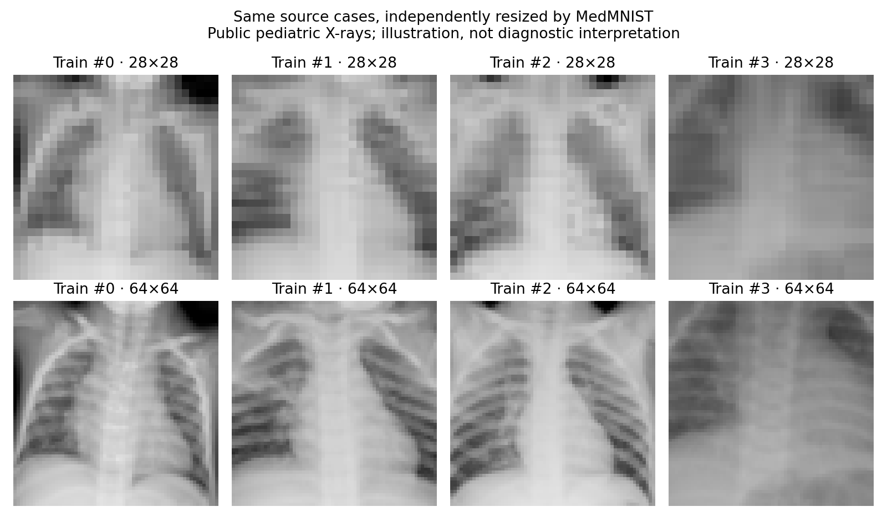

# Methodischer Audit

Erster Audit: 8. November 2026; Präzisierung zu Datenherkunft und Versuch 09: 9. November 2026.

## Rechnerisch bestätigte Befunde

Accuracy, Krankheits-AUROC, Brier Score und Anteil hochkonfidenter Fehler stimmen für alle 20 Pilot- und 60 CNN-Ergebniszeilen mit den gespeicherten Vorhersagen überein. Die Labels entsprechen dem prüfsummengesicherten Archiv. In allen 30 Seed-/Bedingungskombinationen des frühen CNN-Versuchs erhält Temperature Scaling die Klassenentscheidung. Diese Prüfungen belegen rechnerische Konsistenz, keine klinische Gültigkeit. Prüfprogramm: `python experiments/audit.py`; wegen seiner Berichtsausgabe in einer isolierten Kopie ausführen, wenn historische Artefakte erhalten bleiben sollen.

## Pixelüberschneidungen und Datenaufteilung

Acht unterschiedliche 28×28-Pixelarrays kommen sowohl in Training als auch in Validation vor. Zusätzlich gibt es 18 überschüssige Wiederholungen innerhalb des Trainingssatzes und drei im Testsatz; in Validation keine internen exakten Duplikate. Zwischen Training/Test sowie Validation/Test wurden keine exakt identischen Arrays gefunden. Diese Zahlen betreffen Pixelhashes, nicht Patienten. Verkleinerung kann unterschiedliche Ausgangsbilder auf dasselbe Array abbilden; umgekehrt bleiben ähnliche, aber nicht identische Aufnahmen unerkannt.

Die frühen Versuche verwendeten Validation zugleich für Modellwahl und Temperature Scaling. Zusammen mit der beobachteten Überschneidung ist das keine unabhängig saubere Kalibrierung. Diese Ergebnisse bleiben historische Baselines auf den offiziellen Splits. Seit Versuch 04 werden Pixelgruppen getrennt behandelt, mit separaten Auswahl- und Kalibrierungsteilmengen. Die Patientenunabhängigkeit folgt daraus nicht.

## PneumoniaMNIST: Patientenbezug und Grenzen der Quellenlage

PneumoniaMNIST basiert auf den pädiatrischen Thoraxaufnahmen aus **Kermany et al. (2018)**, [doi:10.1016/j.cell.2018.02.010](https://doi.org/10.1016/j.cell.2018.02.010). Die [MedMNIST-v2-Publikation](https://doi.org/10.1038/s41597-022-01721-8) nennt 5.856 Aufnahmen und beschreibt das Aufteilen des Quell-Trainingssatzes im Verhältnis 9:1, zentrales Zuschneiden und Verkleinern. Die hier verwendeten MedMNIST-NPZ-Dateien enthalten Bilder und Klassenlabels, **keine Patienten-IDs, Originaldateinamen oder Aufnahmezeitpunkte**. Ein patientenbezogener Split ist daraus nicht rekonstruierbar; etwaige Zuordnungen der Originaldateien stehen in diesem Export nicht mehr zur Verfügung.

**Die konkrete Behauptung longitudinaler Thoraxaufnahmen derselben Kinder ist mit den hier geprüften Quellen nicht gesichert.** Die Kermany-Sammlung enthält sowohl OCT- als auch Thoraxdaten. Auf der [Originaldatenseite, Version 2](https://data.mendeley.com/datasets/rscbjbr9sj/2) bezieht sich die Formulierung „(disease)-(randomized patient ID)-(image number by this patient)“ ausdrücklich auf **OCT Images**. Sie darf nicht als Beleg für wiederholte oder longitudinal datierte pädiatrische Thoraxaufnahmen übernommen werden. Mehrere Aufnahmen pro Person und eine zeitlich belegte longitudinale Serie sind zudem unterschiedliche Aussagen. Eine belastbare Bestätigung für den Thoraxanteil erfordert Originalmetadaten beziehungsweise eine darauf bezogene Primärquelle. Sie liegt diesem Repository bislang nicht vor.

**Warum Pixel-Deduplizierung patientenbezogenes Leakage nicht verhindern kann:** Werden mehrere Aufnahmen derselben Person verwendet, unterscheiden sie sich schon durch Zeitpunkt, Projektion, Positionierung, Belichtung oder Verarbeitung in den Pixeln. Solche Arrays erhalten verschiedene Hashes und können über Training, Modellwahl/Validation, Kalibrierung und Test verteilt sein. Dennoch teilen sie patientenspezifische Anatomie und gegebenenfalls denselben Krankheitsverlauf oder Aufnahmebedingungen. Ein Modell kann dadurch patientenbezogene Information wiedererkennen; außerdem sind Fehler und Beobachtungen statistisch abhängig. Auch ohne exakte Bildduplikate können Leistungsmaße und bildbasierte Unsicherheitsintervalle deshalb zu optimistisch sein.

Ohne Patienten-IDs kann dieser Audit solche Überschneidungen weder ausschließen noch ihre Häufigkeit beziffern. Ein Nachweis tatsächlichen patientenbezogenen Leaks zwischen allen vier Teilmengen wird nicht behauptet. Benötigt werden patientenweise Gruppierung **vor** der Aufteilung und ein unabhängiger Testsatz mit dokumentierter Herkunft. Pixelgruppen sind nur eine begrenzte Schadensbegrenzung, kein Ersatz dafür.

## Auflösung und Störungen

Beim offiziellen 64×64-Archiv wurden MD5 `8f4eceb4ccffa70c672198ea285246c6` und identische Splitlabels gegenüber 28×28 geprüft. Die Duplikatzahlen sind ebenfalls acht Training/Validation-Überschneidungen, 18 überschüssige Trainings- und drei Testwiederholungen, ohne exakte Training/Test- oder Validation/Test-Überschneidung. Höhere Auflösung beseitigt dieses Problem nicht. [Auditdaten](../../reports/audit/resolution_64.json).

Die vier Bildfälle wurden nach Index gewählt. Prüfprogramm: `python scripts/compare_resolutions.py`. Der frühe feste CNN-Kopf kann nicht ohne Architekturänderung auf größere Bilder übertragen werden. Seit Versuch 04 ermöglicht ein adaptiver Kopf einen kontrollierteren Vergleich. Gleiche Unschärfe in Pixeln bedeutet bei verschiedenen Auflösungen unterschiedliche relative Stärke.

28×28 Pixel eliminieren radiologische Feinstrukturen. Synthetisches Pixelrauschen auf dieser Auflösung dient als kontrolliertes ML-Testbed für niedriges Signal-Rausch-Verhältnis (SNR), **nicht als physikalisches Modell klinischer Röntgendegradation**. Quantenrauschen, Dosis, Detektorantwort, Rekonstruktion und Bildnachverarbeitung werden nicht nachgebildet. Auch Kontrastverschiebung zu 0,5 ist eine synthetische Intensitätsmanipulation.

## Weitere methodische Grenzen

- Der bekannte Testsatz wurde wiederholt untersucht; Folgeversuche sind explorativ. Eine verblindete externe Prüfung oder prospektive Registrierung fehlt.
- Drei Trainingsseeds zeigen begrenzt die Trainingsstreuung, nicht Patientenunsicherheit. Seed-Minimum und -Maximum sind deskriptiv. Eine hohe Fehlererkennungs-AUROC kann mit einem unbrauchbaren Klassifikator zusammenfallen.
- Binäres Temperature Scaling verändert die Konfidenzrangfolge nicht. Mehr Parameter oder geringerer Validierungsverlust belegen keine bessere Fehlererkennung.
- Trainingsverlust wird innerhalb jeder Epoche über wechselnde Modellzustände gemittelt, Validierungsverlust am Endzustand berechnet. Ihr Abstand ist kein direkt vergleichbarer Generalisierungsfehler.
- Linien zwischen unterschiedlichen Störbedingungen bilden keine kontinuierliche physikalische Schweregradskala ab.

## Mechanistische Ergänzung aus Versuch 09

Alle 250 Modell-Fall-Paare exakt auf den fünf betroffenen Kalibrierungsschwellen haben einen Nullvektor in der letzten ReLU-Merkmalsschicht; ihr Logit entspricht exakt dem Bias. Die Punktmasse entsteht damit vor der Quantilregel. Sättigung bei Konfidenz 1,0 erklärt diese Gleichstände nicht. Tie-Breaking und Nullvektor-Ausschluss beheben die Modellschwäche nicht allgemein; unter Rauschen können akzeptierte Mengen leer werden. [Bericht und Gegenproben](MECHANISTIC_TIES.md).

Belegt sind trainierte kleine Modelle, reproduzierbare Vorhersagen und eng begrenzte Störungsdiagnosen. Nicht belegt sind klinische Sicherheit, unabhängige Patiententrennung, zuverlässige automatische Fehlererkennung oder Überlegenheit gegenüber etablierten klinischen Modellen. Der Literaturüberblick ist keine systematische Vollerhebung.
