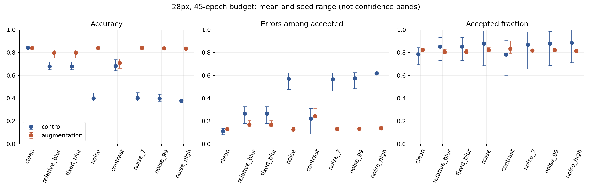
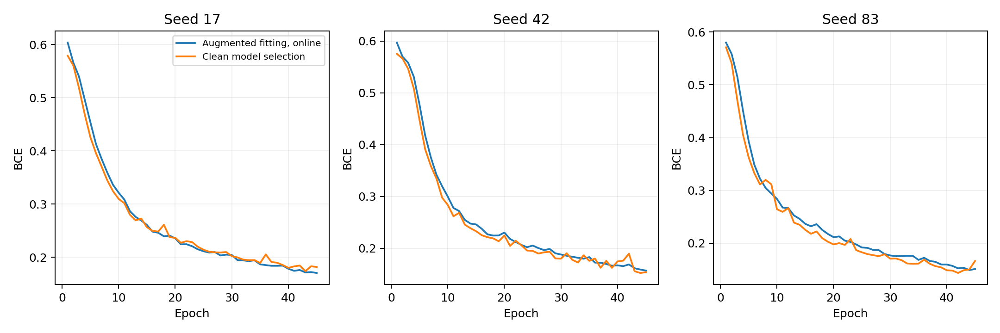

# Versuch 07 – Gezieltes Training gegen Rauschen

Drei neue 28×28-Modelle mit derselben Architektur und demselben 45-Epochen-Budget wie die Kontrollmodelle aus Versuch 06. Einziger geplanter Trainingsunterschied: Mit Wahrscheinlichkeit 0,5 erhält jedes Trainingsbild frisches Gaußrauschen (SD 0,1) und wird auf [0,1] begrenzt. Modellwahl und Kalibrierung bleiben ausschließlich auf getrennten Originaldaten.

## Ergebnisse im Vergleich

| Bedingung | Arm | Accuracy | Fehler unter akzeptierten Fällen | Akzeptierter Anteil | Fehler bei rückblickend 80% Akzeptanz |
|---|---|---:|---:|---:|---:|
| clean | control | 84.1% | 11.2% | 78.5% | 12.2% |
| clean | augmentation | 84.1% | 13.0% | 82.2% | 13.4% |
| noise | control | 40.0% | 57.0% | 88.1% | 58.8% |
| noise | augmentation | 84.0% | 12.6% | 82.2% | 12.9% |
| noise_7 | control | 40.1% | 56.6% | 86.7% | 59.0% |
| noise_7 | augmentation | 84.0% | 12.9% | 81.7% | 13.1% |
| noise_99 | control | 39.6% | 57.3% | 88.0% | 59.2% |
| noise_99 | augmentation | 83.6% | 13.1% | 82.3% | 13.4% |
| noise_high | control | 37.8% | 61.9% | 88.6% | 60.3% |
| noise_high | augmentation | 83.5% | 13.6% | 81.4% | 13.8% |
| relative_blur | control | 67.9% | 26.6% | 85.2% | 22.1% |
| relative_blur | augmentation | 79.9% | 16.9% | 80.6% | 17.1% |
| contrast | control | 68.3% | 22.1% | 78.4% | 21.6% |
| contrast | augmentation | 71.0% | 24.4% | 83.3% | 21.7% |

Mittelwerte über alle drei Seeds. noise = SD 0,1 / Seed42; noise_7 und noise_99 ändern die Zufallsfolge, noise_high nutzt SD 0,2 / Seed42. Die nachträglich auf 80% angeglichene Akzeptanz ist eine Rangdiagnose, keine Einsatzregel.

Primärer Vergleich: Unterschied des Rauschen-minus-Original-Anstiegs der akzeptierten Fehlerrate, Augmentation minus Kontrolle: **-46.33 Prozentpunkte**, bedingtes gepaartes 95%-Intervall **[-51.96; -40.78]**. Sekundäre Differenz der Accuracy auf Originalbildern: **-0.05 Prozentpunkte**, exploratives Intervall **[-1.34; 1.18]**.

## Was der Versuch aussagen kann

Die Intervention kennt absichtlich dieselbe Rauschfamilie und primäre Stärke wie die Auswertung. Ein Erfolg ist deshalb ein enger Nachweis störungsspezifischer Anpassung, kein Beleg allgemeiner Robustheit. Die anderen Rauschfolgen und stärkere Störung wurden bereits früher betrachtet; sie sind kein unberührter externer Test. Nachteile unter Unschärfe, Kontrast oder auf Originalbildern gehören ebenso zum Ergebnis. Die Trainingskurve bezieht sich auf teilweise verrauschte Bilder, die Auswahlkurve auf Originalbilder; ihr Abstand ist kein unmittelbar vergleichbarer Generalisierungsfehler.

## Nachweise und Reproduktion

[Protokoll](AUGMENTATION_PROTOCOL.md) · [48 Vergleichszeilen](../../reports/augmentation/comparison.csv) · [Primäre Analyse](../../reports/augmentation/primary.json) · [Nachprüfung](../../reports/augmentation/verification.json) · [PDF](../../reports/augmentation/comparison.pdf). Die 24 neuen Ergebniszeilen sowie sechs Modellgewichte und Kalibrierungsschwellen beider Arme wurden nachgeprüft; alte Kontrollvorhersagen stimmen mit Versuch 06 überein.

Training: `python experiments/resolution_study.py --config configs/augmentation_study.json --output reports/augmentation --models models/augmentation`. Auswertung: `python experiments/augmentation_analysis.py`. Vorher Grundabhängigkeiten, CPU-PyTorch und die dokumentierten Archive bereitstellen. Die ursprünglichen Studien bleiben unverändert.

## Grenzen

Bekannter Benchmark, nur 28px, drei Seeds, unbekannte Patientenzusammenhänge. Intervalle gelten bedingt auf feste trainierte Modelle und Annahmeschwellen und schließen Kalibrierungs- sowie Trainingsunsicherheit aus. Die Unterdrückung eines synthetischen Fehlermusters ist keine klinische Sicherheitsgarantie. Es fand keine externe Validierung statt.

## Interne Merkmalsdiagnose

Unter dem primären Rauschen haben die drei augmentierten Modelle bei 85, 89 und 72 Fällen einen vollständig leeren letzten Merkmalsvektor. Nullvektoren sind damit nicht vollständig verschwunden. Sie sind auch für sich genommen kein Beweis einer falschen Entscheidung: Die Bias-Ausgabe kann für normal gelabelte Fälle korrekt sein. Entscheidend bleiben Fehler und Akzeptanz, nicht nur die Zahl aktiver Neuronen.

[Diagnose nach Klasse](../../reports/augmentation/noise_diagnostics_augmented.csv). Reproduktion: `python experiments/noise_diagnostics.py --reports reports/augmentation --models models/augmentation --tag augmented --output reports/augmentation`.
