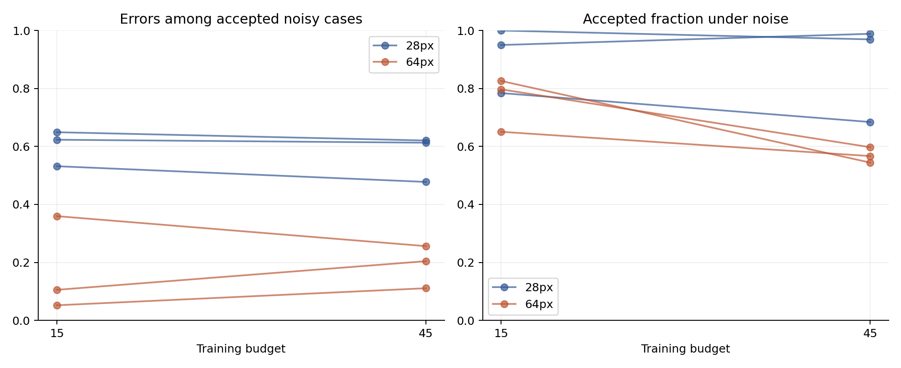
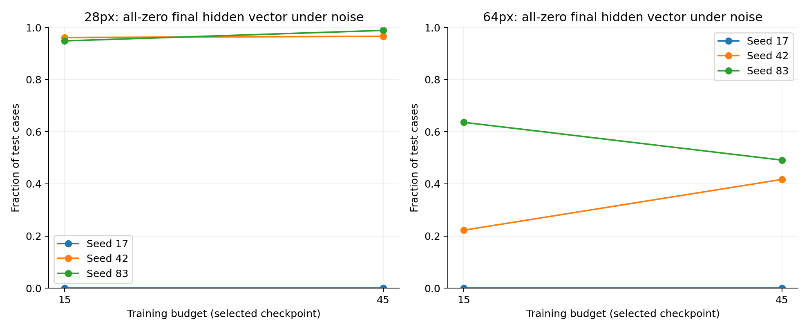
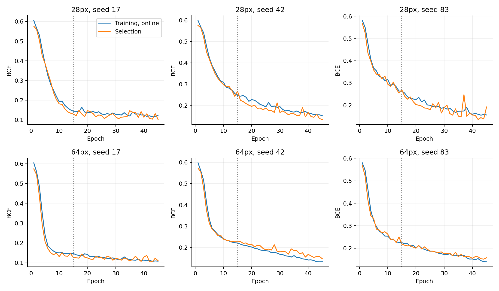
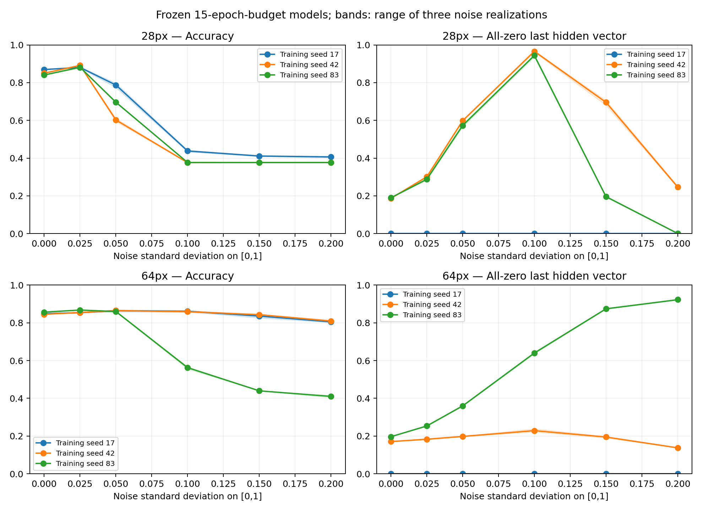

# Versuch 06 – Rauschen, Merkmalsverlust und längeres Training

Nachanalyse und festgelegte Trainingsverlängerung auf demselben bereits untersuchten Benchmark. Die sechs Modelle wurden mit identischer Initialisierung und Reihenfolge erneut trainiert, diesmal mit einem Budget von 45 statt 15 Epochen. Checkpoints werden weiterhin ausschließlich nach Modellwahl-Daten ausgewählt. Kein Rauschtraining, keine neue Architektur.

## Was in den früheren Modellen passiert

Bei den 28px-Modellen mit Seed 42 und 83 ist unter dem getesteten Rauschen für 597 bzw. 589 der 621 Fälle der gesamte letzte Merkmalsvektor null. Für diese Fälle reduziert sich der Logit rechnerisch auf den festen Bias der Ausgabeschicht; P(pneumonia) liegt bei etwa 0,422 bzw. 0,439. Das erklärt die identische Negativentscheidung in diesen Fällen, aber nicht automatisch die Ursache aller übrigen Fehler.

Skalierung, Rauschverteilung, Clipping, float32-Verarbeitung und alte Vorhersagen wurden reproduziert. Das ist ein nachvollziehbarer interner Rechenmechanismus, keine klinische Erklärung. Zero-ReLU-Aktivierungen sind inputabhängig; daraus folgt nicht, dass diese Neuronen bei allen Bildern dauerhaft tot sind.

## Vergleich der Trainingsbudgets

| Auflösung | Budget | Accuracy original | Accuracy Rauschen | Fehler unter akzeptierten Rauschfällen | Akzeptierte Rauschfälle |
|---|---:|---:|---:|---:|---:|
| 28 | 15 | 85.3% | 39.9% | 60.1% | 91.1% |
| 28 | 45 | 84.1% | 40.0% | 57.0% | 88.1% |
| 64 | 15 | 85.0% | 76.1% | 17.2% | 75.8% |
| 64 | 45 | 86.2% | 65.6% | 19.0% | 57.0% |

Mittelwerte über die drei Seeds. Unterschiedliche Akzeptanzraten müssen zusammen mit dem Fehleranteil gelesen werden. Ein längeres Budget heißt nicht, dass der ausgewählte Checkpoint aus Epoche 45 stammt.

Primärer Vergleich bei 28px: Veränderung des Rauschen-minus-Original-Anstiegs der akzeptierten Fehlerrate, 45er- minus 15er-Budget: **-3.31 Prozentpunkte**, bedingtes gepaartes 95%-Intervall **[-5.31; -1.47]**. Negative Werte bedeuten einen geringeren Anstieg unter dieser Regel. Das ist kein externer Wirksamkeitsnachweis.

## Gewählte Checkpoints

| Auflösung | Seed | Gewählte Epoche im 45er-Budget | Trainingssekunden |
|---|---:|---:|---:|
| 28 | 17 | 45 | 17.0 |
| 28 | 42 | 45 | 17.7 |
| 28 | 83 | 42 | 17.9 |
| 64 | 17 | 42 | 116.5 |
| 64 | 42 | 45 | 115.9 |
| 64 | 83 | 44 | 123.3 |

## Nachprüfbarkeit

Die ersten 90 Epocheneinträge (15 je Lauf) stimmen mit den früheren Verläufen überein; maximale Verlustabweichung 0. Alle 30 neuen Ergebniszeilen, sechs gespeicherten Modelle und Kalibrierungsschwellen wurden nachgeprüft.

[Protokoll](BUDGET_PROTOCOL.md) · [Ergebnis-CSV](../../reports/budget/results.csv) · [Primärer Vergleich](../../reports/budget/primary.json) · [Prüfnachweis](../../reports/budget/verification.json) · [Diagnose pro Klasse, 15er-Budget](../../reports/budget/noise_diagnostics_15.csv) · [Diagnose pro Klasse, 45er-Budget](../../reports/budget/noise_diagnostics_45.csv)

Reproduktion: `python experiments/noise_diagnostics.py`; `python experiments/resolution_study.py --config configs/budget_study.json --output reports/budget --models models/budget`; `python experiments/noise_diagnostics.py --reports reports/budget --models models/budget --tag 45`; `python experiments/budget_analysis.py`. CPU-PyTorch und Grundabhängigkeiten wie in der README. Neue Läufe ersetzen nur die angegebenen Budget-Ausgaben.

## Grenzen

Drei Seeds, ein bekannter Datensatz, synthetisches Gaußrauschen und unbekannte Patientenidentitäten. Die gepaarten Intervalle resampeln eindeutige Pixelgruppen und halten Training sowie Kalibrierung fest; sie erfassen nicht deren Unsicherheit. Die Hauptfrage wurde nach Sichtung der früheren Rauschfehler gewählt. Weitere Bedingungen sind sekundär. Es gibt keine Aussage über allgemeine medizinische Sicherheit, keine garantierte maximale Fehlerrate und keine unabhängige Replikation.

## Warum die Annahmeregel den Merkmalsverlust nicht abfängt

Bei den alten 28px-Modellen akzeptiert die feste Kalibrierungsschwelle alle 597 bzw. 589 Bias-only-Ausgaben der Seeds 42 und 83; darunter sind 377 bzw. 382 falsche Vorhersagen. Diese Ausgaben müssen nicht hochkonfident im Sinne von mindestens 90% sein. Sie liegen lediglich über oder auf der für das jeweilige Modell gesetzten Annahmeschwelle. Die inklusive Regel `confidence >= cutoff` akzeptiert auch Gleichstände. Eine auf clean-Daten gewählte Schwelle ist deshalb keine Absicherung gegen einen solchen Merkmalsverlust.

[Zählung beider Trainingsbudgets](../../reports/budget/bias_acceptance.csv). Reproduktion: `python experiments/bias_acceptance.py` nach den Aktivierungsdiagnosen.

## Sechs Rauschstärken, drei Rausch-Zufallsfolgen

Diese Zusatzdiagnose verwendet ausschließlich die eingefrorenen 15er-Modelle: sechs Rauschstärken × drei Rauschseeds × sechs Modelle, insgesamt 108 Auswertungen. Die Bänder zeigen Minimum und Maximum über Rauschrealisationen, keine Konfidenzintervalle. Originalzustand und die frühere Störung mit SD 0,1 und Seed 42 wurden gegen die gespeicherten Ergebnisse geprüft.

Der Anteil vollständig leerer Merkmalsvektoren ist nicht bei jedem Modell monoton: Bei stärkerem Rauschen können wieder Merkmale aktiviert werden, während die Klassifikation weiterhin schlecht bleibt. Weniger Nullvektoren beweisen deshalb keine Erholung. Auch auf Originalbildern existieren bei einigen Modellen Nullvektoren; ihre bloße Existenz ist kein Fehlernachweis. Die diagnostizierte Bias-Ausgabe erklärt einen Teil des Zusammenbruchs, nicht die gesamte Robustheit.

[108 Diagnosezeilen](../../reports/budget/noise_severity.csv) · [Nachprüfung](../../reports/budget/sweep_verification.json). Reproduktion: `python experiments/noise_sweep.py`.
