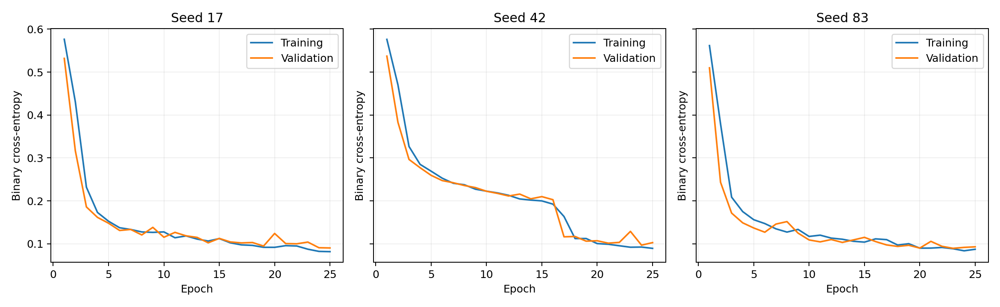
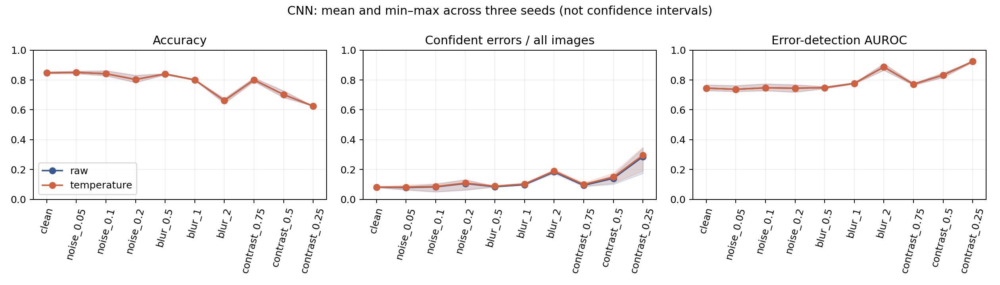
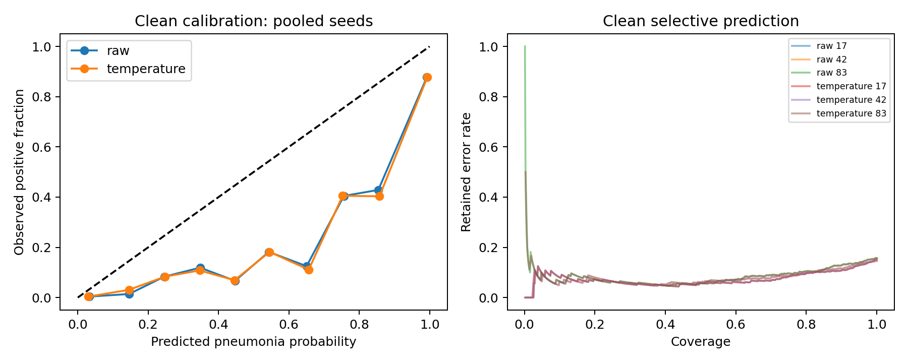

# CNN study — three training runs

**Audit update:** Exact train/validation pixel overlaps and internal test repeats were found after these experiments. Interpret these as official-split exploratory results; see [the audit](AUDIT.md).

A convolutional model was trained from scratch three times on the official training split. Each run completed 25 epochs. Checkpoints and temperature scaling used only validation data. This is a follow-up on an already examined test benchmark, not an independent confirmation.

Architecture: two convolutional blocks and a dense head; **105,281 parameters**. Seeds: 17, 42, 83.

## Results

Means across three seeds; brackets show minimum–maximum, not confidence intervals. The same 624 test images are used throughout.

| Condition | Calibration | Accuracy | Brier score | Confident errors / all | Error-detection AUROC |
|---|---|---:|---:|---:|---:|
| clean | raw | 0.848 [0.843–0.854] | 0.123 [0.118–0.129] | 0.082 [0.080–0.085] | 0.745 [0.729–0.767] |
| clean | temperature | 0.848 [0.843–0.854] | 0.124 [0.119–0.131] | 0.083 [0.080–0.087] | 0.745 [0.729–0.767] |
| blur_2 | raw | 0.662 [0.644–0.676] | 0.266 [0.257–0.283] | 0.184 [0.175–0.199] | 0.887 [0.866–0.909] |
| blur_2 | temperature | 0.662 [0.644–0.676] | 0.271 [0.261–0.285] | 0.190 [0.183–0.200] | 0.887 [0.866–0.909] |
| contrast_0.25 | raw | 0.625 [0.625–0.625] | 0.325 [0.288–0.344] | 0.286 [0.175–0.343] | 0.924 [0.919–0.926] |
| contrast_0.25 | temperature | 0.625 [0.625–0.625] | 0.330 [0.294–0.352] | 0.296 [0.192–0.351] | 0.924 [0.919–0.926] |

## Learning and checkpoint selection

| Seed | Selected epoch | Validation BCE | Temperature |
|---|---:|---:|---:|
| 17 | 25 | 0.0904 | 0.948 |
| 42 | 24 | 0.0970 | 0.974 |
| 83 | 23 | 0.0896 | 0.890 |

## Interpretation

A larger, spatial model is now available, but parameter count is not evidence of clinical quality. Compare the clean results and corruption failures rather than treating training duration as progress. Three seeds reveal some optimization variability; they do not resolve sampling uncertainty, patient dependence or distribution shift.

Temperature scaling changes probability magnitudes while preserving binary decisions and uncertainty ranking. Therefore accuracy and error-detection AUROC should stay unchanged within numerical precision. A smaller Brier score does not automatically mean improved error detection or safer rejection. The rejection threshold is chosen by a validation percentile; positive temperature scaling should preserve the retained cases.

Calibration uses the same validation set as checkpoint selection. Its apparent validation fit is optimistic; there is no guarantee of improvement on the test distribution. Pooled calibration plots repeat the same cases across seeds and are descriptive, without confidence bands.

## Reproducibility and evidence

Install the base requirements, then `pip install --index-url https://download.pytorch.org/whl/cpu torch==2.5.1`. Run `OPENBLAS_NUM_THREADS=2 OMP_NUM_THREADS=2 python experiments/cnn_study.py`. This replaces the CNN outputs. Full epoch logs, CSV results, individual predictions and environment metadata are in `reports/cnn/`; selected state dictionaries are in `models/cnn/`. Load with `torch.load(path, weights_only=True)` into the documented `CNN` architecture.

## Next scientific steps

Add paired uncertainty estimates for model comparisons and error detection; inspect clinically plausible corruption definitions; compare related literature; establish a higher-resolution, patient-aware external dataset. No external validity, novelty or clinical safety is established here.
