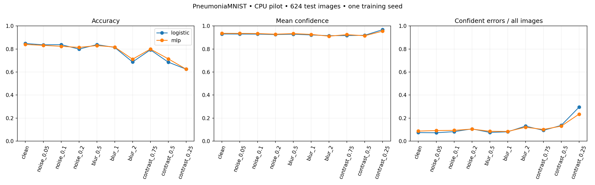
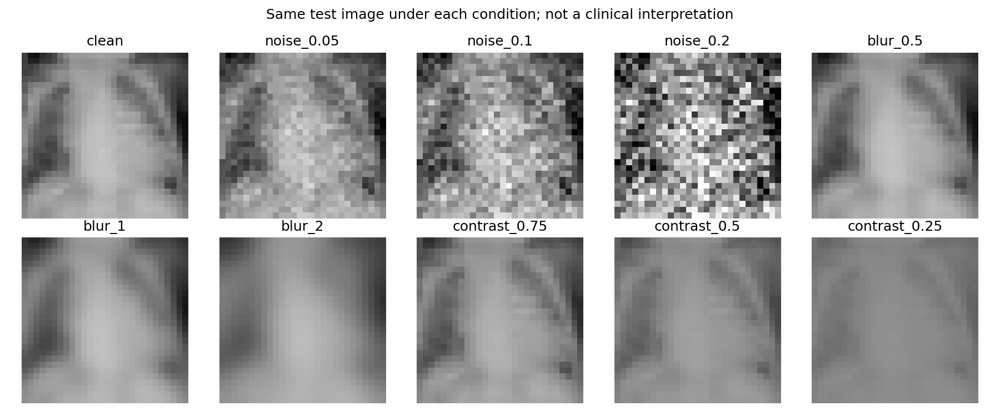

# Pilot 01 — When confidence survives image degradation

**Audit update:** Exact train/validation pixel overlaps and internal test repeats were found after these experiments. Interpret these as official-split exploratory results; see [the audit](AUDIT.md).

Two CPU-trained classifiers were evaluated on the same 624 official PneumoniaMNIST test images. Hyperparameters and neural checkpoint were selected using validation log loss. The experiment implementation and protocol were committed before the test evaluation (`d835b86`).

| Model / condition | Accuracy | Mean confidence | Confident errors / all images |
|---|---:|---:|---:|
| Logistic / clean | 84.8% | 93.1% | 7.4% |
| Neural MLP / clean | 84.0% | 93.6% | 8.7% |
| Neural MLP / blur σ=2 | 71.2% | 91.2% | 12.0% |
| Neural MLP / contrast ×0.25 | 62.5% | 95.5% | 23.4% |

The strongest contrast reduction increased the MLP's high-confidence error proportion by 14.7 percentage points (paired image-bootstrap 95% interval: 12.0–17.5 points). These are exploratory, per-comparison intervals, without multiplicity correction. They condition on one fitted model and do not capture patient dependence, training variability or stochastic corruption variability.

At contrast ×0.25, both models predict pneumonia for every test image. Accuracy then equals the positive-class prevalence (62.5%); specificity is zero. This is not useful diagnostic performance. On clean images, the MLP already has 94 false positives and six false negatives, with specificity 59.8%. Mean confidence must not be presented as the probability that the model is correct.

The neural network does not outperform the linear baseline on clean accuracy. Contrast changes preserve linear score ranking, explaining why logistic AUC stays constant while fixed-threshold accuracy collapses. This distinction between discrimination and threshold-dependent decisions is central to interpreting the experiment.

## Evidence and limits

Complete results: `reports/metrics/results.csv`; per-image probabilities and labels: `predictions.npz`; checkpoint selection: `validation.json`; configuration and environment: `run.json`; portable parameters: `models/`. Bootstrap unit is an image, not a verified patient. Test order indexes identify predictions within the checksum-verified archive.

This is a 28×28 pediatric X-ray benchmark, one training seed, one dataset, synthetic perturbations, no external validation and no calibration intervention. Findings do not establish clinical safety, novelty or behavior on real acquisition failures. The test set has now been evaluated: follow-up experiments must be declared as follow-up analyses, not described as an untouched first test.

Next: literature comparison, patient-aware higher-resolution dataset selection, multiple seeds, a convolutional baseline, validation-only calibration, and external evaluation where licensing and access permit. A local SwiftUI/Core ML demonstration follows numerical export validation.
