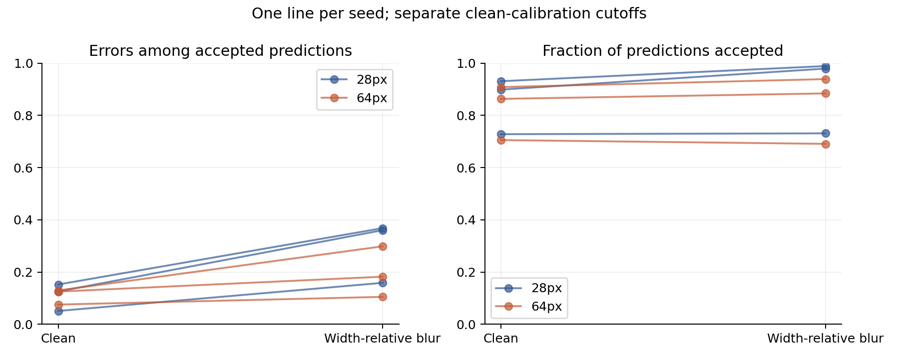
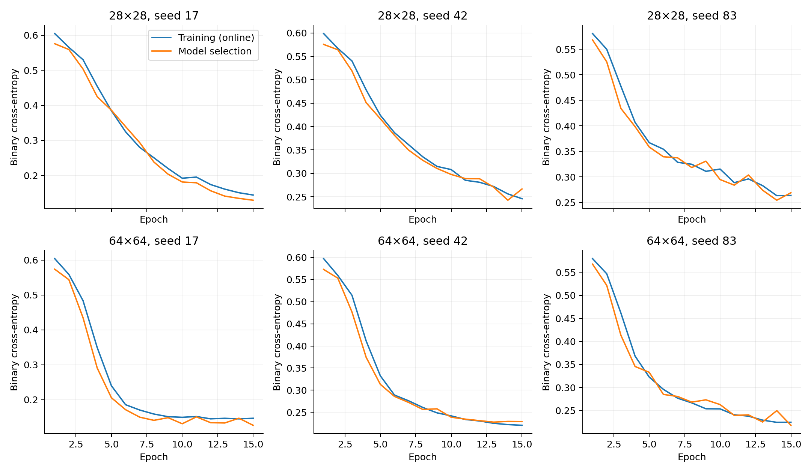

# Resolution and rejection — exploratory study

A duplicate-aware sensitivity analysis, separate from the historical official-split pilots. No exact pixel group crosses fitting, model selection, calibration or testing. Unknown patient identities remain a limitation.

## Design

4,682 fitting cases; 262 model-selection cases; 262 calibration cases; 621 unique test representatives. Six runs: two resolutions × three seeds × 15 epochs. Identical adaptive-pooling architecture and parameter count. Thresholds target 80% clean calibration coverage; actual test coverage may differ.

## Clean versus width-relative blur

| Resolution | Condition | Accuracy, mean | Retained error, mean | Coverage, mean |
|---|---|---:|---:|---:|
| 28 | clean | 85.3% | 11.0% | 85.2% |
| 28 | relative_blur | 66.5% | 29.6% | 90.0% |
| 64 | clean | 85.0% | 11.0% | 82.6% |
| 64 | relative_blur | 75.9% | 19.5% | 83.8% |

## Primary contrast

The difference in blur-minus-clean retained error risk (64 minus 28), averaged over matched seeds, is **-10.09 percentage points**, with a paired conditional 95% percentile interval of **[-12.03, -8.23] points**. Negative values favor 64 pixels for this particular risk change, not necessarily for clean accuracy or coverage.

Bootstrap: 2000 equal-group paired replicates; 0 discarded for empty retained subsets. Seeds are held fixed; patients are not known. This interval does not include retraining or calibration-set sampling uncertainty.

The accepted cohorts may differ across conditions and models. Interpret risk jointly with coverage; greater rejection can reduce observed risk. A single predefined blur contrast does not demonstrate general robustness. Secondary noise, contrast and fixed-pixel blur results are in results.csv, not independent confirmations.

## Reproduce and inspect

`configs/resolution_manifest.json` records every exact group and selected index. `configs/resolution_study.json` and [the protocol](RESOLUTION_PROTOCOL.md) were committed before fitting. Run `python experiments/resolution_study.py` then `python experiments/resolution_analysis.py` after installing base dependencies and CPU PyTorch 2.5.1. Training replaces this study’s outputs, not older studies. Full histories, model hashes, timings, software environment and predictions are in reports/resolution; weights are in models/resolution. PDF figures are available beside PNG previews.

## Limits and next checks

This known pediatric benchmark is not an external test. Exact deduplication is not patient separation. Fifteen epochs are a fixed experimental budget rather than a proven optimum. Equal epochs imply different computational cost. Spatial receptive fields still differ relative to image width, so this compares resolution-specific pipelines, not a perfectly isolated information-content intervention. Gaussian blur is synthetic; physical acquisition degradation and clinical usefulness remain untested. Calibration uncertainty with only 262 cases may be substantial. A further independent dataset and clinical input are required before medical conclusions.

## Training record

Each network has **21,249 parameters**. Adaptive pooling deliberately keeps capacity fixed across resolutions; this model is smaller than the earlier 105,281-parameter pilot. That architectural change prevents attributing differences versus the old pilot solely to deduplication.

| Resolution | Seed | Selected epoch | Training seconds |
|---|---:|---:|---:|
| 28 | 17 | 15 | 5.4 |
| 28 | 42 | 14 | 5.5 |
| 28 | 83 | 14 | 5.7 |
| 64 | 17 | 15 | 38.6 |
| 64 | 42 | 13 | 37.5 |
| 64 | 83 | 15 | 38.8 |

Checkpoints at or near the last epoch indicate that convergence is not established. The current result describes a fixed 15-epoch budget, not each resolution’s best achievable performance. It does not justify selecting a winning clinical model.

Verification: all 30 result rows recalculated, all six saved checkpoints reproduce clean outputs, all six calibration cutoffs recomputed, and the manifest hash matches. Twelve unit tests passed.
