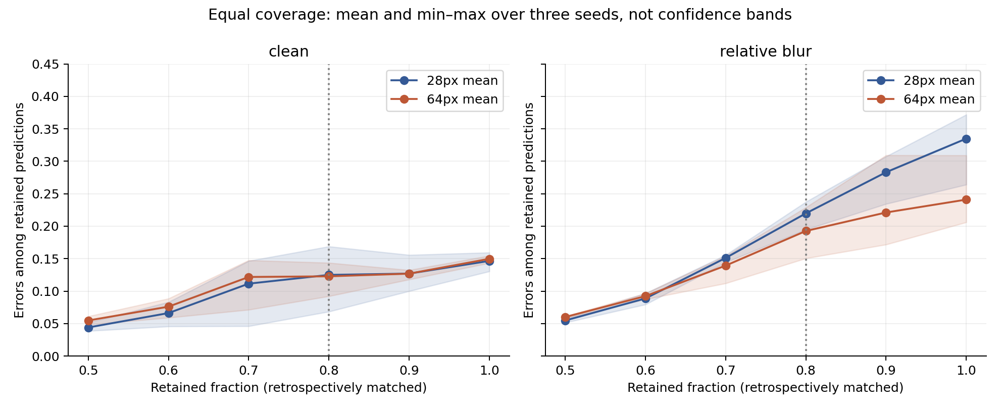
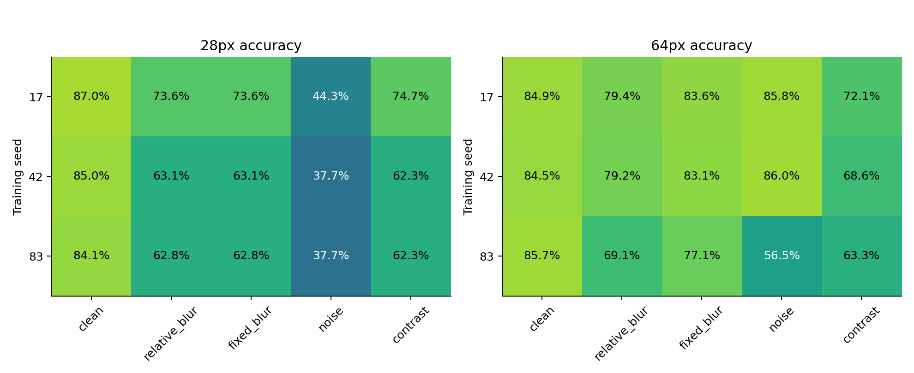
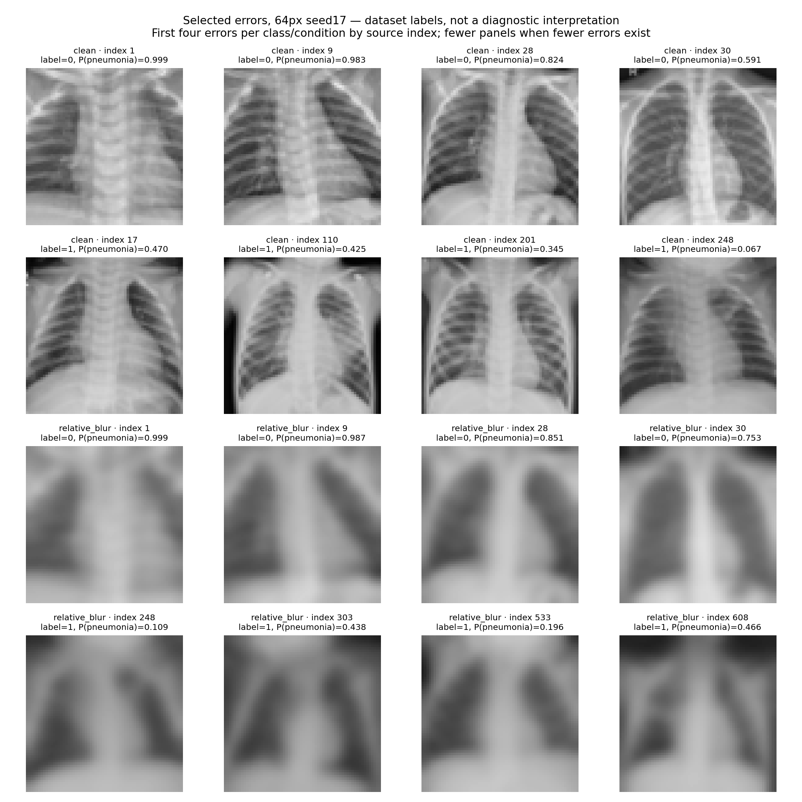

# Versuch 05 – Ist der Vorteil nur eine Frage des Zurückhaltens?

**Nachanalyse der sechs Modelle aus Versuch 04, kein neues Training.** Die Modelle mit 64×64-Bildern akzeptierten unter Unschärfe weniger Vorhersagen als die Modelle mit 28×28. Deshalb war offen, wie groß der Unterschied bei gleicher Prüfbelastung bleibt.

## Gleicher Anteil akzeptierter Vorhersagen

Wir akzeptieren rückblickend bei jedem Modell und jeder Bildbedingung die 80 % mit der höchsten Konfidenz. Bei exakt gleicher Konfidenz an der Grenze werden alle betroffenen Fälle gleich gewichtet. Das entspricht zufälliger Auswahl innerhalb dieser Gruppe im Erwartungswert; richtige Labels werden niemals zum Auflösen eines Gleichstands benutzt.

| Auflösung | Fehler unter akzeptierten Originalbildern | Fehler unter akzeptierten unscharfen Bildern | Anstieg |
|---|---:|---:|---:|
| 28×28 | 12,50 % | 21,98 % | 9,48 Prozentpunkte |
| 64×64 | 12,28 % | 19,27 % | 6,98 Prozentpunkte |

Mittelwerte über drei Trainingsseeds, jeweils dieselben 621 eindeutigen Testrepräsentanten. Das sind nicht drei unabhängige Patientengruppen. Bei 621 Fällen entsprechen 80 % rechnerisch 496,8 akzeptierten Fällen; der Grenzfall wird anteilig gewichtet.

Der Unterschied der Anstiege beträgt **−2,50 Prozentpunkte** (64 minus 28). Das gepaarte 95%-Bootstrap-Intervall beträgt **[−4,16; −0,72] Prozentpunkte**. Resampling: 2.000 Stichproben mit gemeinsamen Fallindizes für beide Auflösungen, Bedingungen und Seeds; die Akzeptanzgewichte werden jeweils neu berechnet. Das Intervall gilt bedingt auf die sechs fertigen Modelle und erfasst keine Trainings-, Kalibrierungs- oder unbekannte Patientencluster-Unsicherheit.

Die Flächen zeigen Minimum bis Maximum der drei Seeds, keine Konfidenzbänder. Bei Originalbildern liegt keine konsistente Überlegenheit von 64×64 über den gesamten gezeigten Bereich vor.

## Warum das nicht die frühere Zahl ersetzt

Versuch 04 verwendete eine **vorher auf Kalibrierungsdaten festgelegte Schwelle**. Bei Verschlechterung durfte sich die Zahl akzeptierter Fälle verändern. Der Unterschied der Risikoanstiege lag dabei bei −10,09 Prozentpunkten.

Hier setzen wir rückblickend **denselben akzeptierten Anteil** fest. Der Unterschied ist deutlich kleiner. Beide Berechnungen sind korrekt, aber sie beschreiben unterschiedliche Regeln. Die Differenz der beiden Kennzahlen ist keine kausale Zerlegung des Auflösungseffekts. Zudem sind die akzeptierten Fälle trotz gleicher Anzahl nicht zwangsläufig dieselben Fälle.

Die neue Analyse benötigt die Konfidenzverteilung der Testdaten. Sie ist eine diagnostische Rangvergleichsanalyse, keine bereits einsatzbereite Schwelle für unbekannte neue Patienten. Aus ihr folgt insbesondere keine garantierte Fehlerrate von höchstens einem bestimmten Wert.

## Nicht nur das günstigste Ergebnis zeigen

Unter dem getesteten Gaußrauschen sagen die 28×28-Modelle mit Seed 42 und 83 **für alle 621 Fälle „normal“** voraus. Die Accuracy ist dann 37,7 %, entsprechend dem Anteil normal gelabelter Fälle. Auch das 64×64-Modell mit Seed 83 fällt bei Rauschen deutlich ab. Ein Mittelwert oder nur die Unschärfe-Grafik würde diese Schwächen verdecken. Die Ursache ist hier noch nicht erklärt; weder ein medizinischer Mechanismus noch ein Implementierungsfehler darf ohne weitere Prüfung behauptet werden.

## Konkrete Fehlerbeispiele

Gezeigt werden für das 64×64-Modell mit Seed 17 jeweils die ersten vier Fehler pro tatsächlichem Label und Bedingung, sortiert nach ursprünglichem Testindex. Gibt es weniger Fehler, werden weniger gezeigt. Label 0 bedeutet „normal“, Label 1 „pneumonia“ laut Datensatz. Dieselben Fälle können in beiden Bedingungen erscheinen. Es handelt sich weder um repräsentative Häufigkeitsbelege noch um Erklärungen, welche Bildregionen das Modell verwendet. Es wurden keine klinischen Befunde aus den Bildern abgeleitet.

## Nachweise

- [Festgelegter Analyseplan](SELECTIVE_REVIEW_PROTOCOL.md) und [Konfiguration](../../configs/selective_review.json).
- [180 Ergebniszeilen](../../reports/selective_review/matched_coverage.csv): zwei Auflösungen × drei Seeds × fünf Bedingungen × sechs Akzeptanzanteile.
- [Aufschlüsselung nach wahrem Label](../../reports/selective_review/class_breakdown.csv), damit akzeptierte Fehler und zurückgehaltene korrekte Fälle nicht verschwinden.
- [Primärer Vergleich und Intervalle](../../reports/selective_review/primary.json), [Fehlerfall-Indizes](../../reports/selective_review/error_atlas.json), [Provenienz](../../reports/selective_review/provenance.json).
- [PDF-Diagramm](../../reports/selective_review/equal_coverage.pdf) für einen Bericht.

Reproduktion nach Versuch 04: `python experiments/selective_review.py`. Softwaretests: `python -m unittest discover -s tests -v`. Die 18 Tests umfassen Gleichstände, Label-unabhängige Auswahl, Permutationsinvarianz und korrekte Nenner. Softwaretests beweisen keine medizinische Sicherheit.

## Folgerung für die weitere Arbeit

Der Auflösungsvergleich liefert einen begrenzten Hinweis zugunsten von 64×64 bei dieser definierten Unschärfe. Die zuvor auffällig große Differenz hängt jedoch auch mit den unterschiedlichen Akzeptanzraten zusammen. Weiterhin ungeklärt sind Trainingsbudget, erhebliche Seed-Unterschiede, verrauschungsbedingte Zusammenbrüche und Übertragbarkeit auf andere Patienten. Eine faire Facharbeit muss diese Befunde zusammen berichten.

Zusätzliche Nachprüfung: Alle 180 Ergebniszeilen wurden mit einer separat implementierten Berechnung über Konfidenzgruppen reproduziert. Die 60 Klassenzeilen ergeben dieselben akzeptierten Fall- und Fehlergewichte. [Prüfnachweis](../../reports/selective_review/verification.json); ausführbar mit `python experiments/verify_selective_review.py`.
