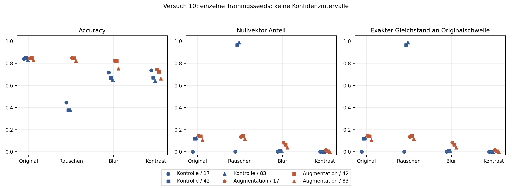
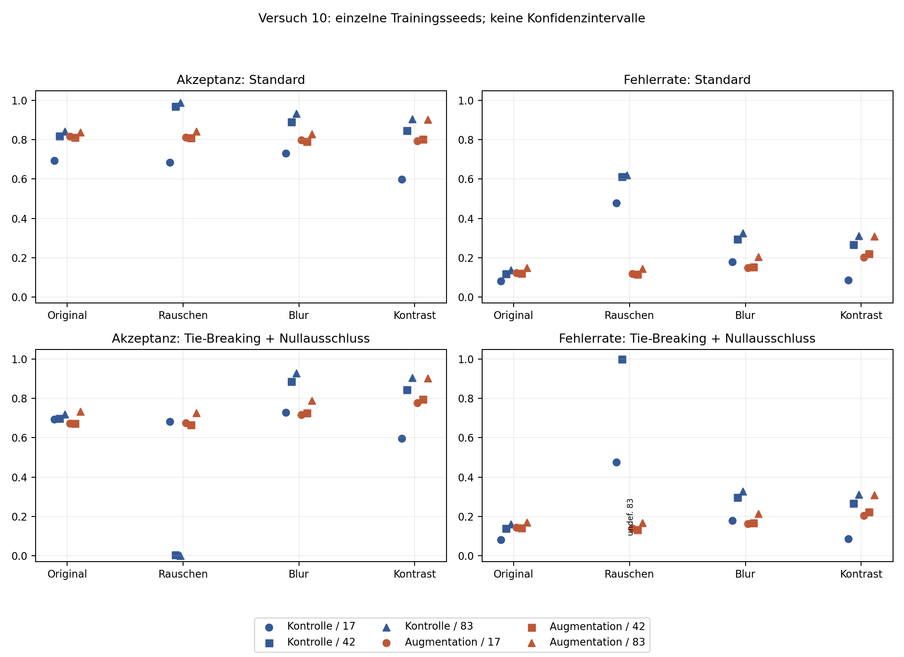

# Versuch 10 – Transfer der Rauschaugmentation auf Blur und Kontrastreduktion

Reine Nachanalyse der sechs eingefrorenen 28×28-Modelle aus dem Vergleich in Versuch 07: Kontrolle und Rauschaugmentation, jeweils Seeds 17, 42 und 83. Kein neues Training und keine Anpassung der Schwellen an gestörte Bilder. 262 Original-Kalibrierungsfälle, dieselben 621 deduplizierten Testrepräsentanten.

## Fragestellung und begrenzter Transferbegriff

Verhindert Rauschaugmentation Nullaktivierung der letzten Merkmalschicht auch bei anderen Störungen? Bleiben die akzeptierten Vorhersagen dann zuverlässig?

„Ungesehen“ bedeutet hier ausschließlich **nicht als Trainingsaugmentation verwendet**. Blur und Kontrastreduktion sowie die Testfälle waren bereits Gegenstand früherer Projektanalysen. Versuch 10 ist deshalb keine verblindete OOD-Validierung und keine unabhängige Replikation. Auch die Ausgangsaussage muss eingeschränkt werden: Versuch 07 verhinderte den Nullvektor unter dem bekannten Rauschen nicht vollständig; bei augmentierten Modellen bleiben dort 85, 89 und 72 von 621 Fällen mit `h = 0`.

## Festgehaltene Bedingungen und Regeln

- Originalbilder: uint8 / 255, float32.
- Bekanntes Rauschen: additives Gaußrauschen, SD 0,1, Generator-Seed 42; anschließend Begrenzung auf [0,1].
- Blur: Gaußfilter mit Sigma 1 Pixel, Randbehandlung `reflect`, keine Filterung über Fälle. Bei 28×28 sind `relative_blur` und `fixed_blur` des bestehenden Codes identisch; sie werden nur einmal ausgewertet, nicht als zwei Replikationen gezählt.
- Kontrast: `0.5 + 0.5 * (image - 0.5)`, begrenzt auf [0,1].

Nullvektor bedeutet, dass alle 32 Werte nach der letzten ReLU exakt null sind. Der Logit muss dann exakt dem Bias entsprechen. Die Gleichstandsrate misst `confidence == tau`, ohne Toleranz, an der **ursprünglichen** Kalibrierungsschwelle.

**Standard:** `confidence >= tau`, wobei `tau` das linear interpolierte 20%-Quantil der Original-Kalibrierungskonfidenzen ist. **Kombinierte Regel aus Versuch 09:** auf denselben Kalibrierungsfällen gelernte Konfidenz-/SHA-256-Ranggrenze mit unverändertem Salt `study09-v1`, zusätzlich Ausschluss aller Nullvektoren. Kein Nachfüllen, kein erneutes Kalibrieren, keine Anpassung auf Testlabels. Die Rangregel allein akzeptiert 209/262 Kalibrierungsfälle; nach Nullvektor-Ausschluss besteht auch dort keine feste 80%-Quote. Die ursprüngliche Quantilschwelle und die Ranggrenze müssen nicht identisch sein.

## Mechanistische Befunde

| Arm / Seed | Nullvektoren Original | Bekanntes Rauschen | Blur | Kontrastreduktion |
|---|---:|---:|---:|---:|
| Kontrolle / 17 | 0 | 0 | 0 | 0 |
| Kontrolle / 42 | 75 | 600 | 4 | 1 |
| Kontrolle / 83 | 76 | 614 | 4 | 0 |
| Augmentation / 17 | 89 | 85 | 51 | 10 |
| Augmentation / 42 | 87 | 89 | 41 | 3 |
| Augmentation / 83 | 65 | 72 | 24 | 0 |

Nenner jeweils 621. In allen 24 Modell-/Bedingungskombinationen entspricht die Gruppe exakt auf der Originalschwelle der Nullvektorgruppe; Kontrolle/Seed 17 hat weder Nullvektoren noch Schwellen-Gleichstände.

**Der massive Rausch-Kollaps der Kontrollmodelle tritt unter diesen Blur- und Kontrastbedingungen nicht wieder auf.** Tatsächlich sinkt die Nullvektorzahl gegenüber den Originalbildern. Augmentierte Modelle haben unter Blur dennoch mehr Nullvektoren und Gleichstände als die Kontrollen, bei zugleich höherer Accuracy. Es wäre daher falsch, hier aus mehr Nullvektoren automatisch schlechtere Klassifikation oder aus wenigen Nullvektoren verlässliche Fehlererkennung abzuleiten.



Ein Punkt pro Modell und Bedingung; keine Seed-Mittelwerte und keine Konfidenzintervalle. Die horizontalen Versätze dienen nur der Lesbarkeit. Bedingungen sind kategorial, keine durchgehende Schweregradskala. [PDF](../../reports/transfer/mechanism.pdf).

## Akzeptierte Fehler unter den nicht trainierten Störungen

Zellen der letzten beiden Spalten: akzeptierte Fälle / davon Fehler. Der Nenner aller Testbedingungen ist 621; vollständige Prozentwerte für Accuracy, Nullvektoren, Gleichstände, Akzeptanz und akzeptierte Fehlerrate stehen in der [Ergebnistabelle](../../reports/transfer/results.md) und der [CSV-Datei](../../reports/transfer/results.csv).

| Arm / Seed | Bedingung | Korrekt insgesamt | Standard: akzeptiert / Fehler | Kombinierte Regel: akzeptiert / Fehler |
|---|---|---:|---:|---:|
| Kontrolle / 17 | Blur | 446 | 454 / 81 | 453 / 81 |
| Kontrolle / 42 | Blur | 415 | 554 / 163 | 550 / 163 |
| Kontrolle / 83 | Blur | 404 | 580 / 189 | 576 / 189 |
| Augmentation / 17 | Blur | 511 | 496 / 74 | 445 / 72 |
| Augmentation / 42 | Blur | 510 | 492 / 75 | 451 / 75 |
| Augmentation / 83 | Blur | 467 | 514 / 105 | 490 / 105 |
| Kontrolle / 17 | Kontrast | 458 | 372 / 32 | 371 / 32 |
| Kontrolle / 42 | Kontrast | 417 | 526 / 140 | 525 / 140 |
| Kontrolle / 83 | Kontrast | 398 | 562 / 175 | 562 / 175 |
| Augmentation / 17 | Kontrast | 462 | 493 / 99 | 483 / 99 |
| Augmentation / 42 | Kontrast | 450 | 498 / 110 | 495 / 110 |
| Augmentation / 83 | Kontrast | 411 | 560 / 173 | 560 / 173 |

Unter Blur ist die Accuracy bei allen drei augmentierten Seeds höher als bei der jeweils gleich gesetzten Kontrolle. Unter der Standardregel liegt ihre akzeptierte Fehlerrate bei 14,92 %, 15,24 % und 20,43 %. Die kombinierte Regel hebt diese auf 16,18 %, 16,63 % und 21,43 % an: Sie entfernt überwiegend korrekte Fälle. Dass ein Teil der Blur-Leistung besser ist, beweist weder allgemeinen Robustheitstransfer noch einen Sicherheitsgewinn durch Nullvektor-Ausschluss.

Unter Kontrastreduktion erreichen die augmentierten Modelle zwar ebenfalls jeweils eine höhere Gesamt-Accuracy als die Kontrollen, ihre akzeptierten Fehlerraten liegen aber bei 20,08 %, 22,09 % und 30,89 %. Bei Seed 17 ist diese Fehlerrate höher als bei der Kontrolle (8,60 %), bei deutlich anderer Akzeptanz. Nur 10, 3 beziehungsweise 0 Nullvektoren erklären diese Fehler nicht. Die kombinierte Regel verwirft hier keine falschen Vorhersagen zusätzlich und erhöht teilweise den Fehleranteil der verbleibenden Fälle.



[PDF](../../reports/transfer/selection.pdf). Im bekannten Rauschen ist die kombinierte Fehlerrate für Kontrolle/Seed 83 undefiniert, weil kein Fall akzeptiert wird; bei Seed 42 bleiben zwei falsche Fälle. Der fehlende Punkt wird ausdrücklich markiert. Eine leere Menge hat keine gemessene Fehlerrate von null.

## Einordnung

Die Befunde stützen keine einfache Kette „Augmentation verhindert Nullvektoren, deshalb erkennt das Modell seine Fehler“. Die Wirkung hängt von Störung und Seed ab; auch ohne massiven Merkmalskollaps werden zahlreiche falsche Vorhersagen akzeptiert. Umgekehrt können Nullvektoren korrekte Vorhersagen liefern. Die Kombination aus Tie-Breaking und Nullvektor-Ausschluss verändert die Fallauswahl und garantiert keine geringere Fehlerrate.

Die Untersuchung beschreibt einen bekannten Benchmark, jeweils eine Blur- und Kontraststärke und drei feste Modelle pro Arm. Es werden keine neuen Signifikanztests oder Unsicherheitsintervalle abgeleitet. Gleiche Seed-Zahlen begründen keine identischen gelernten Repräsentationen; interne Aktivierungen verschiedener Modelle sind nicht automatisch dieselben Merkmale. Patientenunabhängigkeit ist mangels IDs nicht belegt. 28×28 Pixel entfernen radiologische Feinstrukturen; synthetische Störungen sind ein kontrolliertes ML-Testbed und kein physikalisches Modell klinischer Röntgendegradation. Eine klinische oder institutionsübergreifende Aussage folgt daraus nicht.

## Reproduktion und Nachweise

```bash
python experiments/transfer_study.py --output /tmp/study10-new
python experiments/verify_transfer.py --output /tmp/study10-new
python -m unittest discover -s tests -v
python experiments/verify_project.py --output /tmp/study10-project-checks
```

Neue Ausgabeordner sind erforderlich. Die Analyse verwendet deterministische CPU-Inferenz mit zwei Threads, gespeicherte Gewichte und unveränderte Vorverarbeitung. Alle Vorhersagen werden exakt gegen Versuch 07 geprüft, die Referenzentscheidungen für Original und Rauschen zusätzlich gegen Versuch 09.

Der separate Prüfer rechnet alle 48 Ergebniszeilen skalar nach und wiederholt die vollständige Inferenz und Abbildungserstellung in einem temporären Verzeichnis: 129 Arrays und alle vier PNG-/PDF-Dateien stimmen exakt überein. Das ist ein Determinismusnachweis in dieser Softwareumgebung, keine Garantie gleicher Bits auf beliebiger Hardware. Alle **166 früheren Modell- und Ergebnisartefakte** bleiben gemäß SHA-256 unverändert. Die vollständige Testsuite umfasst **43 erfolgreiche Tests**, darunter sechs neue für Versuch 10. Historische Prüfprogramme liefen in einer isolierten Kopie.

[Prüfartefakt](../../reports/transfer/verification.json) · [Projektprüfungen](../../reports/transfer/project_checks/verification.json) · [Provenienz](../../reports/transfer/provenance.json) · [Vorherige Prüfsummen](../../reports/transfer/previous_artifacts.json) · [Kalibrierungsgrenzen](../../reports/transfer/calibration.csv).
