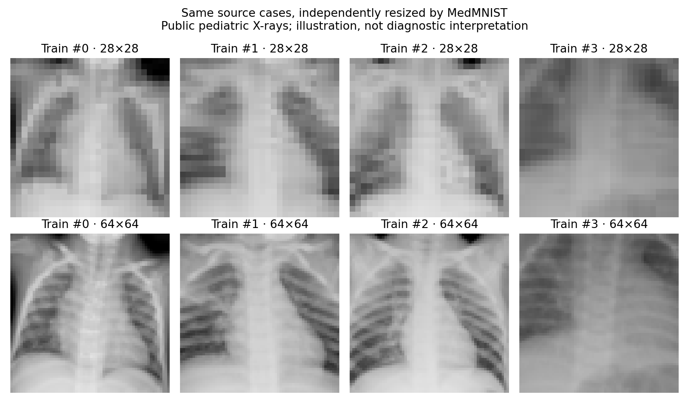

# Methodological audit — 8 November 2026

## What survives verification

Recomputed accuracy, disease AUC, Brier score and high-confidence error proportion match all 20 pilot and 60 CNN CSV rows against stored predictions. Labels match the checksum-verified archive. All 30 CNN seed/condition combinations preserve class decisions under temperature scaling. These checks verify arithmetic consistency, not clinical validity. Reproduce with `python experiments/audit.py`.

## Material findings

**Eight unique 28×28 pixel arrays occur in both training and validation.** The archive also contains 18 excess repeated training arrays and three excess repeated test arrays; validation has no internal exact duplicates. No exact array overlaps were found between training/test or validation/test. Counts refer to pixel hashes, not patients. Resizing may collapse distinct source images to identical arrays. Similar but nonidentical images and shared patients remain undetected.

Validation is used both to choose checkpoints and fit temperatures. Combined with the observed overlap, it cannot be described as independently clean calibration evidence. Test repeats also undermine naive independent-image uncertainty assumptions. Existing results remain historical official-split baselines; do not silently delete cases or replace their reported numbers.

The benchmark test set has been inspected repeatedly. Later experiments are exploratory follow-ups. No blind external test or registered prospective study has occurred.

The fixed dense CNN head has 32×7×7 spatial inputs. Simply increasing resolution changes or breaks that architecture; a fair comparison needs a resolution-compatible model and explicit parameter/compute controls. Equal blur sigma in pixels has different relative strength at different resolutions. Contrast reduction towards 0.5 is a synthetic intensity manipulation, not an established X-ray acquisition degradation model.

Three seeds expose limited training variability, not patient-level uncertainty. A high error-detection AUROC can coexist with a clinically unusable classifier, as when every image receives the positive label. Binary temperature scaling cannot improve confidence ranking; neither more parameters nor a lower validation loss establishes better error detection.

Training loss is averaged across changing model states during each epoch; validation loss is measured at the final state. The learning curves should not be interpreted as a perfectly matched train/validation generalization gap. Corruption plot lines connect separate categorical conditions and do not represent one continuous physical severity scale.

## Evidence status

Supported: small fitted models, reproducible saved outputs, exploratory corruption sensitivity, limited confidence-based error ranking. Unsupported: clinical safety, new medical discovery, independent patient separation, reliable automatic error recognition, superiority over established clinical models.

The focused literature map documents established precedents. Its scope is not a complete review. Further training should follow the revised study plan and overlap assessment rather than seeking a more impressive score on this known test set.

## Higher-resolution cross-check

The official 64×64 archive was downloaded (~20 MB), verified against MedMNIST's MD5 `8f4eceb4ccffa70c672198ea285246c6`, and all split labels were checked against the 28×28 archive. At 64×64 the overlap counts are again eight distinct train/validation arrays, no train/test or validation/test overlap, 18 excess training repetitions and three excess test repetitions. This demonstrates that the overlap issue persists at higher resolution; it does not establish original patient identities. Raw audit outputs: `reports/audit/resolution_64.json`.

Run `python scripts/compare_resolutions.py` to reproduce this check and figure. These are the first four training cases, chosen by index rather than appearance. No higher-resolution model has been trained in this audit.
