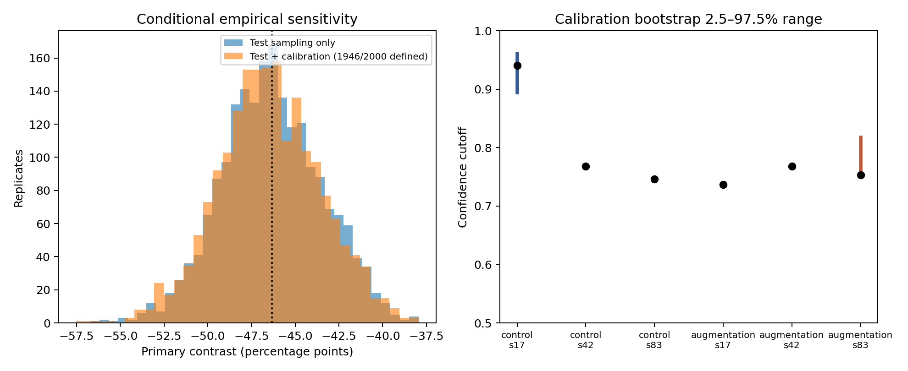
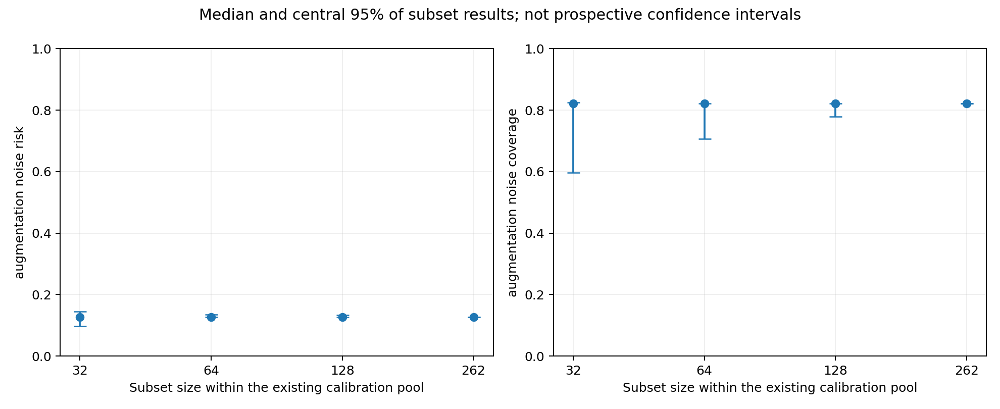

# Versuch 08 – Wie stabil ist die Kalibrierung?

Keine neuen Modelle. Die sechs Modelle aus dem Augmentationsvergleich bleiben unverändert. Neu ist, dass nicht nur die Testfälle, sondern auch die 262 Fälle zur Bestimmung der Annahmeschwellen variiert werden.

## Primärer Vergleich

Kennzahl wie in Versuch 07: Unterschied des Rauschen-minus-Original-Anstiegs der Fehlerrate unter akzeptierten Vorhersagen, Augmentation minus Kontrolle. Negative Werte sprechen unter dieser Regel für die Augmentation.

| Auswertung | Punktschätzer | Empirischer 2,5–97,5%-Bereich | Undefinierte Ziehungen |
|---|---:|---:|---:|
| Nur Testfälle variieren | -46.33 pp | [-51.96; -40.78] pp | 0 / 2000 |
| Test- und Kalibrierungsfälle variieren | -46.33 pp | [-52.47; -40.84] pp | 54 / 2000 |

Der feste Vergleich reproduziert die ursprüngliche Analyse aus Versuch 07 mit denselben Testziehungen. Die neue Analyse setzt in jeder Ziehung für alle Modelle gemeinsam dieselben gezogenen Kalibrierungsfälle ein und berechnet deren Schwellen neu. Modelle und deren Auswahl bleiben fest.

## Gleichstände an der Annahmeschwelle

| Arm | Seed | Schwelle | Kalibrierungsfälle genau auf der Schwelle | Tatsächlich akzeptiert im Kalibrierungssatz |
|---|---:|---:|---:|---:|
| control | 17 | 0.940302 | 0 / 262 | 79.8% |
| control | 42 | 0.768156 | 51 / 262 | 90.1% |
| control | 83 | 0.746400 | 51 / 262 | 93.9% |
| augmentation | 17 | 0.737013 | 51 / 262 | 90.1% |
| augmentation | 42 | 0.767968 | 50 / 262 | 90.5% |
| augmentation | 83 | 0.753490 | 47 / 262 | 93.1% |

Die Regel verwendet `confidence >= cutoff`. Große Gruppen identischer Konfidenz werden deshalb gemeinsam akzeptiert. Ein Zielwert von 80% ergibt nicht zwingend genau 80% Akzeptanz, selbst auf den Kalibrierungsfällen. Solche Punktmassen erschweren die gewöhnliche Deutung von Bootstrap-Perzentilen als nominal verlässliches 95%-Konfidenzintervall. Die Bereiche werden hier bewusst als empirische Sensitivitätsbereiche ausgewiesen.

## Weniger Kalibrierungsfälle

Je 500 Teilmengen der Größen 32, 64, 128 und 262 wurden ohne Zurücklegen aus dem vorhandenen Pool gezogen; ausgewertet wurde auf allen 621 Testrepräsentanten. Bei 262 ist die Variation definitionsgemäß null: Es handelt sich jedes Mal um denselben vollständigen Pool. Das ist kein Nachweis, dass 262 neue Patienten immer eine stabile Schwelle liefern.

## Nachweise

[Protokoll](CALIBRATION_PROTOCOL.md) · [Zusammenfassung aller Kennzahlen](../../reports/calibration/summary.json) · [Schwellen und Gleichstände](../../reports/calibration/thresholds.csv) · [Teilmengen-Ergebnisse](../../reports/calibration/subset_sensitivity.csv) · [PDF](../../reports/calibration/bootstrap_sensitivity.pdf).

Alle Kalibrierungsvorhersagen und gezogenen Indexlisten sind gespeichert. Reproduktion: `python experiments/calibration_study.py`. Verwendet die bestehenden Modellgewichte und das geprüfte 28px-Archiv; keine erneute Optimierung.

## Grenzen

Empirische Wiederziehungen ersetzen keine neue Klinik oder neue Patienten. Die Analyse bleibt bedingt auf sechs feste Modelle, einen bekannten Benchmark und Pixelgruppen. Sie enthält weder Trainings-/Modellwahlunsicherheit noch unbekannte Patientenkorrelation. Die Intervallbreite kann trotz zusätzlicher Variation auch kleiner werden, etwa durch diskrete Schwellen; eine einfache monotone „mehr Unsicherheit = breiter“-Interpretation ist nicht garantiert. Keine garantiert sichere Annahmeschwelle oder klinische Fehlerobergrenze wird abgeleitet.

## Leere Teilmengen sind kein Erfolg

Bei 54 der 2000 gemeinsamen Wiederziehungen ist der primäre Vergleich undefiniert, weil mindestens eine benötigte akzeptierte Teilmenge leer ist. Der angegebene gemeinsame Perzentilbereich beruht auf den übrigen 1946 Ziehungen und ist damit zusätzlich auf Definierbarkeit bedingt. Er darf nicht so gelesen werden, als hätte die Regel in allen Ziehungen funktioniert. Eine Regel, die keine Fälle akzeptiert, hat hier keine gemessene Fehlerrate von null.

[Aufschlüsselung nach Modell und Bedingung](../../reports/calibration/empty_subsets.csv). Die Zahl angenommener Fälle je Modell/Bedingung ist für jede Ziehung im Bootstrap-Archiv gespeichert.

## Methodische Konsequenz

Vor einer weiteren Modellvergrößerung sollte die Annahmeregel Gleichstände ausdrücklich behandeln. Eine mögliche nächste Untersuchung ist eine nur auf Kalibrierungsdaten bestimmte, zufällige Annahme eines Anteils der Grenzgruppe. Sie würde das Akzeptanzziel im Erwartungswert treffen, aber weder die Fehlerquote garantieren noch Verteilungsänderungen lösen. Die bisherige Regel wird hier nicht rückwirkend geändert.

Mit Kalibrierung ist in diesem Versuch die Festlegung der Annahmeschwelle gemeint, nicht eine nachträgliche Korrektur der Modellwahrscheinlichkeiten durch Temperature Scaling.

Zusätzliche Nachprüfung: `python experiments/verify_calibration.py` rechnet beide Varianten aller 2.000 Bootstrap-Ziehungen und sämtliche 2.000 Teilmengen-Auswertungen mit einer separaten skalaren Implementierung nach. [Prüfdatei](../../reports/calibration/verification.json).
