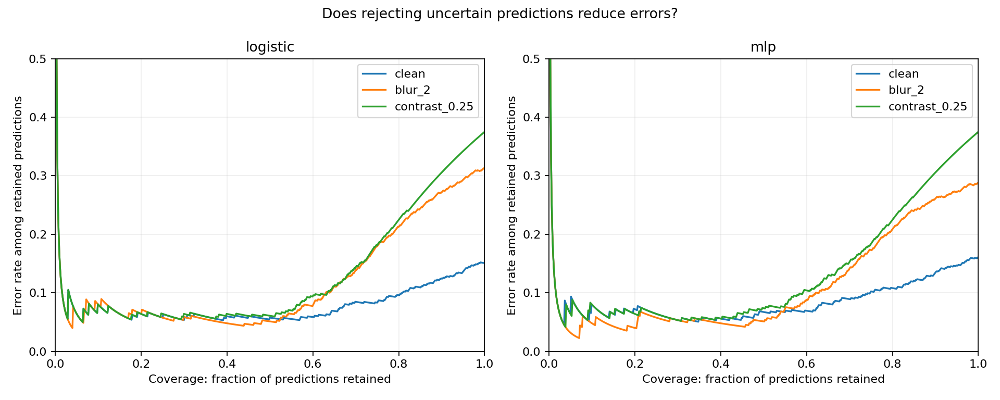

# Can uncertainty flag the model's mistakes?

The first pilot counted confident errors. That did not directly test whether uncertainty could distinguish a wrong prediction from a correct one. This follow-up does, using the saved models without retraining.

## What was tested

Error score = 1 − max(p, 1−p). Higher scores mean greater uncertainty. An error is the positive class for error-detection AUROC and average precision (AP); these are different from pneumonia-classification AUC. AUROC 0.5 corresponds to chance ranking. AP must be read alongside error prevalence.

A rejection threshold was set separately for each model at the 20th percentile of confidence on the original validation images. Predictions below that threshold are flagged for review. This targets approximately 80% validation coverage; test coverage is allowed to change. Neither the test labels nor corrupted test images were used to choose the threshold. Risk–coverage curves describe the whole ranking, not an independently selected operating point. Equal-confidence predictions are retained together.

This is an exploratory follow-up conducted after inspecting the pilot test results. It is not a preregistered confirmation or an untouched external test.

## Neural model results

| Condition | Error-detection AUROC | Errors flagged | Predictions retained | Error rate among retained |
|---|---:|---:|---:|---:|
| Original | 0.736 | 54.0% | 74.2% | 9.9% |
| Blur σ=2 | 0.828 | 68.3% | 69.1% | 13.2% |
| Contrast ×0.25 | 0.916 | 59.0% | 76.9% | 20.0% |

On original images, 161 predictions are flagged: 54 errors and 107 correct predictions. Of the 100 total errors, 46 remain unflagged. A review queue therefore catches some mistakes but has substantial cost and misses almost half of them.

Under strong contrast loss, the error ranking improves, yet accepted predictions still have a 20% error rate. There is no contradiction: relative ranking can remain informative while probabilities and a fixed threshold become unreliable. Here every classification is positive, so error ranking is largely a ranking of normal versus pneumonia cases. High error-detection AUROC alone is not proof of a useful safety mechanism.

The linear baseline's clean error-detection AUROC is 0.746, compared with 0.736 for the neural model. This small descriptive difference does not establish superiority: no paired model-comparison interval, repeated training or independent replication has been performed.

## Reproduce and inspect

Run `python experiments/error_detection.py` after the pilot. Full results for both models and all conditions are in `reports/metrics/error_detection.csv`. Thresholds and SHA-256 hashes of the weights are in `error_detection.json`. The existing prediction archive contains every test probability and label.

Six unit tests cover metric denominators, perfect and reversed error rankings, undefined cases and tied confidence. These validate calculations, not clinical effectiveness. This follow-up has no uncertainty intervals yet; the point estimates must not be interpreted as confirmed differences.

## What remains unanswered

The model does not introspect or explain its mistakes. We use its probability output as a warning signal and compare that signal with known labels offline. Repeated training, uncertainty intervals for detection metrics, validation-only calibration, clinically plausible corruptions and external data are still required. Confidence cannot establish whether a new patient's label is correct.
