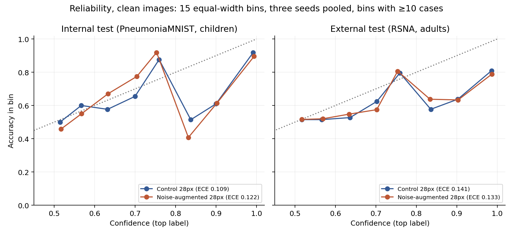
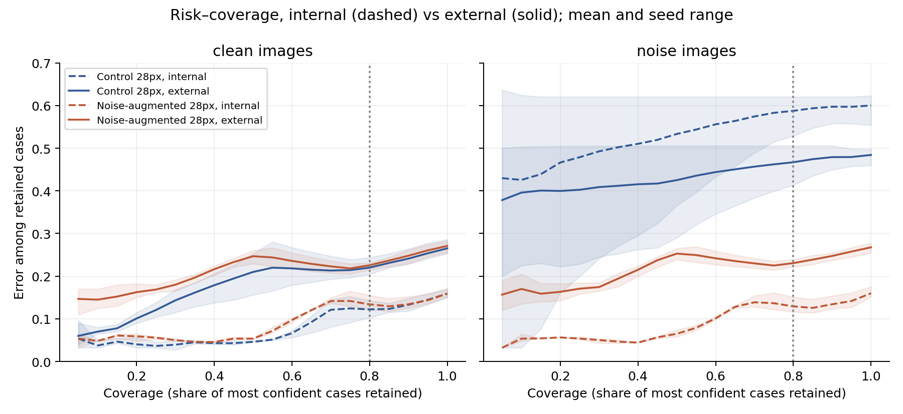

# Externer Test auf RSNA-Thoraxaufnahmen Erwachsener

Explorativ, Stand 10. November 2026. Protokoll vor der Auswertung festgelegt: [PROTOCOL.md](PROTOCOL.md). Eingefrorene 28px-CNNs aus Versuch 07 (Kontrolle vs. Rauschaugmentation, je drei Seeds) mit ihren unveränderten Annahmeschwellen (Ziel: 80 % Akzeptanz auf den Kalibrierungsdaten). Kein Training, keine neuen Schwellen.

**Daten.** 2.000 Bilder aus der RSNA Pneumonia Detection Challenge (überwiegend Erwachsene, Labels von Radiologen-Panels; Bilder aus NIH ChestX-ray14): 1.000 `Lung Opacity` (positiv) und 1.000 `Normal` (negativ), mit festem Seed gezogen, eine Aufnahme pro Patient-ID ([Liste](../../configs/external_rsna_sample.csv)). Dazu getrennt 500 `No Lung Opacity / Not Normal`. Vorverarbeitung wie bei PneumoniaMNIST: Mittelzuschnitt, Bicubic auf 28×28.

| Clean, Mittel über 3 Seeds [95%-Bootstrap] | Kontrolle intern | Kontrolle extern | Augmentiert intern | Augmentiert extern |
|---|---:|---:|---:|---:|
| Accuracy | 84,1 % [81,3; 86,7] | 73,5 % [71,8; 75,2] | 84,1 % [81,3; 86,7] | 72,9 % [71,1; 74,7] |
| AUROC | 0,941 [0,918; 0,960] | 0,820 [0,802; 0,838] | 0,926 [0,900; 0,947] | 0,804 [0,785; 0,823] |
| ECE (15 Bins) | 0,109 [0,092; 0,135] | 0,141 [0,129; 0,156] | 0,122 [0,106; 0,150] | 0,133 [0,121; 0,150] |
| Annahmerate (feste Schwelle) | 78,5 % [75,7; 81,3] | 69,8 % [68,0; 71,3] | 82,2 % [79,4; 84,8] | 75,2 % [73,6; 76,7] |
| Fehler unter akzeptierten Fällen | 11,2 % [8,8; 13,8] | 20,6 % [18,7; 22,5] | 13,0 % [10,5; 15,9] | 21,8 % [19,8; 23,7] |

Primärer externer Vergleich (Fehler unter akzeptierten Fällen, clean, augmentiert minus Kontrolle): **+1,2 pp [+0,4; +1,9]**. Unter Rauschen (SD 0,1) extern: Kontrolle 45,6 % [43,3; 47,8], augmentiert 22,5 % [20,5; 24,5] Fehler unter akzeptierten Fällen (Differenz −23,1 pp [−26,3; −19,9]); intern waren es 57,0 % vs. 12,6 %.

**Befund.** Beim Wechsel vom internen Test (PneumoniaMNIST, pädiatrische Guangzhou-Aufnahmen) auf den externen RSNA/NIH-Test verdoppelt sich etwa der Fehler unter akzeptierten Fällen (≈11–13 % → ≈21–22 %). Dieser Rückgang betrifft einen Datensatz- und Populationswechsel — andere Population, Aufnahme, Vorverarbeitung und Labeldefinitionen — und ist nicht nachgewiesen allein durch den Wechsel von Kindern zu Erwachsenen. Die Schwelle lehnt extern zwar mehr ab (Annahme ≈70–75 % statt ≈80 %), fängt den Einbruch aber nicht auf. Bei 80 % Abdeckung ist das externe Risiko etwa doppelt so hoch wie das interne. Nur die Kontrollmodelle kommen bei sehr geringer Abdeckung (≤ 10 %) wieder in die Nähe des internen Niveaus (Risk-Coverage-Abbildung). Der Nutzen der Rauschaugmentation überträgt sich auf verrauschte externe Bilder, bringt auf sauberen externen Bildern aber keinen Vorteil. Von den 500 `Not Normal`-Fällen stufen die Modelle ≈64 % als Pneumonie ein; unter den akzeptierten davon sind ≈73–75 % falsch. Andere Auffälligkeiten werden also selbstsicher als Pneumonie gelesen. Alle Bedingungen: [conditions.png](conditions.png), [results.csv](results.csv), [summary.json](summary.json).

**Aufnahmerichtung (explorativ).** In der Primärstichprobe sind 964 AP- und 1.036 PA-Aufnahmen. Die Klassenanteile unterscheiden sich stark: AP 766 `Lung Opacity` / 198 `Normal` (Prävalenz 79,5 %), PA 234 / 802 (22,6 %). Kennzahlen mit Intervall stammen aus einer nachträglichen, innerhalb der Aufnahmeart gezogenen Bootstrap-Auswertung der gespeicherten Vorhersagen ([stratified_view.json](stratified_view.json), [Abbildung](stratified_view.png)).

| Clean, Mittel über 3 Seeds [95%-Bootstrap] | Kontrolle AP | Kontrolle PA | Augmentiert AP | Augmentiert PA |
|---|---:|---:|---:|---:|
| Accuracy | 81,7 % [79,5; 83,9] | 65,8 % [63,0; 68,5] | 81,0 % [78,6; 83,1] | 65,4 % [62,7; 68,1] |
| AUROC (innerhalb der Aufnahmeart) | 0,818 [0,786; 0,849] | 0,725 [0,687; 0,760] | 0,804 [0,770; 0,837] | 0,721 [0,682; 0,756] |
| Sensitivität | 87,8 % [85,6; 89,8] | 67,7 % [61,9; 72,8] | 86,8 % [84,6; 88,9] | 66,7 % [60,9; 71,9] |
| Spezifität | 58,2 % [52,2; 64,5] | 65,3 % [62,3; 68,2] | 58,2 % [52,1; 64,4] | 65,1 % [62,1; 68,2] |
| Annahmerate | 75,7 % [73,5; 77,6] | 64,3 % [61,7; 66,8] | 79,8 % [77,8; 81,9] | 70,8 % [68,6; 73,1] |
| Fehler unter akzeptierten Fällen | 11,9 % [9,8; 14,0] | 30,1 % [27,0; 33,6] | 12,7 % [10,5; 14,9] | 31,3 % [28,1; 34,6] |

Die 64px-Kontrolle liegt nahe bei den 28px-Werten (Accuracy 81,9 % [79,5; 84,0] gegen 64,9 % [62,2; 67,6]; Fehler unter akzeptierten Fällen 11,8 % [9,7; 14,1] gegen 30,9 % [27,8; 34,4]). Die niedrigere Accuracy bei PA ist zum Teil durch die andere Prävalenz erklärbar. Auch die AUROC innerhalb der jeweiligen Aufnahmeart ist bei PA niedriger (Kontrolle, AP minus PA: +0,093 [+0,045; +0,141]). Das spricht gegen eine reine Prävalenzerklärung, beweist aber keinen Aufnahmeart-Shortcut: Fallmix, Schweregrad, Bildqualität und andere Aufnahmeunterschiede bleiben Alternativen. Die AP/PA-Unterschiede begründen eine Untersuchung möglicher Abhängigkeiten, mehr nicht.

**Grenzen.** Der Vergleich vermengt Datensatz und Population; ein isolierter Alterseffekt ist nicht gezeigt. `Lung Opacity` ist nur ein Stellvertreter für Pneumonie, und die Labels sind verrauscht. Die Auflösung beträgt 28×28. Die MedMNIST-Interpolation ist nicht dokumentiert (Bicubic angenommen). 131 Bilder stammen von Personen unter 18 Jahren; die Auswertung nur mit Erwachsenen ändert wenig (`external_adult` in `results.csv`). Die Patient-IDs sind nicht mit NIH-Patienten verknüpft. Die Intervalle gelten bedingt auf feste Modelle und Schwellen. Die Bilder stammen aus einem inoffiziellen Hugging-Face-Spiegel (Revision fixiert, Prüfsummen geprüft). Es gibt keinen klinischen Anspruch.

**Daten und Lizenz.** RSNA Pneumonia Detection Challenge (2018), Shih et al., *Radiology: AI* 2019, [doi:10.1148/ryai.2019180041](https://doi.org/10.1148/ryai.2019180041); zugrunde liegende Bilder: NIH ChestX-ray14, Wang et al., CVPR 2017, NIH Clinical Center. Die RSNA-Nutzungsbedingungen erlauben laut dem amtlichen Text akademische, Lehr- sowie andere kommerzielle oder nicht-kommerzielle Zwecke, gebunden an ein Identifizierungsverbot und an vorgeschriebene Quellenangaben bei Weitergabe. Die Rohbilder werden nicht im Repository verteilt. Einzelheiten, Zitate und ungeprüfte Punkte (Kaggle-Regeln, NIH-Primärtext, Rechte des Spiegels): [docs/DATA_LICENSE_EXTERNAL.md](../../docs/DATA_LICENSE_EXTERNAL.md). Das ist keine rechtliche Feststellung.

**Reproduzieren.** `python experiments/external_data.py` lädt etwa 340 MB, ohne Login. Danach `python experiments/external_eval.py` (etwa 1 Minute auf der CPU). Die AP/PA-Auswertung aus gespeicherten Vorhersagen: `python experiments/external_stratify.py`. Tests: `python -m unittest tests.test_external tests.test_external_stratify`.
