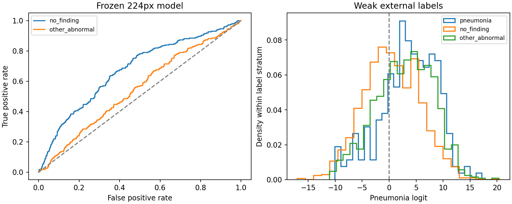

# Externer Transfer des unveränderten 224px-Modells

Primäre AUROC gegen No-finding-Kontrollen: **0.673 [0.636; 0.710]**. Das ist ein NIH-abgeleiteter Transferbenchmark mit textbasierten Labels, keine klinische Validierung des 512px-Modells.

## Daten und Trennung

Das offizielle ChestMNIST224-Testarchiv umfasst 22,433 Bilder. Exakte 224px-Pixelduplikate werden durch den ersten Repräsentanten ersetzt; bei widersprüchlichen vollständigen Labelvektoren wird die gesamte Hashgruppe ausgeschlossen. Verblieben: 22,430 Bilder; 2 Duplikatpaare, 1 widersprüchliche Hashgruppen.
Alle 242 verbleibenden Pneumonie-Label-positiven Bilder werden verwendet, darunter 183 mit zusätzlichen Labels. Mit festem Seed wurden 2000 No-finding-Kontrollen und 1000 Kontrollen mit anderen Labels ausgewählt, ohne Modellvorhersagen zu betrachten.

Das [Protokoll](../../configs/external_chest224.json) wurde vor Inferenz festgeschrieben. Der originale MobileNet224-Encoder und der bereits gelernte lineare Kopf bleiben unverändert. Die Rekonstruktion reproduziert 16 interne Referenzlogits. Native 224px-Eingaben werden direkt normalisiert; keine Hochskalierung als vermeintliche 512px-Information. Klassifikationsschwelle 0,5, Konfidenzschwelle aus der früheren internen Kalibrierung. Kein Training, keine externe Kalibrierung und keine Test-basierte Modellwahl.

## Ergebnisse

| Kontrollgruppe | AUROC [95 %] | Sensitivität | Spezifität | Accuracy | Fehler bei 80 % Abdeckung |
|---|---:|---:|---:|---:|---:|
| no_finding | 0.673 [0.636; 0.710] | 78.9 % | 47.5 % | 50.9 % | 49.3 % |
| other_abnormal | 0.548 [0.510; 0.590] | 78.9 % | 29.5 % | 39.1 % | 62.9 % |

Bei der unveränderten internen Konfidenzschwelle werden im primären Vergleich 38.8 % der Fälle akzeptiert. Unter diesen liegt die Fehlerquote bei **52.1 %**, gegenüber 49.1 % über alle Fälle. Die interne Ablehnungsregel liefert auf dieser Stichprobe damit keine verlässliche Fehlerreduktion. Auch die mittlere Modellkonfidenz von 90.5 % ist keine bestätigte individuelle Erkrankungswahrscheinlichkeit.



2.000 labelstratifizierte Bild-Bootstraps pro Vergleich, bei festem Modell. Patientenkennungen fehlen im NPZ: Abhängigkeiten mehrerer Aufnahmen können die Intervalle zu eng machen. Die Intervalle sind keine klinischen oder patientenvalidierten Unsicherheitsgrenzen. Alle weiteren Kennzahlen, insbesondere NLL und Abdeckung bei fester Konfidenzschwelle, stehen in [results.csv](results.csv).

## Grenzen

- No finding bedeutet einen vollständig leeren Textlabel-Vektor, nicht unabhängig bestätigte Gesundheit. Andere Erkrankungen und zusätzliche Pneumonie-Tags können sich überlagern.
- Extern gegenüber der Kermany-Trainingsquelle; NIH kann sich jedoch mit historischen RSNA-Projekttests überschneiden. Keine Behauptung vollständig neuer Patienten oder einer neuen unabhängigen Klinik.
- Labelqualität, Alters-/Patientenpopulation, Bildgeometrie und Quelle unterscheiden sich gleichzeitig; die Analyse isoliert keine Fehlerursache.
- Fallkontrollartige Stichprobe: Accuracy, NLL, Präzision und Akzeptanzfehler beschreiben diese Stichprobe, keine Zielpopulation.
- Native 224px-Daten prüfen den 224px-Ausgangspunkt. Die unabhängige klinische 512px-Prüfung bleibt offen.

## Nachrechnung und Quellen

[Stichprobe und Ausschlüsse](sampling.json), [Vorhersagen](predictions.npz), [Intervalle und Herkunft](summary.json), [unabhängige Kennzahlenprüfung](verification.json), [unabhängige Stichprobenprüfung](sampling_verification.json). Die Prüfer rekonstruieren alle 4.000 vollständigen Bootstrapziehungen sowie die Auswahl aus sämtlichen offiziellen Testbildern.

```bash
python scripts/fetch_external_chest224.py
python experiments/external_chest224.py
python scripts/verify_external_chest224.py
python scripts/verify_external_chest224_sample.py
python scripts/report_external_chest224.py
python scripts/report_pipeline_transfer.py
```

Der Erzeuger überschreibt keine vorhandene Ergebnisstudie; für Wiederholungen eine separate Arbeitskopie verwenden. [Zweiseitige Forschungsnotiz](research_note.pdf) verbindet diese Auswertung mit der [512px-Vorverarbeitungsanalyse](../original_512/preprocessing/README.md).

Quelle: [offizielles Zenodo-Archiv](https://zenodo.org/records/10519652), MD5 `45bd33e6f06c3e8cdb481c74a89152aa`. Attribution: Yang et al., MedMNIST v2, Scientific Data (2023), doi:10.1038/s41597-022-01721-8; Wang et al., ChestX-ray8, CVPR (2017), NIH ChestX-ray14. Laut offizieller ChestMNIST-Metadatei CC BY 4.0; [Lizenz- und Zugangsprüfung](../../docs/LICENSING.md). Rohbilder bleiben lokal. Code und Analyse mit KI-Assistenz.
