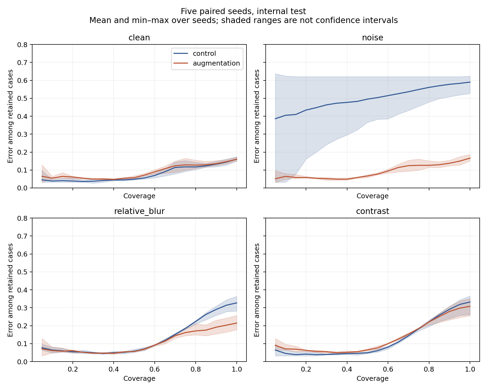

# Fünf gepaarte Seeds: Replikation des Augmentationseffekts

Explorative Erweiterung vom 10. November 2026. Zu den historischen Seeds 17, 42 und 83 kommen die vor dem Training festgelegten Seeds 123 und 2026 hinzu, jeweils Kontrolle und Augmentation. Keine Auswahl nach Testergebnis. Architektur, Daten-Splits, Modellwahlregel und 45-Epochen-Budget bleiben unverändert. Externe Modelle und Ergebnisse wurden nicht erweitert.

## Primärer Kontrast

Unterschied des Rauschen-minus-clean-Anstiegs der akzeptierten Fehlerrate, Augmentation minus Kontrolle. Negative Werte sprechen unter der bestehenden Annahmeregel für Augmentation.

| Seed | Kontrolle clean | Kontrolle Rauschen | Augmentation clean | Augmentation Rauschen | Primärer Kontrast |
|---|---:|---:|---:|---:|---:|
| 17 | 8.1% | 47.8% | 12.2% | 11.9% | -40.0 pp |
| 42 | 11.8% | 61.3% | 12.1% | 11.5% | -50.1 pp |
| 83 | 13.6% | 62.1% | 14.8% | 14.3% | -48.9 pp |
| 123 | 11.3% | 38.5% | 8.9% | 9.3% | -26.9 pp |
| 2026 | 8.2% | 61.3% | 10.0% | 10.6% | -52.5 pp |

Mittel über alle fünf Paare: **-43.67 pp**. Alle fünf Kontraste sind negativ. Historische drei Seeds: -46.33 pp; zusätzliche zwei Seeds: -39.67 pp.

## Zwei getrennte Unsicherheitsquellen

- **Trainingsvariation:** approximatives 95%-t-Intervall über fünf gepaarte Seed-Kontraste: [-56.71; -30.63] pp, 4 Freiheitsgrade. Nur fünf Beobachtungen, näherungsweise Normalverteilung angenommen; feste Daten und Protokolle.
- **Testfallvariation:** 2.000 gepaarte Wiederziehungen von Testrepräsentanten bei zehn festen Modellen und Schwellen: [-48.97; -38.01] pp. Keine Trainingsunsicherheit.

Diese Intervalle sind weder austauschbar noch eine gemeinsame Schätzung von Trainings- und Patientenunsicherheit. Die fünf Modelle pro Arm teilen Daten und Architektur. Der bekannte Benchmark bleibt explorativ.

## Alle Bildbedingungen

| Arm / Bedingung | Accuracy | Akzeptanz | Fehler unter akzeptierten Fällen |
|---|---:|---:|---:|
| control / clean | 83.9% | 77.5% | 10.6% |
| control / noise | 41.0% | 84.3% | 54.2% |
| control / relative_blur | 67.3% | 85.3% | 26.7% |
| control / contrast | 66.8% | 80.7% | 23.8% |
| augmentation / clean | 84.0% | 77.3% | 11.6% |
| augmentation / noise | 83.4% | 76.9% | 11.5% |
| augmentation / relative_blur | 78.5% | 75.8% | 15.3% |
| augmentation / contrast | 69.2% | 78.6% | 21.2% |

Mittel über fünf Seeds. Die Auswahlmengen unterscheiden sich zwischen Modellen; Annahmequoten sind daher mit den Fehlerraten zu lesen.



Schattierung: Minimum–Maximum der Seed-Kurven, keine Konfidenzintervalle. Vier Bedingungen auf derselben Skala.

## Reproduzieren

```bash
python scripts/fetch_data.py
python experiments/resolution_study.py --config configs/five_seed_control.json --output /tmp/five-seed-control --models /tmp/five-seed-control-models
python experiments/resolution_study.py --config configs/five_seed_augmentation.json --output /tmp/five-seed-augmentation --models /tmp/five-seed-augmentation-models
python experiments/five_seed_analysis.py --output /tmp/five-seed-analysis
```

Die ersten beiden Trainingsbefehle reproduzieren neue Läufe in getrennten Ordnern. Das Analyseskript liest die versionierten historischen und neuen Ergebnisse an ihren Repository-Pfaden; der letzte Befehl rechnet diese gespeicherten Ergebnisse nach. Es führt kein neues Training aus. Die Modelle und Vorhersagen wurden mit den festgeschriebenen Versionen aus `requirements.txt` und CPU-PyTorch 2.5.1 berechnet. [Softwarestand](environment.json).

[Vorab festgelegter Plan](../../configs/five_seed_protocol.json) · [Zusammenfassung und Quellen-Prüfsummen](analysis/summary.json) · [Seed-Kontraste](analysis/per_seed.csv) · [Alle Kennzahlen](analysis/results.csv). Die Erweiterung ersetzt weder einen externen Test noch den noch offenen Vergleich mit einer zweiten Architektur.
