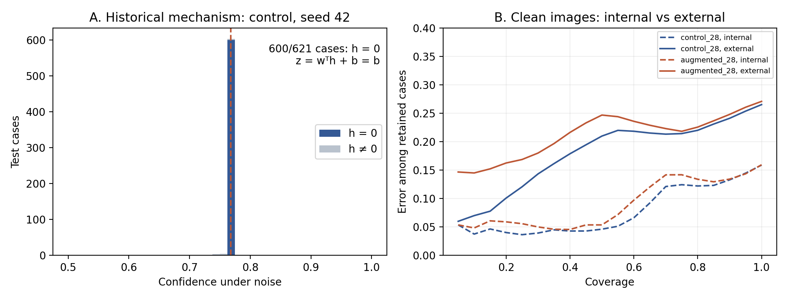
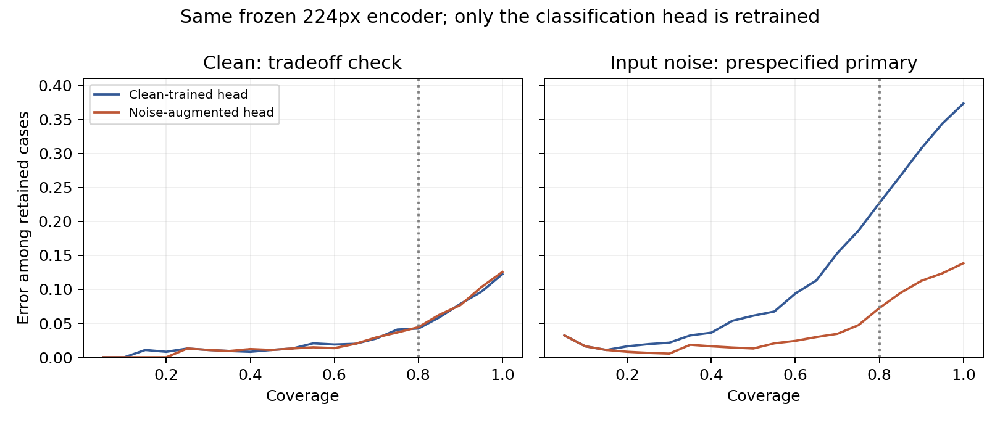

# Konfidenz unter Bildstörungen und Datensatzwechsel

Medical AI Reliability Lab · Explorative Forschungsnotiz · 10. November 2026 · Kein begutachteter Fachartikel

## Zusammenfassung

Fragestellung: Wann versagt konfidenzbasierte Ablehnung bei kleinen medizinischen Bildklassifikatoren, und welche Verbesserungen tragen über die untersuchte Störung hinaus? Die Studie verbindet einen mechanistischen Befund auf PneumoniaMNIST, einen kontrollierten Augmentationsvergleich und einen externen Test auf einer fixierten RSNA-Stichprobe.

Zwei zusätzliche, vor dem Training festgelegte Seeds erweitern den internen Vergleich auf fünf Seed-Paare. Der Unterschied des Fehleranstiegs unter Rauschen gegenüber clean, Augmentation minus Kontrolle, beträgt -43.7 Prozentpunkte. Alle fünf Paare zeigen dieselbe Richtung; das approximative 95%-Intervall über Seed-Paare beträgt [-56.7; -30.6] Prozentpunkte.

Extern steigt die akzeptierte Fehlerrate der ursprünglichen 28px-Kontrolle von 11,2 % auf 20,6 %, bei sinkender Akzeptanz von 78,5 % auf 69,8 %. Rauschaugmentation bietet im vorab definierten Vergleich auf unveränderten externen Bildern keinen Vorteil. Aufnahmeart und Label sind in der Stichprobe stark verknüpft.

Ergänzender Auflösungsvergleich: Ein eingefrorenes ImageNet-ResNet-18 mit trainierter linearer Klassifikationsschicht erhält dieselben Fälle mit 224×224-Information oder auf 28×28 reduzierter Information. Die Test-AUROC beträgt 0.980 gegenüber 0.960; gepaarte Differenz +0.019 [+0.009; +0.032]. Dies prüft Bildinformation unter einem gemeinsamen Encoder, keine klinische Vollauflösung. Unter Eingangsrauschen steigt die akzeptierte Fehlerrate des 224px-Modells jedoch auf 35,6 % bei 96,8 % Akzeptanz; der clean-Vorteil bedeutet keine allgemein höhere Rauschresistenz.

Gezielte Intervention: Ein neuer linearer Kopf mit gleich gewichtetem clean-/Rauschtraining senkt bei unverändertem 224px-Encoder das Risiko unter Testrauschen bei 80 % Abdeckung von 22.7% auf 7.2%. Differenz -15.5 pp [-19.3; -11.8]. Zwei weitere Testrausch-Seeds bestätigen die Richtung; Unschärfe bleibt ein Gegenbeispiel für allgemeine Zuverlässigkeit.

Temperature Scaling, ausschließlich intern auf clean-Kalibrierungsbildern angepasst, erhöht die Test-NLL der Kontrolle von 0.505 auf 0.585. Die Konfidenz-Rangfolge bleibt bei positiver Temperatur unverändert. Bessere Fit-Kalibrierung garantiert weder Test-Kalibrierung noch bessere Fehlererkennung.

## Beitrag und Reichweite

Der Beitrag ist eine nachvollziehbare Verbindung aus konkretem Bias-only-Mechanismus, dokumentierten Grenzen einer Ablehnungsregel und getrennt ausgewiesenen Unsicherheitsquellen. Das Ergebnis ist kein klinischer Sicherheitsnachweis. Niedrige Auflösung, bekannte Testdaten, unklare Patientenunabhängigkeit und offene Rechte des externen Datenspiegels begrenzen die Aussagekraft.

Aufbau: Methoden (S. 2), Mechanismus und externe Übertragung (S. 3), Kalibrierung und Fallmix (S. 4), Auflösung und Intervention (S. 5), Grenzen, Nachprüfbarkeit und Quellen (S. 6).

---

# Methoden und Trennung der Auswertungen

## Daten und Splits

PneumoniaMNIST enthält pädiatrische Thoraxaufnahmen. Nach gemeinsamer Pixel-Deduplizierung über die geprüften Auflösungen werden 4.682 Trainingsfälle, 262 Modellwahlfälle, 262 getrennte Kalibrierungsfälle und 621 Testrepräsentanten verwendet. Pixelidentität ist kein Patientenidentifikator. Frühere Auswertungen desselben Benchmarks machen spätere Analysen explorativ.

Der externe Test umfasst 2.000 RSNA-Bilder: 1.000 Lung Opacity und 1.000 Normal, fixierter Stichprobenseed und eine Aufnahme pro RSNA-ID. Zusätzlich wurden 500 No Lung Opacity / Not Normal getrennt untersucht. Die Stichprobe ist überwiegend erwachsen, enthält jedoch Minderjährige. Lung Opacity ist keine gesicherte Pneumoniediagnose; verschiedene IDs können ohne NIH-Zuordnung nicht als verschiedene Personen garantiert werden.

## Modelle und Intervention

Das 28px-CNN hat 21.249 Parameter. Kontrolle und Augmentation verwenden dieselbe Architektur, Splits, Adam-Lernrate 0,001, Batchgröße 128 und 45 Epochen. Der niedrigste Modellwahlverlust bestimmt den Checkpoint. Rauschaugmentation betrifft 50 % der Trainingsbilder mit Gaußrauschen SD 0,1; Werte werden auf [0,1] begrenzt. Zu Seeds 17, 42 und 83 kommen 123 und 2026 hinzu. Extern bleiben ausschließlich die ursprünglichen drei Seeds pro Arm und die damaligen Schwellen eingefroren.

Testbedingungen: clean, Gaußrauschen SD 0,1, Gaußunschärfe Sigma 1 bei 28px, Kontrastreduktion auf die Hälfte um 0,5. Die 64px-Kontrolle des externen Tests ist keine zweite Architektur. Ein ergänzender eingefrorener ResNet-18-Encoder wird auf S. 5 untersucht; kein medizinisches End-to-End-Training.

## Endpunkte und Unsicherheit

Konfidenz ist max(p,1−p). Die Annahmeschwelle ist das linear interpolierte 20%-Quantil der clean-Kalibrierungskonfidenz; Werte auf der Schwelle werden akzeptiert. Akzeptierte Fehlerrate wird zusammen mit Abdeckung berichtet. Risk-Coverage verwendet anteilige Grenzgruppen bei Gleichständen.

Bild-Bootstrap und Seed-Streuung werden getrennt berichtet: 2.000 gekoppelte Testwiederziehungen bei festen Modellen versus ein approximatives t-Intervall über fünf gepaarte Seed-Kontraste. AP/PA-Intervalle ziehen innerhalb Aufnahmeart×Label. Keines dieser Verfahren erfasst unbekannte Patientenkorrelation oder allgemeine klinische Unsicherheit.

---

# Mechanismus und externer Test

Abbildung 1. Links: historischer Kontrollseed 42 unter Rauschen; 600 von 621 Fällen haben einen Nullvektor in der letzten ReLU-Repräsentation. Rechts: Risk-Coverage auf clean-Bildern, Mittel der drei historischen Seeds; interne Kurven gestrichelt, externe durchgezogen. Dies sind unterschiedliche Analysen: Der linke Einzelfallmechanismus erklärt nicht sämtliche externen Fehler.

## Was mechanistisch nachgewiesen ist

Für die letzte lineare Schicht gilt z = wᵀh + b. Bei h = 0 folgt exakt z = b, also ein konstanter Output innerhalb dieser Aktivierungsgruppe. Die betroffenen Bias-Werte liefern die Klasse normal, nicht die Mehrheitsklasse. Eine inklusive Quantilschwelle kann eine ganze Punktmasse akzeptieren. Nichtleere Repräsentationen garantieren umgekehrt keine zuverlässige Vorhersage.

## Was der externe Vergleich zeigt

Die 28px-Kontrolle erreicht extern 73,5 % Accuracy, AUROC 0,820 und ECE 0,141. Ihre akzeptierte Fehlerrate beträgt 20,6 % [18,7; 22,5] bei 69,8 % Akzeptanz. Die Augmentation erreicht 21,8 % akzeptierte Fehler bei 75,2 % Akzeptanz. Der vorab festgelegte primäre Unterschied ist +1,2 Prozentpunkte [+0,4; +1,9], Augmentation minus Kontrolle.

Unter externem synthetischem Rauschen beträgt die akzeptierte Fehlerrate 45,6 % ohne und 22,5 % mit Augmentation. Ein Nutzen gegen dieselbe Störung überträgt sich damit, ein Vorteil auf unveränderten externen Bildern nicht. Alter, Fallmix, Aufnahmebedingungen und Labeldefinition ändern sich gleichzeitig; die Verschlechterung darf nicht allein dem Alterswechsel zugeschrieben werden.

---

# Wahrscheinlichkeitskalibrierung und Fallmix

## Temperature Scaling

Pro eingefrorenem 28px-Modell wird eine positive Temperatur innerhalb [0,05; 20] durch Minimierung der binären NLL auf 262 clean-Kalibrierungsfällen angepasst. Testbilder beeinflussen den Fit nicht. Alle sechs Temperaturen liegen zwischen 0,579 und 0,986 und schärfen die Wahrscheinlichkeiten. Keiner der Fits liegt an einer Grenze.

Kontrolle, clean: NLL 0.505 → 0.585; Differenz +0.080, gepaarter Test-Bootstrap [+0.056; +0.108]. Die NLL steigt in allen acht Arm/Bedingung-Kombinationen. ECE auf clean sinkt leicht, aber ihre Differenzintervalle umfassen null. Die Intervalle konditionieren auf die angepassten Temperaturen und umfassen keine Fit-Unsicherheit.

Eine nachfolgende Sensitivitätsanalyse zieht Kalibrierungs- und Testfälle gemeinsam neu und passt alle Temperaturen erneut an. Der zentrale 95%-Bereich der clean-NLL-Differenz beträgt bei Kontrolle [−0,022; +0,346] und bei Augmentation [+0,009; +0,765]. Die Einbeziehung des Fits relativiert den konditionalen Befund insbesondere bei der Kontrolle. Dies sind empirische Bereiche unter festen Modellen, keine klinischen Garantien.

Positive Temperatur erhält die Ordnung nach absolutem Logit und die binäre Entscheidung. Bei entsprechend transformierter Schwelle bleibt dieselbe Menge akzeptiert. Ein Kalibrierungsverfahren kann daher die Wahrscheinlichkeitsskala verändern, ohne die Risk-Coverage-Kurve zu verbessern. Für eine erneute externe NLL-Auswertung fehlen exakte externe Logits; gesättigte gespeicherte Float32-Wahrscheinlichkeiten werden nicht als exakte Logits ausgegeben.

## AP/PA und Labelverteilung

AP umfasst 964 Fälle (766 positiv, 198 negativ), PA 1.036 Fälle (234 positiv, 802 negativ). Die Positivanteile betragen 79,5 % beziehungsweise 22,6 %. Die akzeptierte Fehlerrate der 28px-Kontrolle ist zunächst 11,9 % bei AP und 30,1 % bei PA.

Bei gleicher Gewichtung beider Klassen innerhalb jeder Ansicht beträgt der Risikoabstand PA minus AP nur noch +4.1 Prozentpunkte [-1.0; +9.7]. Das Intervall umfasst null, beweist aber keine Gleichwertigkeit. Standardisierte akzeptierte Fehler werden als Verhältnis gewichteter Fehler und Akzeptanz berechnet; sie sind keine klinische Risikoabschätzung.

Eine nach Sichtung gewählte Regel AP → positiv, PA → negativ erreicht 78,4 % Accuracy ohne Bildpixel. Das ist eine deskriptive Fallmix-Baseline, kein unabhängig validiertes Modell und kein Beweis dafür, dass die CNNs einen Aufnahmeart-Shortcut verwenden.

---

# 224px: Verbesserung und Grenzen

Auflösungsvergleich: Das offizielle 224px-Archiv wird mit derselben auf 28px reduzierten Bildinformation verglichen, jeweils als 224px-Eingabe desselben eingefrorenen ImageNet-ResNet-18. Trainiert wird eine standardisierte logistische Klassifikationsschicht, C-Auswahl nur auf clean-Modellwahlfällen. Alle Fälle und Splits bleiben gleich. AUROC: 0,980 vs. 0,960; gepaarte Differenz +0,019 [0,009; 0,032]. Dies ist keine klinische Vollauflösung.

Der clean-Vorteil schützt nicht vor Störungen: Das ursprüngliche 224px-Modell akzeptiert unter Eingangsrauschen 96,8 % bei 35,6 % Fehlern. Ein scheinbarer Vorteil des 28px-Zweigs bei Quellrauschen enthält Filterung durch Verkleinerung (RMSE 0,0095 statt 0,0993). Beide Rauschpositionen wurden separat geprüft; Encoder, Köpfe und Schwellen blieben dabei fest.

Intervention: Jede der 4.682 Trainingsaufnahmen liefert clean- und Rauschmerkmale, jeweils mit Gewicht 0,5; Gesamtgewicht und ursprünglicher StandardScaler bleiben erhalten. Nur ein neuer linearer Kopf wird gelernt. Auswahl aus C ∈ {0,01; 0,1; 1; 10} nach clean-Modellwahl-NLL, Schwelle nur aus clean-Kalibrierung. Trainingsseed 20261116 unterscheidet sich von den Testseeds 42, 7 und 99. Es sind dieselben Testfälle, keine drei unabhängigen Kohorten.

Primär unter Testrauschen Seed 42 bei 80 % Abdeckung: -15.46 pp [-19.28; -11.84], Augmentation minus Kontrolle. Clean: +0.20 pp [-1.05; +1.01], kein Nichtunterlegenheitsnachweis. Beide alternativen Rausch-Seeds zeigen ebenfalls geringere Risiken; alle Intervalle sind auf ausgewählte Modelle bedingt.

Post-hoc-Kontrolle der Regularisierung: Der primäre Vergleich verwendete clean-gewählte C-Werte 0,01 und 0,1. Bei gleichem C bleibt der Rauschgewinn bestehen: -14.7 pp bei C=0,01 und -22.1 pp bei C=0,1; beide bedingten Intervalle liegen unter null. Dies ist eine Sensitivitätsanalyse, kein unabhängiger Bestätigungstest.

Abbildung 2. Neue Intervention, beide Modelle mit 224px-Information. Die Verbesserung gilt nicht allgemein: Unter Unschärfe akzeptiert der augmentierte Kopf 99,5 % der Fälle, davon 37,4 % falsch. Bei gleicher 80%-Abdeckung betragen die Blur-Risiken 24,7 % vs. 26,0 %; die unterschiedliche feste Annahmemenge erklärt den scheinbaren Gegensatz. Die Analyse betrifft einen eingefrorenen Encoder und eine Trainingsrausch-Realisierung, kein End-to-End-Training oder externen Transfer.

---

# Grenzen, Nachprüfbarkeit und Werkzeuge

## Was offen bleibt

Die Studie ist explorativ und nutzt einen wiederholt untersuchten Benchmark mit niedriger Auflösung. Synthetische Störungen repräsentieren keine vollständige reale Aufnahmepipeline. Die fünf Seeds sind endlich und teilen Daten, Architektur und Auswahlregeln. Der zweite Encoder ist auf ImageNet vortrainiert und bleibt eingefroren; End-to-End-Training bei höherer Auflösung, neue unabhängige Kliniken und prospektive Annahmeregeln fehlen. Eine Verbesserung unter Gaußrauschen ist keine allgemeine Robustheitsgarantie.

Die externen Bilder wurden früher über einen inoffiziellen Hugging-Face-Spiegel bezogen. Ein belastbarer Original-Lizenztext und ein Nachweis seiner Weitergabeberechtigung sind bislang nicht verifiziert. Für diese Nachanalysen wurden keine weiteren RSNA-Rohbilder geladen. Prüfsummen sichern Integrität, nicht Nutzungsrechte. Einzelheiten stehen in docs/LICENSING.md.

## Nachprüfbarkeit

Konfigurationen für Temperature Scaling, stratifizierte Standardisierung und zusätzliche Seeds wurden vor den jeweiligen neuen Berechnungen versioniert. Modelle und numerische Ausgaben früherer Studien bleiben erhalten. Neue Gewichte, Vorhersagen, Logits, Bootstrap-Ausgaben, Quellen-Prüfsummen und Softwareversionen sind gespeichert. scripts/verify_followup.py prüft 120 Kennzahlen separat und die sechs Temperatur-Optima; die Unit-Tests prüfen zusätzlich Randfälle.

Reproduktion: Anforderungen aus requirements.txt und CPU-PyTorch 2.5.1; Datenprüfung mit scripts/fetch_data.py. Neue Analysen: experiments/temperature_scaling.py, experiments/external_view_analysis.py, experiments/five_seed_analysis.py und experiments/high_resolution_probe.py. Die zusätzlichen Trainingskonfigurationen stehen unter configs/five_seed_*.json. Der Bericht wird mit scripts/build_followup_report.py und optional requirements-report.txt erzeugt. Hochauflösende Folgestudien: experiments/high_resolution_robustness.py und experiments/high_resolution_augmentation.py. Separate Prüfer rechnen die primären Bootstrap-Ziehungen unabhängig nach.

## Eigenleistung und KI-Assistenz

Die neuen Auswertungsskripte, Tests, Dokumentation und dieser Bericht wurden in dieser Sitzung mit Codex-Unterstützung erstellt und ausgeführt. Der Auftrag zur Fortführung und zur Forschungsausrichtung kam vom Projektverantwortlichen. Welche früheren methodischen Entscheidungen und Prüfungen er persönlich vorgenommen hat, lässt sich aus dem Repository nicht verlässlich ableiten und wird hier nicht erfunden. Eine fachliche Prüfung durch den Projektverantwortlichen oder eine externe Betreuung wird nicht als erfolgt behauptet.

## Quellen

Yang et al. (2023), MedMNIST v2. DOI: 10.1038/s41597-022-01721-8. Kermany et al. (2018), Cell. DOI: 10.1016/j.cell.2018.02.010. Shih et al. (2019), Radiology: Artificial Intelligence. DOI: 10.1148/ryai.2019180041. Wang et al. (2017), ChestX-ray8, CVPR. Guo et al. (2017), On Calibration of Modern Neural Networks, ICML, PMLR 70:1321–1330. Numerische Quellen: reports/external/, reports/temperature_scaling/, reports/five_seed/analysis/ und reports/figures/overview_summary.json; Auflösungsvergleich: reports/high_resolution/.

