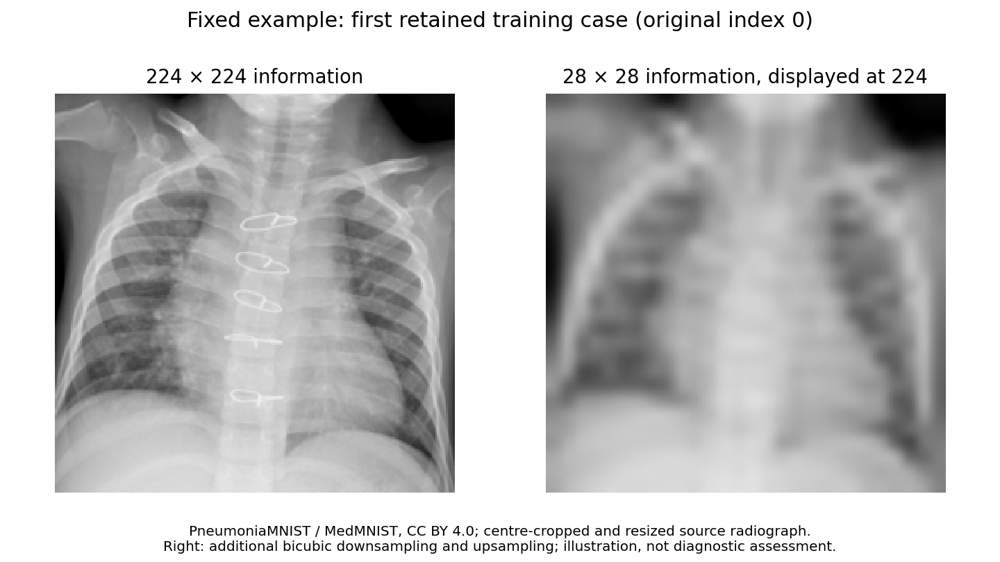
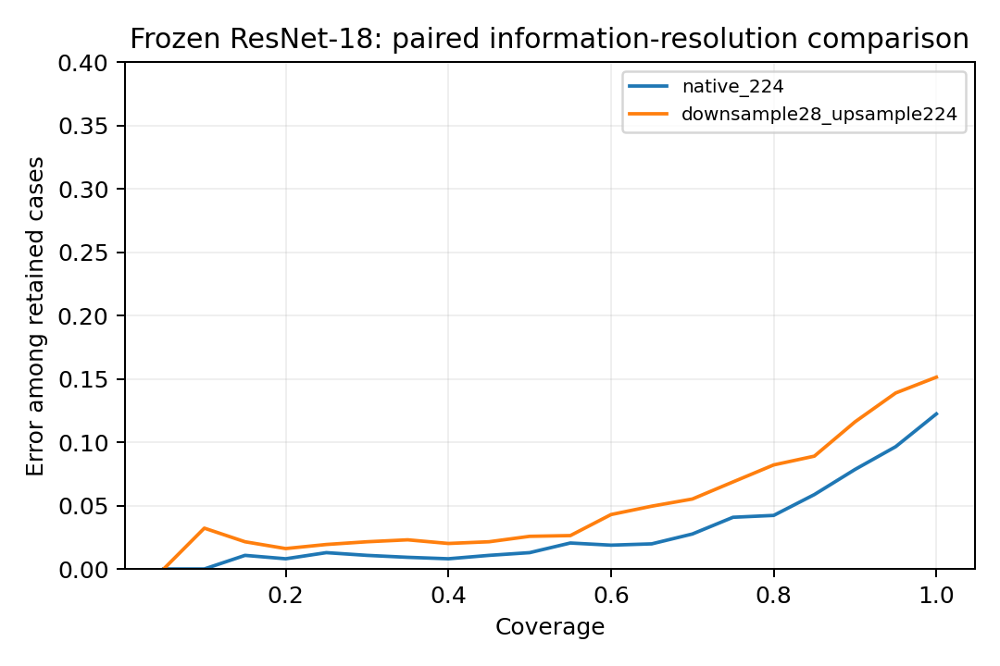

# 224×224 gegen 28×28 Bildinformation

Explorative Auflösungsprüfung vom 10. November 2026. **28×28 allein belegt keine diagnostische Aussagekraft.** Diese Auswertung verwendet daher das offizielle 224px-Archiv statt hochskalierter alter 28px-Dateien. Auch 224×224 bleibt gegenüber Original-Röntgenbildern verkleinert.



Der erste behaltene Trainingsfall wurde vor der Auswertung als Beispiel festgelegt; keine Auswahl nach Testergebnis. Quelle: PneumoniaMNIST / MedMNIST, CC BY 4.0. Rechts zusätzliche Bicubic-Reduktion und Wiedervergrößerung.

## Kontrollierter Vergleich

Beide Zweige beginnen mit exakt derselben offiziellen 224×224-Aufnahme. Ein Zweig behält diese Information; der andere reduziert mit Bicubic auf 28×28 und vergrößert zurück auf 224×224. Dadurch sind Netzwerk und Eingabegröße gleich. Ein ResNet-18 mit ImageNet-Gewichten bleibt eingefroren und liefert 512 Merkmale. Pro Zweig wird eine logistische Klassifikationsschicht mit derselben Auswahlregel gelernt. Das ist eine zweite Repräsentation gegenüber den historischen kleinen CNNs, aber kein medizinisch feinabgestimmtes ResNet.

Alle Splits bleiben getrennt: 4.682 Training, 262 Modellwahl, 262 Kalibrierung, 621 Testrepräsentanten. Standardisierung ausschließlich auf Trainingsmerkmalen. C ∈ {0,01; 0,1; 1; 10}, gewählt nach NLL auf dem Modellwahlsplit. Die Konfidenzschwelle ist weiterhin das inklusive 20%-Quantil auf Kalibrierungsfällen. Kein Fit auf Testlabels. Die 224px-Labelreihenfolge stimmt mit dem bisherigen Archiv überein; unter den behaltenen Fällen gibt es keine exakten 224px-Duplikate. Dies beweist keine Patientenunabhängigkeit.

## Ergebnis auf dem bekannten internen Test

Primärer, vor der neuen Auswertung festgelegter Endpunkt: **AUROC-Differenz 224px minus 28px-Information**. Alle anderen Kennzahlen sind sekundär.

| Kennzahl | 224px-Information | 28px-Information | Differenz [95%-Bild-Bootstrap] |
|---|---:|---:|---:|
| AUROC (primär) | 0.980 | 0.960 | +0.019 [+0.009; +0.032] |
| Accuracy | 87.8% | 84.9% | +2.9 pp [+0.8; +5.3] |
| NLL | 0.298 | 0.409 | -0.111 [-0.163; -0.065] |
| Brier | 0.085 | 0.112 | -0.028 [-0.040; -0.016] |
| ECE (15 Bins) | 0.057 | 0.084 | -0.028 [-0.049; -0.010] |
| Akzeptanz | 73.3% | 71.5% | +1.8 pp [-1.4; +4.8] |
| Fehler unter akzeptierten Fällen | 4.2% | 6.1% | -1.9 pp [-3.7; -0.1] |

Sensitivität / Spezifität: 224px 99.5% / 68.4%; 28px-Information 99.0% / 61.5%. Gewählte C-Werte: 0.01 beziehungsweise 0.01.

2.000 gepaarte Wiederziehungen derselben Testrepräsentanten, bedingt auf den eingefrorenen Encoder, ausgewählte Köpfe und Schwellen. Keine Unsicherheit durch Vortraining, Modellwahl oder unbekannte Patientenkorrelation. Die Differenz der akzeptierten Fehlerraten bezieht sich auf modellabhängig unterschiedliche Annahmemengen; sie ist nur zusammen mit der Akzeptanz zu lesen.



## Einordnung

Die AUROC ist in diesem kontrollierten Vergleich mit 224px-Information höher; auch das bedingte gepaarte Intervall liegt oberhalb null. Damit wird ein Vorteil zusätzlicher Bildinformation für diesen Encoder auf diesem Test unterstützt. Daraus folgt weder ausreichende radiologische Auflösung noch klinische Eignung.

Dieser Vergleich ersetzt die frühere Architektur nicht rückwirkend. Die hochskalierten 28px-Bilder sind bewusst neu aus den 224px-Bildern abgeleitet; sie sind nicht notwendigerweise pixelidentisch mit dem historischen MedMNIST-28px-Archiv. Beide Zweige nutzen dieselbe ImageNet-Repräsentation und dieselben Fälle. Ergebnisse gelten für diese Vorverarbeitung und diese eingefrorene Repräsentation. Ein End-to-End-Training, ein unabhängiger externer Test mit 224px oder mehr und Originalauflösungen bleiben offen. Höhere Auflösung kann auch unerwünschte Merkmale erhalten; ein besserer Score identifiziert nicht automatisch den medizinisch relevanten Grund.

## Nachrechnen

```bash
python scripts/fetch_high_resolution.py
python experiments/high_resolution_probe.py --output /tmp/high-resolution-reproduction
python scripts/verify_high_resolution.py
```

Voraussetzungen: festgeschriebene Pakete aus `requirements.txt`, CPU-PyTorch 2.5.1 und Torchvision 0.20.1. Erster Lauf lädt zusätzlich die öffentlichen ImageNet-Gewichte. Merkmale werden unter `data/high_resolution_features/` gecacht; Cache-Herkunft wird gegen Daten, Manifest, Protokoll, Skript und Encoder geprüft. Roharchiv und Encoder werden nicht im Repository mitverteilt. Der Ausgabeordner der Auswertung muss neu sein. Der separate Prüfer prüft die versionierten Ergebnisse im Repository.

[Vorab festgelegter Plan](../../configs/high_resolution_probe.json) · [Kennzahlen, Modellwahl und Prüfsummen](summary.json) · [Logits und gelernte Köpfe](predictions_and_probes.npz) · [Bootstrap](bootstrap.npz) · [Lizenzen und Attribution](../../docs/LICENSING.md).

## Folgetest: Robustheit bei eingefrorenen Modellen

Die anschließende [Störungsauswertung](robustness/README.md) prüft Eingangsrauschen, Rauschen vor Verkleinerung, Unschärfe und Kontrast bei unveränderten Modellen und Schwellen. Der clean-Auflösungsvorteil ist damit von der Robustheit gegen Störungen zu unterscheiden. Die Filterwirkung des Herunterskalierens wird über zwei Rauschpositionen und den tatsächlich verbleibenden RMSE kontrolliert.

## Intervention: Rauschaugmentation des Kopfes

Die [anschließende Interventionsstudie](augmentation/README.md) trainiert bei eingefrorenem Encoder einen neuen linearen Kopf mit gleich gewichtetem clean-/Rauschtraining. Sie prüft den Rauschgewinn, den clean-Nachteil und zwei weitere Rausch-Seeds; Kontrollmodell und Kontrollschwellen bleiben erhalten.
