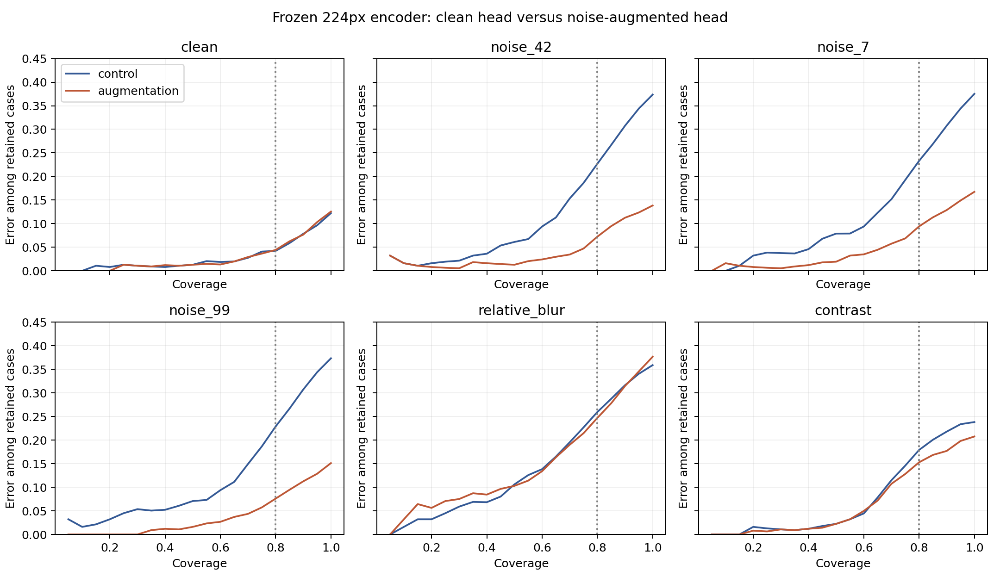

# Rauschaugmentation der 224px-Klassifikationsschicht

Explorative Intervention vom 10. November 2026 nach dem beobachteten Versagen unter Rauschen. Der ResNet-18-Encoder bleibt auf seinen ImageNet-Gewichten eingefroren. Neu trainiert wird nur die logistische Klassifikationsschicht. Kein End-to-End-Finetuning und keine externe Validierung. [Vorab festgelegter Plan](../../../configs/high_resolution_augmentation.json).

## Gleiche Trainingsgewichtung und getrennte Splits

Jede der 4.682 Trainingsaufnahmen liefert saubere und verrauschte Merkmale, jeweils mit Gewicht 0,5. Die 9.364 Trainingszeilen sind keine zusätzlichen Patienten; ihr Gesamtgewicht bleibt 4.682. Ein Test prüft, dass Duplizieren identischer Merkmale mit halbem Gewicht dieselbe logistische Lösung liefert. Dadurch wird die Regularisierung nicht allein durch eine Verdopplung des Trainingsgewichts verändert.

Das Rauschen hat SD 0,1 am 224px-Eingang, wird auf [0,1] begrenzt und auf uint8 gerundet. Ein fester, indexgebundener Trainingsseed 20261116 erzeugt eine Realisierung pro Bild. Testseeds 42, 7 und 99 unterscheiden sich davon. Die drei Tests verwenden dieselben Bilder; sie sind keine unabhängigen Patientenkohorten.

Der StandardScaler aus dem ursprünglichen sauberen Training bleibt unverändert. Die Regularisierung wird wie beim Kontrollmodell ausschließlich nach clean-Modellwahl-NLL aus C ∈ {0,01; 0,1; 1; 10} gewählt. Die neue Annahmeschwelle stammt nur aus den 262 clean-Kalibrierungsfällen. Kontrollmodell und Kontrollschwelle bleiben exakt erhalten.

## Vorab festgelegter primärer Vergleich

**Differenz der Fehlerrate bei 80 % Abdeckung unter Testrauschen Seed 42, Augmentation minus Kontrolle: -15.46 pp [-19.28; -11.84].** Negative Werte sprechen für Augmentation. 2.000 gepaarte Wiederziehungen der 621 Testrepräsentanten, bedingt auf zwei ausgewählte Köpfe, einen Encoder und feste Schwellen. Keine Unsicherheit durch Training, Auswahl der Regularisierung oder unbekannte Patientenkorrelation.

| Bedingung | Risiko bei 80 %: Kontrolle | Risiko bei 80 %: Augmentation | Differenz [95%-Bootstrap] |
|---|---:|---:|---:|
| clean | 4.2% | 4.4% | +0.2 pp [-1.0; +1.0] |
| noise_42 | 22.7% | 7.2% | -15.5 pp [-19.3; -11.8] |
| noise_7 | 23.3% | 9.4% | -13.9 pp [-17.7; -10.5] |
| noise_99 | 22.9% | 7.6% | -15.3 pp [-18.9; -11.8] |
| relative_blur | 26.0% | 24.7% | -1.2 pp [-2.9; +0.4] |
| contrast | 17.9% | 15.3% | -2.6 pp [-3.8; -1.0] |

Auf clean-Bildern beträgt die entsprechende Differenz +0.20 pp [-1.05; +1.01]. Ein Intervall, das null umfasst, beweist keine Gleichwertigkeit oder Nichtunterlegenheit. Alternate Rauschseeds, Blur, Kontrast und weitere Kennzahlen sind sekundär, ohne Multiplizitätskorrektur.



## Modellabhängige Annahmeschwellen

| Bedingung / Modell | Accuracy | Akzeptanz | Fehler unter akzeptierten Fällen | AUROC |
|---|---:|---:|---:|---:|
| clean / control | 87.8% | 73.3% | 4.2% | 0.980 |
| clean / augmentation | 87.4% | 72.8% | 3.1% | 0.980 |
| noise_42 / control | 62.6% | 96.8% | 35.6% | 0.939 |
| noise_42 / augmentation | 86.2% | 64.3% | 2.8% | 0.968 |
| noise_7 / control | 62.5% | 95.5% | 34.7% | 0.926 |
| noise_7 / augmentation | 83.3% | 64.6% | 4.5% | 0.954 |
| noise_99 / control | 62.6% | 97.4% | 36.0% | 0.927 |
| noise_99 / augmentation | 84.9% | 64.4% | 3.8% | 0.968 |
| relative_blur / control | 64.1% | 56.7% | 13.1% | 0.877 |
| relative_blur / augmentation | 62.3% | 99.5% | 37.4% | 0.878 |
| contrast / control | 76.2% | 73.4% | 13.8% | 0.973 |
| contrast / augmentation | 79.2% | 72.9% | 11.9% | 0.972 |

Die beiden Modelle akzeptieren unterschiedliche Fallmengen. Ein Vergleich ihrer festen akzeptierten Fehlerraten ist daher nur zusammen mit der Abdeckung sinnvoll. Der primäre Vergleich oben verwendet für beide Modelle dieselbe Abdeckung, aber ebenfalls nicht notwendigerweise dieselben ausgewählten Fälle.

## Befund und Gegenbeispiel

Unter primärem Testrauschen sinkt das Risiko bei gleicher 80%-Abdeckung von 22,7 % auf 7,2 %. Die beiden anderen Testrausch-Seeds zeigen ebenfalls Verbesserungen (23,3 % → 9,4 % und 22,9 % → 7,6 %). Der Erfolg beruht daher nicht ausschließlich darauf, mehr Fälle abzulehnen. Bei den modellabhängigen Schwellen sinkt die akzeptierte Fehlerrate unter primärem Rauschen zwar von 35,6 % auf 2,8 %, gleichzeitig aber auch die Akzeptanz von 96,8 % auf 64,3 %; diese beiden Veränderungen sind gemeinsam zu lesen.

Der clean-Risikounterschied bei 80 % Abdeckung ist klein (+0,20 pp), sein Intervall umfasst null. Dies ist kein Nachweis, dass auf sauberen Bildern grundsätzlich kein Nachteil entstehen kann. Unschärfe bleibt ein deutliches Gegenbeispiel: Mit seiner ursprünglichen clean-Kalibrierungsschwelle akzeptiert der augmentierte Kopf 99,5 % der unscharfen Fälle, davon 37,4 % falsch. Bei gleicher 80%-Abdeckung liegen die Blur-Risiken bei 24,7 % gegenüber 26,0 %; auch hier darf die unterschiedliche Annahmemenge nicht ignoriert werden. Die Maßnahme verbessert die untersuchte Rauschrobustheit, nicht allgemeine Verlässlichkeit.

## Nachanalyse bei gleichem C

Die clean-Modellwahl wählte C=0,01 für die Kontrolle und C=0,1 für den augmentierten Kopf. Deshalb wurde **nach Sichtung des primären Ergebnisses** eine separate [Sensitivitätsanalyse](../../../configs/high_resolution_regularization_sensitivity.json) festgelegt. Sie berichtet alle vier Kombinationen aus Training mit/ohne Augmentation und diesen beiden C-Werten; kein neuer Gewinner ersetzt die primären Modelle.

| Festes C | Bedingung | Risikodifferenz bei 80 %, Augmentation − Kontrolle [95%-Bootstrap] |
|---|---|---:|
| 0.01 | clean | +1.01 pp [-0.40; +1.97] |
| 0.01 | noise_42 | -14.69 pp [-18.88; -11.31] |
| 0.1 | clean | -0.40 pp [-1.57; +0.97] |
| 0.1 | noise_42 | -22.10 pp [-25.52; -18.72] |

Der Rauschgewinn erscheint auch bei gleichem C in beiden Vergleichen. Damit erklärt ein bloßer Wechsel des Regularisierungswerts den beobachteten Vorteil in dieser Analyse nicht. Dies bleibt eine post-hoc-Diagnose auf denselben Daten; sie ist kein unabhängiger Bestätigungstest. [Ergebnisse](regularization_sensitivity/summary.json). Reproduktion: `python experiments/high_resolution_regularization_sensitivity.py --output /tmp/matched-c-sensitivity`.

## Auswahl und Grenzen

Gewähltes C des augmentierten Kopfes: 0.1; clean-Modellwahl-NLL: 0.0523; clean-Kalibrierungsschwelle: 0.981211. Alle vier Kandidaten und Auswahlwerte stehen in [selection.json](selection.json). Kein Testwert wurde zur Auswahl verwendet.

Diese Intervention untersucht eine einzelne Trainingsrausch-Realisierung bei fester Stärke. Erfolg bei drei Testrausch-Realisierungen belegt keine Robustheit gegen beliebige Rauscharten, Geräteeffekte oder externe Populationen. Der interne Testsatz war zuvor bekannt; der neue Plan macht ihn nicht rückwirkend unberührt. Die Interpretation bleibt auf diesen Encoder, die Merkmalsstandardisierung, die ausgewählten Köpfe und die beobachteten Daten beschränkt.

## Nachrechnen

```bash
python experiments/high_resolution_augmentation.py --output /tmp/high-resolution-augmentation-reproduction
python scripts/verify_high_resolution_augmentation.py
```

Voraussetzungen wie beim [ursprünglichen 224px-Vergleich](../README.md). Merkmale werden lokal unter `data/high_resolution_augmentation/` gecacht; Quellen-, Skript- und Helfer-Prüfsummen verhindern unbemerktes Wiederverwenden eines anderen Stands. Der Ausgabeordner muss neu sein. Der separate Prüfer rekonstruiert den neuen Kopf aus gespeicherten Parametern, bestätigt die ursprünglichen Kontrollvorhersagen und rechnet alle 2.000 Bootstrap-Ziehungen für Rauschgewinn und clean-Nachteil unabhängig nach.

[Zusammenfassung](summary.json) · [Alle Kennzahlen](results.csv) · [Vorhersagen](predictions.npz) · [Gelernter Kopf und Kalibrierungslogits](augmented_head.npz) · [Bootstrap](bootstrap.npz) · [Prüfung](verification.json).

## Fortsetzung über die Störstärke

Die [eingefrorene Störstärkenanalyse](../severity/README.md) erweitert die Prüfung auf Rauschen bis SD 0,2 und Unschärfe bis Sigma 16. Modelle und Schwellen bleiben unverändert; bekannte Stärken dienen als Kontrollpunkte.
