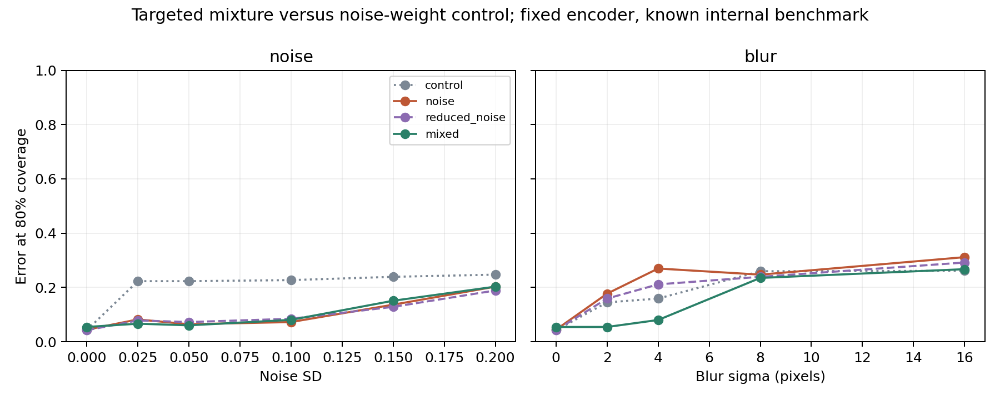

# Gezielte Mischung aus Rausch- und Unschärfetraining

Explorative Intervention vom 10. November 2026, **nach** dem beobachteten Nachteil der reinen Rauschaugmentation bei Unschärfe Sigma 4. Diese gezielte Reparatur auf einem bekannten Benchmark ist kein unabhängiger Bestätigungstest. Encoder und clean-StandardScaler bleiben eingefroren; nur zwei neue lineare Köpfe werden gelernt. [Vorab festgelegter Interventionsplan](../../../configs/high_resolution_mixed_augmentation.json).

## Vier Vergleichsarme

| Arm | Anteil clean | Anteil Rauschen SD 0,1 | Anteil Unschärfe Sigma 4 |
|---|---:|---:|---:|
| ursprüngliche Kontrolle (`control`) | 100 % | 0 % | 0 % |
| ursprünglicher Rauschkopf (`noise`) | 50 % | 50 % | 0 % |
| Kontrolle mit weniger Rauschen (`reduced_noise`) | 75 % | 25 % | 0 % |
| gezielte Mischung (`mixed`) | 50 % | 25 % | 25 % |

Die Gewichte summieren sich je Ursprungsbild zu 1; jedes Training hat Gesamtgewicht 4.682. Es entstehen keine neuen Patienten. Der Rauschseed bleibt 20261116. Der Vergleich mixed gegen reduced_noise hält den Rauschanteil gleich; er ersetzt clean-Beispiele durch Blur-Beispiele. Der Vergleich mixed gegen noise verändert dagegen sowohl Rausch- als auch Blur-Anteil. Alle neuen C-Werte werden separat mit derselben clean-Modellwahlregel gewählt; die Kontrolle ist ein Pipelinevergleich, kein Beweis einer isolierten biologischen Ursache.

## Primärer Vergleich

Bei **Unschärfe Sigma 4** beträgt die Risikodifferenz bei 80 % Abdeckung, mixed minus ursprünglicher Rauschkopf, **-18.96 pp [-22.30; -15.94]**. Negative Werte sprechen für die Mischung. 2.000 gemeinsame Testbild-Wiederziehungen, bedingt auf die ausgewählten Köpfe und den festen Encoder. Keine Trainings-/Modellwahl- oder Patientenkorrelationsunsicherheit.

| Bedingung | Kontrolle | Rauschkopf | Weniger Rauschen | Mischung |
|---|---:|---:|---:|---:|
| clean | 4.2% | 4.4% | 4.2% | 5.4% |
| noise_0.025 | 22.3% | 8.2% | 7.9% | 6.6% |
| noise_0.05 | 22.3% | 6.4% | 7.2% | 6.0% |
| noise_0.1 | 22.7% | 7.2% | 8.5% | 8.1% |
| noise_0.15 | 23.9% | 13.6% | 12.8% | 15.1% |
| noise_0.2 | 24.7% | 20.3% | 18.9% | 20.3% |
| blur_2 | 14.5% | 17.7% | 15.9% | 5.4% |
| blur_4 | 15.9% | 27.0% | 21.1% | 8.0% |
| blur_8 | 26.0% | 24.7% | 23.9% | 23.5% |
| blur_16 | 26.1% | 31.2% | 29.2% | 26.7% |
| noise_7 | 23.3% | 9.4% | 9.7% | 9.3% |
| noise_99 | 22.9% | 7.6% | 7.9% | 7.6% |
| contrast | 17.9% | 15.3% | 15.5% | 16.3% |

Fehlerraten bei gleicher 80%-Abdeckung. Die Modelle wählen dabei nicht zwangsläufig dieselben Bilder aus. Die Bedingungen verwenden dieselben 621 Testrepräsentanten und sind keine unabhängigen Kohorten.



## Gezielte Gegenvergleiche

| Vergleich bei 80 % | Bedingung | Differenz [punktweises 95%-Bootstrap] |
|---|---|---:|
| mixed − noise | blur_4 | -18.96 pp [-22.30; -15.94] |
| mixed − noise | clean | +1.01 pp [-0.00; +2.42] |
| mixed − noise | noise_0.1 | +0.81 pp [-0.45; +2.17] |
| mixed − noise | noise_0.2 | +0.00 pp [-1.81; +1.41] |
| mixed − noise | blur_2 | -12.28 pp [-15.10; -9.62] |
| mixed − noise | blur_8 | -1.21 pp [-2.62; +0.20] |
| mixed − noise | blur_16 | -4.43 pp [-6.20; -2.62] |
| mixed − reduced_noise | blur_4 | -13.12 pp [-16.55; -10.63] |
| mixed − reduced_noise | clean | +1.21 pp [+0.00; +2.46] |
| mixed − reduced_noise | noise_0.1 | -0.40 pp [-1.41; +1.41] |
| mixed − reduced_noise | noise_0.2 | +1.41 pp [+0.16; +3.18] |
| mixed − reduced_noise | blur_2 | -10.47 pp [-12.88; -7.69] |
| mixed − reduced_noise | blur_8 | -0.40 pp [-1.61; +0.81] |
| mixed − reduced_noise | blur_16 | -2.46 pp [-4.07; -0.81] |

Nur mixed minus noise bei Sigma 4 ist der vorab festgelegte primäre Interventionsvergleich. Andere Vergleiche sind sekundär und nicht multiplicity-korrigiert. Ein nicht eindeutiger clean-Unterschied ist kein Nachweis von Gleichwertigkeit oder Nichtunterlegenheit. Die Stärke des Effekts auf bereits bekannte Störungen ersetzt keinen externen Test.

## Feste Schwellen

| Bedingung / Arm | Accuracy | Akzeptanz | Fehler unter akzeptierten Fällen |
|---|---:|---:|---:|
| clean / control | 87.8% | 73.3% | 4.2% |
| clean / noise | 87.4% | 72.8% | 3.1% |
| clean / mixed | 87.3% | 72.1% | 3.3% |
| clean / reduced_noise | 87.3% | 74.6% | 3.5% |
| noise_0.1 / control | 62.6% | 96.8% | 35.6% |
| noise_0.1 / noise | 86.2% | 64.3% | 2.8% |
| noise_0.1 / mixed | 85.5% | 59.3% | 2.4% |
| noise_0.1 / reduced_noise | 86.0% | 61.4% | 1.8% |
| noise_0.2 / control | 62.3% | 98.9% | 37.0% |
| noise_0.2 / noise | 70.9% | 66.0% | 13.4% |
| noise_0.2 / mixed | 73.3% | 53.9% | 7.2% |
| noise_0.2 / reduced_noise | 73.4% | 57.3% | 7.0% |
| blur_4 / control | 79.2% | 30.9% | 5.7% |
| blur_4 / noise | 68.0% | 76.0% | 24.8% |
| blur_4 / mixed | 86.0% | 65.9% | 3.9% |
| blur_4 / reduced_noise | 73.8% | 50.6% | 16.2% |
| blur_16 / control | 62.6% | 70.7% | 23.2% |
| blur_16 / noise | 62.3% | 100.0% | 37.7% |
| blur_16 / mixed | 62.3% | 100.0% | 37.7% |
| blur_16 / reduced_noise | 62.3% | 100.0% | 37.7% |

Die ursprünglichen beiden Köpfe und Schwellen bleiben erhalten. Neue Schwellen stammen ausschließlich aus clean-Kalibrierung. Fehlerraten bei modellabhängigen Annahmeschwellen sind immer mit der Akzeptanz zu lesen; niedrige Fehler bei wenig akzeptierten Fällen sind kein allgemeiner Erfolg.

## Modellwahl und Reproduktion

- mixed: C=1.0, clean-Modellwahl-NLL 0.0427, Schwelle 0.993490, 14046 Trainingszeilen mit Gesamtgewicht 4682.
- reduced_noise: C=0.1, clean-Modellwahl-NLL 0.0497, Schwelle 0.983366, 9364 Trainingszeilen mit Gesamtgewicht 4682.

```bash
python experiments/high_resolution_mixed_augmentation.py --output /tmp/high-resolution-mixed-reproduction
python scripts/verify_high_resolution_mixed.py
python scripts/plot_high_resolution_mixed.py
```

Die Eingangsmerkmale der früheren Studien werden geprüft und wiederverwendet; nur Blur-Trainingsmerkmale werden zusätzlich berechnet. Neue Köpfe sind separat gespeichert. Der Prüfer kontrolliert die gewichteten Trainingsgradienten, rekonstruiert die Köpfe, bestätigt die alten Vorhersagen und prüft alle 2.000 primären Ziehungen auch für die reduzierte Rauschkontrolle. Plot und Prüfer lesen die versionierten Repository-Ergebnisse.

[Kennzahlen](results.csv) · [Zusammenfassung](summary.json) · [Modellwahl](selection.json) · [Neue Köpfe](new_heads.npz) · [Vorhersagen](predictions.npz) · [Bootstrap](bootstrap.npz) · [Prüfung](verification.json).
