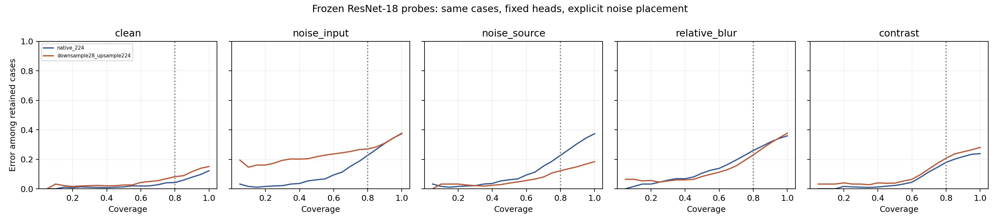

# Robustheit der eingefrorenen Auflösungsmodelle

Explorative Fortsetzung vom 10. November 2026. Encoder, beide linearen Klassifikationsschichten, Standardisierung und Konfidenzschwellen stammen unverändert aus dem [224px-Vergleich](../README.md). Keine neue Modellwahl, kein Nachtraining und keine Neukalibrierung. Die clean-Ergebnisse waren bekannt; der [Plan](../../../configs/high_resolution_robustness.json) wurde vor der neuen Störungsauswertung versioniert.

## Gleiche Abdeckung als primärer Vergleich

Anteil falscher Vorhersagen unter den jeweils konfidentesten 80 %; exakte Gleichstände werden anteilig gewichtet. Primärer Kontrast: (224px-Risiko unter Eingangsrauschen minus 224px-clean-Risiko) minus (28px-Risiko unter Eingangsrauschen minus 28px-clean-Risiko). Positive Werte bedeuten einen stärkeren Rausch-bedingten Risikoanstieg bei 224px; negative Werte einen geringeren Anstieg.

**Primärer Kontrast: -0.28 Prozentpunkte [-4.07; +2.21].** 2.000 gepaarte Wiederziehungen der Testrepräsentanten, bedingt auf zwei feste Modelle und bekannte Daten. Keine Trainings-/Modellwahlunsicherheit, Patientencluster oder Multiplizitätskorrektur. Die folgenden Einzelvergleiche sind sekundär.

| Bedingung | Risiko bei 80 %: 224px | Risiko bei 80 %: 28px | Differenz 224 − 28 [95%-Bootstrap] |
|---|---:|---:|---:|
| clean | 4.2% | 8.2% | -4.0 pp [-5.4; -2.0] |
| noise_input | 22.7% | 27.0% | -4.3 pp [-7.0; -2.2] |
| noise_source | 22.7% | 12.3% | +10.4 pp [+6.8; +13.7] |
| relative_blur | 26.0% | 22.9% | +3.0 pp [+1.0; +4.6] |
| contrast | 17.9% | 20.7% | -2.8 pp [-5.0; -1.4] |



Die Modelle akzeptieren bei gleicher Abdeckung nicht notwendigerweise dieselben Fälle. Der gepaarte Bootstrap zieht dennoch dieselben Bild-IDs für beide Modelle und alle Bedingungen. Kurven sind Einzelmodelle ohne Seed-Bänder.

## Befund

Der primäre Risikoanstiegs-Kontrast beträgt −0,28 pp [−4,07; +2,21] und umfasst null. Das ist kein Nachweis gleicher Robustheit. Beide Modelle verlieren unter Eingangsrauschen deutlich, trotz des vorherigen clean-Vorteils von 224px. Bei den ursprünglichen Schwellen steigen gleichzeitig Konfidenz und Akzeptanz: 224px akzeptiert 96,8 % bei 35,6 % akzeptierten Fehlern; der 28px-Zweig 99,5 % bei 37,4 % Fehlern.

Unter Eingangsrauschen werden 99,7 % der Fälle vom 224px-Modell und 100 % vom 28px-Modell als positiv eingestuft. Die mittlere Top-Label-Konfidenz beträgt 99,4 % beziehungsweise 99,8 %. Bei 62,3 % positiven Testlabels kann der nahezu konstante Positiv-Prädiktor somit rund 62 % Accuracy erreichen, ohne beide Klassen zuverlässig zu unterscheiden. Das ist kein Beweis des historischen Nullvektor-Mechanismus: Hier wurden keine korruptionsbedingten internen Nullvektoren nachgewiesen. Keine gespeicherte Wahrscheinlichkeit ist exakt 0 oder 1; der Befund beruht nicht auf Float-Sättigung.

Auch Unschärfe zeigt, warum Akzeptanz und Fehlerrate gemeinsam zu lesen sind: Bei festen Schwellen wirkt 224px mit 13,1 % akzeptierten Fehlern besser als 28px mit 37,5 %, akzeptiert aber nur 56,7 % statt 99,7 % der Fälle. Bei gleicher 80%-Abdeckung liegen die Risiken bei 26,0 % und 22,9 %. Ein Vergleich allein der festen akzeptierten Fehlerraten würde die unterschiedliche Auswahl verdecken.

Beim 28px-Zweig sinkt das Risiko bei 80 % Abdeckung von 27,0 % unter Eingangsrauschen auf 12,3 %, wenn dasselbe Quellrauschen vor der Verkleinerung liegt. Der realisierte Rausch-RMSE sinkt dabei von 0,0993 auf 0,0095. Dieser scheinbare Robustheitsgewinn enthält die Filterwirkung der Pipeline und darf nicht als allgemeine Überlegenheit von 28px ausgegeben werden.

## Ursprüngliche Konfidenzschwellen

| Bedingung / Bildinformation | Accuracy | Akzeptanz | Fehler unter akzeptierten Fällen | AUROC |
|---|---:|---:|---:|---:|
| clean / 224px-Information | 87.8% | 73.3% | 4.2% | 0.980 |
| clean / 28px-Information | 84.9% | 71.5% | 6.1% | 0.960 |
| noise_input / 224px-Information | 62.6% | 96.8% | 35.6% | 0.939 |
| noise_input / 28px-Information | 62.3% | 99.5% | 37.4% | 0.752 |
| noise_source / 224px-Information | 62.6% | 96.8% | 35.6% | 0.939 |
| noise_source / 28px-Information | 81.6% | 72.8% | 10.0% | 0.954 |
| relative_blur / 224px-Information | 64.1% | 56.7% | 13.1% | 0.877 |
| relative_blur / 28px-Information | 62.3% | 99.7% | 37.5% | 0.911 |
| contrast / 224px-Information | 76.2% | 73.4% | 13.8% | 0.973 |
| contrast / 28px-Information | 72.0% | 76.5% | 18.5% | 0.951 |

Eine geringe akzeptierte Fehlerrate bei stark fallender Akzeptanz wäre kein Beleg für allgemeine Robustheit. Eine leere Annahmemenge ist undefiniert, nicht fehlerfrei. Vollständige Intervalle einschließlich Zahl undefinierter Bootstrap-Ziehungen: [summary.json](summary.json).

## Warum zwei Rauschbedingungen?

- `noise_input`: Erst den jeweiligen clean-Zweig bilden, dann dasselbe indexgebundene Gaußrauschen direkt zur 224px-Netzeingabe addieren. Dieser primäre Vergleich verhindert, dass allein die zusätzliche Verkleinerung des 28px-Zweigs das Rauschen abschwächt.
- `noise_source`: Erst die gemeinsame 224px-Quelle verrauschen, dann die Zweige bilden. Das Verkleinern kann das Rauschen herausfiltern. Dies beschreibt eine andere Verarbeitungskette, keine gleiche effektive Störstärke.
- `relative_blur`: Gemeinsame Quelle mit Gauß-Sigma 8 Pixeln (1/28 der Bildbreite) unscharf machen, dann die Zweige bilden.
- `contrast`: Gemeinsame Quelle mit `0.5 + 0.5*(x-0.5)` verändern, dann die Zweige bilden.

Alle Störungen werden auf [0,1] begrenzt und explizit auf uint8 gerundet. Das Rauschen hat SD 0,1 vor Begrenzung und einen festen Seed pro originalem Testindex; Batchreihenfolge beeinflusst es nicht. Bildbeispiele und Störungen bleiben synthetisch.

| Rauschbedingung / Zweig | Realisierter RMSE, Mittel über 621 Fälle |
|---|---:|
| noise_input / 224px-Information | 0.0991 |
| noise_source / 224px-Information | 0.0991 |
| noise_input / 28px-Information | 0.0993 |
| noise_source / 28px-Information | 0.0095 |

RMSE relativ zum jeweiligen clean-Eingabebild, Pixelwerte in [0,1]. Die Filterung ist damit gemessen und nicht nur vermutet. Die beiden Rauschbedingungen sind für den unverkleinerten 224px-Zweig identisch; seine gespeicherten Logits müssen exakt übereinstimmen. Diese Identität wird zusätzlich geprüft.

## Grenzen und Nachrechnung

Der Vorteil zusätzlicher Information auf clean-Bildern erlaubt keine automatische Aussage über Störungsrobustheit. Der Vergleich gilt für einen eingefrorenen ImageNet-Encoder und zwei ausgewählte lineare Köpfe auf demselben bekannten internen Testsatz. Eine ganze Modellfamilie, Originalauflösung, realistische Aufnahmefehler oder externe klinische Übertragung wurden nicht validiert. Die Verkleinerung und die Platzierung einer Störung gehören zur untersuchten Pipeline; unterschiedliche Ergebnisse belegen keine allgemeine Überlegenheit einer Auflösung.

```bash
python experiments/high_resolution_robustness.py --output /tmp/high-resolution-robustness-reproduction
python scripts/audit_high_resolution_corruptions.py
python scripts/verify_high_resolution_robustness.py
```

Die Auswertung benötigt die gespeicherten Köpfe, den offiziellen 224px-Datensatz und den bereits geprüften Encoder. Ergebnisse werden nur in einem neuen Ausgabeordner angelegt; lokale Inferenz-Zwischenergebnisse unter `data/high_resolution_robustness/` sind an Quellen- und Skript-Prüfsummen gebunden. Audit und separater Prüfer beziehen sich auf die versionierten Ergebnisse im Repository. Der Prüfer rechnet sämtliche 2.000 primären Bootstrap-Ziehungen mit einer unabhängigen gruppierten Gleichstandsbehandlung nach.

[Kennzahlen](results.csv) · [Vorhersagen](predictions.npz) · [Bootstrap](bootstrap.npz) · [Prüfergebnis](verification.json) · [Realisierte Störstärke](corruption_strength.csv).
