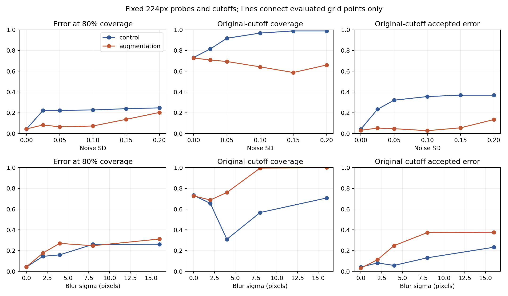
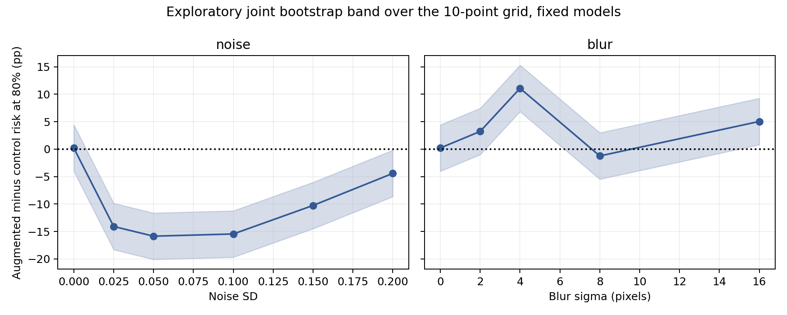

# Störstärke: Grenzen des eingefrorenen 224px-Modells

Explorative Fortsetzung vom 10. November 2026. Kontrolle und rauschaugmentierter Kopf, gemeinsamer Encoder, StandardScaler und clean-Kalibrierungsschwellen bleiben unverändert. Der [Plan](../../../configs/high_resolution_severity.json) wurde vor Auswertung der neuen Stärken versioniert; clean, Rauschen SD 0,1 und Unschärfe Sigma 8 waren bereits bekannt und werden hier als Reproduktionskontrollen verwendet.

## Primärer Endpunkt: doppelte Trainingsrauschstärke

Unter Rauschen mit **SD 0,2** beträgt die Differenz der Fehlerrate bei 80 % Abdeckung, Augmentation minus Kontrolle, **-4.43 pp [-5.84; -2.62]**. Der augmentierte Kopf wurde nur mit SD 0,1 trainiert. Negative Differenzen sprechen unter dieser Kennzahl für Augmentation.

2.000 gepaarte Wiederziehungen derselben 621 Testrepräsentanten, über alle Modelle und Stärken gekoppelt. Intervalle konditionieren auf vorhandene Modelle und Schwellen; Trainings-/Modellwahlunsicherheit und unbekannte Patientenkorrelation fehlen. Die Daten sind ein bereits untersuchter interner Benchmark, keine neue Bestätigungskohorte.

## Vollständiges Raster

| Bedingung | Risiko bei 80 %: Kontrolle | Risiko bei 80 %: Augmentation | Differenz, punktweises 95%-Intervall | Gemeinsames empirisches Band |
|---|---:|---:|---:|---:|
| clean | 4.2% | 4.4% | +0.2 pp [-1.0; +1.0] | [-4.0; +4.4] pp |
| noise_0.025 | 22.3% | 8.2% | -14.1 pp [-17.1; -10.6] | [-18.3; -9.9] pp |
| noise_0.05 | 22.3% | 6.4% | -15.9 pp [-19.7; -12.0] | [-20.1; -11.6] pp |
| noise_0.1 | 22.7% | 7.2% | -15.5 pp [-18.9; -11.8] | [-19.7; -11.2] pp |
| noise_0.15 | 23.9% | 13.6% | -10.3 pp [-12.7; -7.4] | [-14.5; -6.0] pp |
| noise_0.2 | 24.7% | 20.3% | -4.4 pp [-5.8; -2.6] | [-8.7; -0.2] pp |
| blur_2 | 14.5% | 17.7% | +3.2 pp [+1.2; +5.0] | [-1.0; +7.4] pp |
| blur_4 | 15.9% | 27.0% | +11.1 pp [+7.8; +13.8] | [+6.8; +15.3] pp |
| blur_8 | 26.0% | 24.7% | -1.2 pp [-2.8; +0.4] | [-5.5; +3.0] pp |
| blur_16 | 26.1% | 31.2% | +5.0 pp [+3.0; +7.0] | [+0.8; +9.3] pp |



Linien verbinden ausschließlich die berechneten Rasterpunkte. Ein interpolierter Verlauf oder ein sicherer Bereich zwischen den Punkten ist nicht nachgewiesen. Das Ziel 80 % dient dem Vergleich bei gleicher Abdeckung; es ersetzt nicht die ursprünglichen festen Schwellen. Deren Akzeptanz und Fehlerrate stehen in den beiden rechten Spalten.

## Gemeinsame Unsicherheit über die Kurven

Für jeden Bootstrap-Durchlauf wird die größte absolute Abweichung der gepaarten Risikodifferenz von ihrem Punktschätzer über alle zehn unterschiedlichen Rasterpunkte berechnet. Das 95%-Quantil dieser Maxima liefert einen gemeinsamen Radius von **4.23 pp**. Die Abhängigkeit zwischen Stärken und Modellen bleibt durch gemeinsame Bildziehungen erhalten.

Das Band ist eine explorative gemeinsame Sensitivitätsdarstellung über dieses endliche Raster; es ist keine klinische Fehlerobergrenze und keine Garantie nominaler Abdeckung unter unbekannten Patientenkorrelationen. Es ist von den punktweisen Perzentilintervallen zu unterscheiden. Ein Ausschluss von null an einem ausgewählten Einzelpunkt darf nicht ohne Weiteres auf die gesamte Kurve übertragen werden.



## Feste Schwellen und Klassifikation

| Bedingung / Modell | Accuracy | Akzeptanz | Fehler unter akzeptierten Fällen | Sensitivität / Spezifität |
|---|---:|---:|---:|---:|
| clean / control | 87.8% | 73.3% | 4.2% | 99.5% / 68.4% |
| clean / augmentation | 87.4% | 72.8% | 3.1% | 99.5% / 67.5% |
| noise_0.025 / control | 68.3% | 81.5% | 23.3% | 100.0% / 15.8% |
| noise_0.025 / augmentation | 84.9% | 70.9% | 5.2% | 99.7% / 60.3% |
| noise_0.05 / control | 63.8% | 91.8% | 32.1% | 100.0% / 3.8% |
| noise_0.05 / augmentation | 85.3% | 69.4% | 4.6% | 99.2% / 62.4% |
| noise_0.1 / control | 62.6% | 96.8% | 35.6% | 100.0% / 0.9% |
| noise_0.1 / augmentation | 86.2% | 64.3% | 2.8% | 99.2% / 64.5% |
| noise_0.15 / control | 62.3% | 98.9% | 37.0% | 100.0% / 0.0% |
| noise_0.15 / augmentation | 78.7% | 58.8% | 5.5% | 100.0% / 43.6% |
| noise_0.2 / control | 62.3% | 98.9% | 37.0% | 100.0% / 0.0% |
| noise_0.2 / augmentation | 70.9% | 66.0% | 13.4% | 100.0% / 22.6% |
| blur_2 / control | 78.3% | 65.5% | 8.1% | 100.0% / 42.3% |
| blur_2 / augmentation | 76.3% | 68.8% | 11.2% | 100.0% / 37.2% |
| blur_4 / control | 79.2% | 30.9% | 5.7% | 92.5% / 57.3% |
| blur_4 / augmentation | 68.0% | 76.0% | 24.8% | 99.0% / 16.7% |
| blur_8 / control | 64.1% | 56.7% | 13.1% | 100.0% / 4.7% |
| blur_8 / augmentation | 62.3% | 99.5% | 37.4% | 100.0% / 0.0% |
| blur_16 / control | 62.6% | 70.7% | 23.2% | 100.0% / 0.9% |
| blur_16 / augmentation | 62.3% | 100.0% | 37.7% | 100.0% / 0.0% |

Die Zeilen betreffen dieselben Fälle unter verschiedenen künstlichen Störungen, keine unabhängigen Beobachtungen. Annahmemengen unterscheiden sich zwischen Modellen und Bedingungen; niedrige akzeptierte Fehler bei geringer Akzeptanz sind kein Nachweis allgemeiner Verlässlichkeit.

## Vorverarbeitung und numerische Kontrolle

Rauschen wird am 224px-Eingang hinzugefügt, begrenzt und auf uint8 gerundet. Pro originalem Testindex bleibt derselbe Zufallsstrom mit Seed 42 erhalten; die Rauschstärke ändert sich. Unschärfe verwendet Gaußfilter mit reflektierten Rändern bei Sigma 2, 4, 8 oder 16 Pixeln. Nullstärke reproduziert clean exakt. Die Modelle werden auf keiner Störstärke neu angepasst.

Numerische Kontrolle: 0 gesättigte Modell-Fall-Paare mit Wahrscheinlichkeit exakt 0 oder 1. Maximale Differenz des Risikos bei 80 % zwischen der vorab gewählten Wahrscheinlichkeitssortierung und einer zusätzlichen Sortierung nach absolutem Logit: 0.000000 pp. Der primäre Endpunkt wird durch diese Zusatzprüfung nicht rückwirkend geändert.

## Nachrechnung

```bash
python experiments/high_resolution_severity.py --output /tmp/high-resolution-severity-reproduction
python scripts/verify_high_resolution_severity.py
```

Voraussetzungen und lokale Encoder-/Merkmals-Caches wie bei der [Augmentationsstudie](../augmentation/README.md). Die drei bekannten Rasterpunkte werden gegen die gespeicherten Vorhersagen geprüft. Der separate Prüfer rekonstruiert beide Köpfe an allen zehn Punkten, prüft Kennzahlen unabhängig und rechnet alle 2.000 primären Bootstrap-Ziehungen sowie das gemeinsame Band nach.

[Kennzahlen](results.csv) · [Zusammenfassung](summary.json) · [Vorhersagen](predictions.npz) · [Bootstrap](bootstrap.npz) · [Verifikation](verification.json).

## Einordnung

Der Rauschgewinn nimmt bei SD 0,2 deutlich ab: 24,7 % gegenüber 20,3 % Fehlern bei gleicher 80%-Abdeckung. Gleichzeitig verschlechtert der Rauschkopf Unschärfe Sigma 4 von 15,9 % auf 27,0 %. Das gemeinsame empirische Band schließt dort null aus; bei Sigma 2 gilt dies trotz eines punktweise positiven Intervalls nicht. Ein Training gegen eine Störung kann die Empfindlichkeit gegenüber einer anderen erhöhen.

## Gezielte Folgestudie

Der beobachtete Blur-Nachteil motiviert eine [Mischung aus Rausch- und Unschärfetraining](../mixed_augmentation/README.md). Diese Anpassung wurde nach Betrachtung des Stärkenrasters gewählt und ist als gezielte explorative Reparatur gekennzeichnet. Das hier ausgewertete Raster und die ursprünglichen Köpfe bleiben unverändert.
