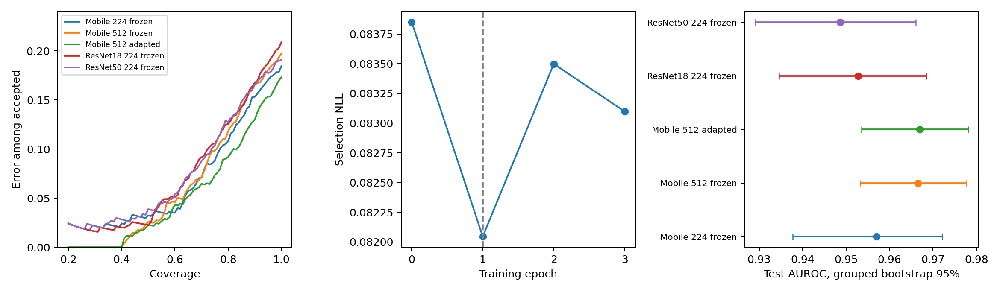
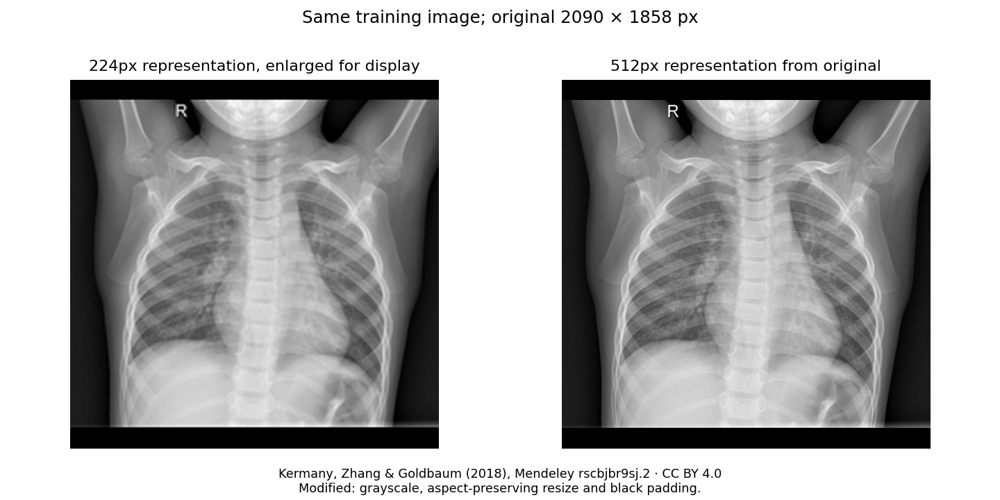

# Originalbilder, 512px und nachtrainierter Bildencoder

Ausgewertet am 11. November 2026; Trainingsläufe begonnen am 10. November. Neuer Ausgangsvergleich mit Original-Thoraxaufnahmen aus der offiziellen Mendeley-Quelle, Auflösung 224/512, partiellem Encodertraining und einer größeren Architektur. Alle vorab festgelegten Arme werden berichtet; eine Verbesserung wird nicht vorausgesetzt.

## Wichtigste Ergebnisse

- Primär: MobileNet 512 minus 224, Test-AUROC **+0.0096**, gepaarter 95%-Gruppenbootstrap **[-0.0042; +0.0251]**.
- Nachtrainiert minus eingefroren bei 512: AUROC **+0.0004 [-0.0008; +0.0015]**. Sekundärer Vergleich.
- Gewählte Epoche: **1 von 0–3**, ausschließlich nach Modellwahl-NLL. Epoche 0 ist der unveränderte Ausgangskopf.

| Modell | AUROC | Accuracy | NLL | Fehler bei 80 % Abdeckung | Annahme bei fester Schwelle | Fehler unter angenommenen Fällen |
|---|---:|---:|---:|---:|---:|---:|
| mobile_224_probe | 0.9570 | 81.6% | 0.6480 | 10.8% | 66.0% | 5.9% |
| mobile_512_probe | 0.9665 | 80.3% | 0.7270 | 11.8% | 68.6% | 6.8% |
| resnet18_224_probe | 0.9528 | 79.1% | 0.5550 | 12.5% | 67.5% | 8.2% |
| mobile_512_finetuned | 0.9669 | 82.7% | 0.6206 | 9.2% | 68.3% | 5.9% |
| resnet50_224_probe | 0.9487 | 80.9% | 0.9083 | 12.7% | 68.1% | 8.1% |



AUROC misst die Rangordnung über mögliche Schwellen; Accuracy verwendet Wahrscheinlichkeit 0,5. Beide ersetzen keine klinische Validierung. Selektive Fehler werden gemeinsam mit der jeweiligen Annahmemenge ausgewertet. Ein Modell mit niedrigerem Fehler bei stark reduzierter Annahme ist nicht automatisch besser.

## Bildquelle und tatsächliche Auflösung

Quelle: Kermany, Zhang & Goldbaum (2018), [Labeled OCT and Chest X-Ray Images for Classification, Version 2](https://data.mendeley.com/datasets/rscbjbr9sj/2), DOI 10.17632/rscbjbr9sj.2, CC BY 4.0. Ausschließlich `ChestXRay2017.zip` (1.235.512.464 Bytes), SHA-256 `13efc055629733dbab07877f8b3c9f81097840dbcdaa326a8542322c2281ce36`. Lizenz und Hash wurden an der offiziellen Quelle geprüft; keine Übernahme der unklaren RSNA-Spiegellizenz.

Die Bilder stammen aus Original-JPEGs, nicht aus hochskaliertem MedMNIST. Das gesamte Bild wird mit Lanczos auf eine lange Kante von 224 oder 512 gebracht und mit schwarzen Rändern zum Quadrat ergänzt. Das Seitenverhältnis bleibt erhalten. Beide Arme erhalten dieselben Fälle. Bei 512 ändern sich räumliche Information und Encoder-Eingabegeometrie gemeinsam; der Vergleich isoliert nicht ausschließlich Bildinformation. Auch 512 ist oft weiterhin eine Verkleinerung.



| Teilmenge | Bilder | Positive | Dateinamen-Gruppen | Lange Kante ursprünglich <512 | Kurze Kante ursprünglich <512 |
|---|---:|---:|---:|---:|---:|
| train | 3842 | 2754 | 2153 | 47 | 189 |
| selection | 442 | 308 | 268 | 4 | 19 |
| calibration | 469 | 343 | 270 | 4 | 19 |
| test | 618 | 387 | 426 | 0 | 19 |

Alle 618 Testbilder haben eine ursprüngliche lange Kante von mindestens 728 Pixeln. 19 haben eine kurze Kante unter 512; der längere Bildrand wird trotzdem verkleinert und der freie Raum gepolstert. 55 Bilder außerhalb des Tests haben selbst an der langen Kante weniger als 512 Pixel und werden entsprechend gekennzeichnet.

## Trennung und Herkunftsaudit

Von 5.856 Bildern wurden 32 exakte dekodierte Grauwert-Duplikate entfernt (Testpriorität). Anschließend wurden 453 Trainingsbilder ausgeschlossen, deren aus dem Dateinamen abgeleitete Kennung auch im Test vorkommt. Alle 453 betreffen PNEUMONIA-Dateinamen. Das sind potenzielle Patientenüberschneidungen, keine nachträglich bestätigten medizinischen Identitäten. NORMAL/NORMAL2-Kennungen und person-Nummern werden nach ihrer Namenskonvention gruppiert; weitere Identitätsverknüpfungen können unbekannt bleiben.

Der offizielle Testbestand bleibt ansonsten erhalten. Die übrigen Trainingsgruppen werden mit einem festgelegten stratified group split in Training, Modellwahl und Kalibrierung aufgeteilt. Kein Trainings-/Modellwahl-/Kalibrierungs-/Testpaar teilt eine erfasste Kennung oder identische Pixel. [Vollständiges Manifest samt Ausschlüssen](manifest.json).

Dies ist dieselbe Quellfamilie wie MedMNIST, kein neuer externer klinischer Test. Die neue Bereinigung, Vorverarbeitung und Aufteilung ändern den Vergleichsmaßstab: frühere 224px-/28px-Zahlen dürfen nicht als direkt gepaarte Referenz verwendet werden.

## Training und Kapazität

ImageNet-vortrainiertes MobileNetV3-Small liefert einen mobilen Ausgangspunkt. Ein train-only StandardScaler und eine logistische Klassifikationsschicht werden für jeden eingefrorenen Arm angepasst; C ∈ {0,01; 0,1; 1; 10} wird nur nach Modellwahl-NLL gewählt. Größere Referenz: ResNet-18 bei 224px. Das ist ein Architektur-/Repräsentationsvergleich, kein isolierter Parameterzahl-Effekt.

| Arm | Parameter inkl. neuem Kopf | Merkmalsdimension | Eingabe |
|---|---:|---:|---:|
| mobile_224_probe | 927,585 | 576 | 224 |
| mobile_512_probe | 927,585 | 576 | 512 |
| resnet18_224_probe | 11,177,025 | 512 | 224 |
| mobile_512_finetuned | 927,585 | 576 | 512 |

Für die 512px-Anpassung werden die letzten zwei Inverted-Residual-Blöcke, der letzte Projektionsblock und der lineare Kopf gelernt. Präfix und BatchNorm-Statistiken/-Parameter bleiben eingefroren. AdamW, drei Epochen, kein Test-Tuning; ein unveränderter Kandidat (Epoche 0) kann gewinnen. Dies ist partielles Fine-Tuning, kein vollständiges End-to-End-Training.

| Epoche | Training-NLL | Modellwahl-NLL |
|---|---:|---:|
| 0 | – | 0.08385 |
| 1 | 0.017843047259649372 | 0.08205 |
| 2 | 0.014646542100205367 | 0.08350 |
| 3 | 0.011858802777036291 | 0.08310 |

Das Protokoll wurde vor Training und Testauswertung versioniert. Nach einer reinen Laufzeitmessung wurde der zunächst geplante ResNet-512/ResNet50-Vergleich an die CPU-Umgebung angepasst: vollständiger Bestand mit MobileNet bei beiden Auflösungen und ResNet18 als größere Referenz. Keine Testwerte bestimmten diese Änderung. [Finales Protokoll](../../configs/original_512.json), Git-Historie `5416738`, `3753a42`, `99eefc0`.

## Unsicherheit und Grenzen

2.000 gemeinsame Wiederziehungen der 426 aus Dateinamen abgeleiteten Testgruppen, jeweils mit allen Bildern der gezogenen Gruppe. Die Intervalle berücksichtigen diese Gruppierung, aber keine unbekannten Identitätsverknüpfungen, Trainingsseed-Streuung oder Modellwahlunsicherheit. Sekundäre Vergleiche sind nicht multiplikativ korrigiert. Ein Seed und drei Anpassungsepochen belegen kein Optimum. Weitere Standorte, Geräte, Altersgruppen, Störungen und unabhängige Kohorten fehlen. Ein gutes internes Ergebnis ist kein Beleg klinischer Einsatzreife.

## SwiftUI und Export

Ein lokaler vollständiger PyTorch-Checkpoint und TorchScript-Export werden unter `data/original_xray/` gespeichert; die Einbindung des angepassten Encoders und des gefalteten Scalers wurde an Modellwahlbeispielen gegengeprüft. Der Core-ML-Export und sein tatsächlicher Prüfstatus stehen in [deployment.json](deployment.json). Ein [SwiftUI-Tensorprüfer](../../ios/ResearchPrototype/README.md) verwendet eine synthetische Referenzeingabe. Xcode-Kompilation, Apple-Laufzeit, Bildvorverarbeitung auf iOS, reale Latenz und Speicherbedarf auf Geräten bleiben eigenständige Prüfungen.

Vollständige Encoder-Checkpoints, Originalbilder, Feature-Caches und das lokale Core-ML-Paket werden nicht im Git-Repository verteilt. Kleine Klassifikationskopf-Parameter sind zur Nachrechnung versioniert. Modellhashes und kleine numerische Artefakte sichern die Zuordnung; für Weitergabe gelten die dokumentierten Quellen und [Lizenzgrenzen](../../docs/LICENSING.md).

## Reproduktion

Die vollständigen Trainingsbefehle in einer frischen Arbeitskopie ausführen, damit gespeicherte Studienausgaben erhalten bleiben.

```bash
python scripts/fetch_original_xray.py
python scripts/prepare_original_xray.py
python experiments/original_512.py
python experiments/original_large_probe.py
python experiments/original_head_control.py
python experiments/original_threshold_transfer.py
python scripts/verify_original_512.py
python scripts/verify_original_large.py
python scripts/verify_original_head_control.py
python scripts/verify_original_threshold_transfer.py
python scripts/characterize_original_512.py
python scripts/plot_original_512.py
python scripts/export_original_coreml.py
python scripts/report_original_512.py
python scripts/build_original_512_report.py
```

Feature-Caches sind durch Manifest-/Code-/Protokollhashes gebunden; für geänderte Vorverarbeitung oder Experimente einen separaten Cache verwenden. Die Export-Abhängigkeit ist optional in `requirements-coreml.txt`; Training verwendet die vorhandene CPU-PyTorch-Umgebung.

[Ergebnisse](results.csv) · [Zusammenfassung](summary.json) · [Vorhersagen](predictions.npz) · [Gruppenbootstrap](bootstrap.npz) · [Unabhängige Prüfung](verification.json).

## Nachanalyse: Schwellen übertragen sich schlecht

Nach Sichtung der geringen Testspezifität wurde eine separate diagnostische Analyse festgelegt. Je Modell werden Schwellen ausschließlich auf Kalibrierungs-Normalbildern für mindestens 90 % bzw. 95 % empirische Spezifität bestimmt. In jeder der 2.000 Wiederziehungen werden Kalibrierungs- und Testgruppen unabhängig gezogen und die Schwellen neu angepasst. Bildgewichtete Kennzahlen mit Gruppierung der Unsicherheit; keine unabhängige Bestätigung und keine klinischen Garantien.

| Modell / Kalibrierungsziel | Erreichte Kalibrierungs-Spezifität | Test-Spezifität [95 %] | Test-Sensitivität |
|---|---:|---:|---:|
| mobile_512_probe|0.9 | 90.5% | 41.1% [29.7%; 54.5%] | 99.7% |
| mobile_512_probe|0.95 | 95.2% | 51.9% [40.5%; 59.3%] | 99.7% |
| mobile_512_finetuned|0.9 | 90.5% | 39.8% [29.6%; 52.8%] | 99.7% |
| mobile_512_finetuned|0.95 | 95.2% | 52.4% [39.3%; 59.0%] | 99.7% |
| resnet50_224_probe|0.9 | 90.5% | 36.8% [26.7%; 49.4%] | 99.7% |
| resnet50_224_probe|0.95 | 95.2% | 51.9% [34.0%; 59.7%] | 98.7% |

Beim angepassten 512px-Modell fällt die Spezifität bereits an der unveränderten 0,5-Klassenschwelle von 98,4 % im Kalibrierungsbestand auf 54,5 % im Test. Die NLL steigt von 0,056 auf 0,621. Eine auf 95 % Kalibrierungs-Spezifität gesetzte Schwelle erreicht im Test nur 52,4 %. Dies belegt eine deutliche Übertragungslücke in diesem Datensatz; deren Ursache (Aufnahmebedingungen, Fallmischung, Artefakte oder andere Faktoren) ist damit nicht isoliert. Mehr Parameter oder weitere Epochen lösen diese Lücke nicht nachweislich.

Die Modelle und der Core-ML-Export bleiben unverändert; die diagnostischen Schwellen werden nicht als neue App-Entscheidungsregeln übernommen. [Vorab festgelegter Nachanalyseplan](../../configs/original_512_threshold_transfer.json), [alle Teilmengen und Schwellen](threshold_transfer/summary.json), [12.000 unabhängig nachgerechnete Schwellenfits](threshold_transfer/verification.json).

## Kontrolle: gleicher Optimierer, nur der Kopf lernt

Ein zusätzlicher Kontrollarm erhält denselben initialen 512px-Kopf, AdamW, Lernrate, Gewichtszerfall, Batchgröße, drei Epochen und dieselben Bildreihenfolgen. Nur die Encoderanpassung entfällt. Gewählte Epoche: 1. Nachtrainierter Encoder minus reine Kopfanpassung: **AUROC +0.0004 [-0.0007; +0.0015]**, Risiko bei 80 % **-2.43 pp [-3.97; -1.03]**.

Damit wird geprüft, ob eine Änderung allein durch das erneute Optimieren des Klassifikationskopfs erklärbar ist. Weiterhin bedingt auf ausgewählte Modelle, kein unabhängiger kausaler oder klinischer Nachweis. Vor Betrachtung der neuen Testergebnisse festgelegt (`fdb6ab6`). [Protokoll](../../configs/original_512_head_control.json), [Ergebnisse](head_control/summary.json), [Prüfung](head_control/verification.json).

## Zusätzlicher größerer Encoder: ResNet-50

ResNet-50 umfasst mit neuem Kopf **23,510,081 Parameter**. Gleicher bereinigter Bestand und dieselbe 224px-Vorverarbeitung. Test-AUROC **0.9487**; ResNet50 minus ResNet18 **-0.0041 [-0.0173; +0.0077]**. Sensitivität 99.2%, Spezifität 50.2%; sekundärer Architekturvergleich.

Diese Ergänzung wurde während der 512px-Merkmalsberechnung und vor Betrachtung der neuen Testergebnisse festgelegt (`3c2b740`). Sie verändert den primären Auflösungsvergleich nicht. Trainiert wurde ein neuer Kopf auf einem eingefrorenen ResNet-50; dies ist kein vollständiges Fine-Tuning des großen Encoders. [Protokoll](../../configs/original_512_large.json), [Ergebnisse](large_encoder/summary.json), [unabhängige Prüfung](large_encoder/verification.json).

## Klassenbezogener Ausgangspunkt

Sensitivität und Spezifität bei Logit-Schwelle 0, mit sekundären 95%-Gruppenbootstrap-Intervallen. Diese Schwelle ist nicht anhand klinischer Kosten optimiert.

| Arm | Sensitivität | Spezifität | FN / positive Fälle | FP / negative Fälle |
|---|---:|---:|---:|---:|
| mobile_224_probe | 99.7% [99.2%; 100.0%] | 51.1% [44.6%; 57.4%] | 1 / 387 | 113 / 231 |
| mobile_512_probe | 99.7% [99.1%; 100.0%] | 47.6% [41.0%; 54.1%] | 1 / 387 | 121 / 231 |
| resnet18_224_probe | 99.2% [98.2%; 100.0%] | 45.5% [39.4%; 52.0%] | 3 / 387 | 126 / 231 |
| mobile_512_finetuned | 99.5% [98.6%; 100.0%] | 54.5% [47.9%; 60.8%] | 2 / 387 | 105 / 231 |

Annahmequoten und verbleibende Fehler je Klasse sind vollständig in [class_breakdown.json](class_breakdown.json) gespeichert.

## Gemessener Rechenbedarf

Lokale Linux-CPU, ein Torch-Thread, Batch 1, 5 Aufwärmläufe und 30 Messungen. Bereits normalisierter synthetischer Tensor; Laden, Bilddekodierung und Größenänderung fehlen. Das ist keine iPhone-Messung. Nicht gewählte Referenzarchitekturen verwenden für diese reine Laufzeitmessung zufällige Gewichte.

| Architektur / Eingabe | Median ms | P90 ms |
|---|---:|---:|
| mobile_224_probe | 12.8 | 19.4 |
| mobile_512_finetuned | 54.3 | 69.1 |
| resnet18_224_probe | 75.8 | 114.0 |

Vollständiger lokaler 512px-Checkpoint: 3.84 MB; TorchScript: 4.12 MB. [Messdaten](runtime.json).

## Nachfolgendes Herkunftsaudit

Eine [separate Analyse von Bildgrößen und Erscheinungsmerkmalen](source_audit/README.md) zeigt ausgeprägte Herkunftsunterschiede insbesondere bei Normalbildern. Sie verändert die hier gespeicherten Diagnosemodelle und numerischen Ergebnisse nicht und wird nicht als kausale Erklärung ausgegeben.
