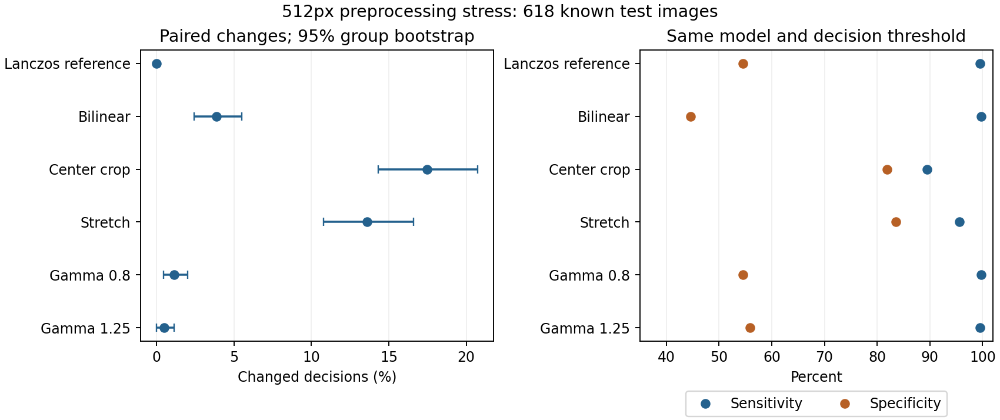

# Vorverarbeitung des eingefrorenen 512px-Modells

Der zentrale Bildausschnitt verändert **108 von 618 Entscheidungen (17,5 %; 95%-Bootstrapintervall 14,3–20,7 %)**. Schon der Wechsel von Lanczos zu bilinearer Interpolation bei gleicher Bildgeometrie verändert 24 Entscheidungen. Die Bildpipeline ist damit Teil des überprüften Modells und muss für eine App reproduziert werden.

## Methoden

Das vor der Auswertung festgeschriebene [Protokoll](../../../configs/original_preprocessing_stress.json) verwendet das unveränderte, partiell nachtrainierte MobileNet512, alle 469 Kalibrierungs- und 618 Testbilder sowie die bisherigen Schwellen (Klassifikation: Logit 0; Konfidenz: 0,994842). Sechs Bedingungen werden auf denselben Bildern verglichen. Der zentrale quadratische Ausschnitt wird aus dem Originalbild gewonnen; er ist keine Lungensegmentierung und kann Anatomie entfernen. Stretch verzerrt das Seitenverhältnis absichtlich. Gamma verändert die bereits vorbereiteten Pixel, schwarze Ränder bleiben schwarz.

Unsicherheit: 2.000 gepaarte Wiederziehungen der aus Dateinamen abgeleiteten Testgruppen, bei festem Modell. Die Gruppen sind keine bestätigten Patientenidentitäten. Primär ist die Entscheidungsänderung durch Center Crop; übrige Vergleiche sind explorativ, ohne Korrektur für Mehrfachvergleiche. Es gibt keine neue Modellwahl, Schwellenanpassung oder Änderung des App-Exports.

| Bedingung | Geänderte Entscheidungen | Test-Accuracy | Sensitivität | Spezifität | AUROC |
|---|---:|---:|---:|---:|---:|
| Lanczos + Letterbox (Referenz) | 0/618 | 82,7 % | 99,5 % | 54,5 % | 0,9669 |
| Bilinear + Letterbox | 24/618 | 79,1 % | 99,7 % | 44,6 % | 0,9597 |
| Center Crop + Lanczos | 108/618 | 86,6 % | 89,4 % | 81,8 % | 0,9217 |
| Stretch + Lanczos | 84/618 | 91,1 % | 95,6 % | 83,5 % | 0,9670 |
| Gamma 0,8 | 7/618 | 82,8 % | 99,7 % | 54,5 % | 0,9663 |
| Gamma 1,25 | 3/618 | 83,2 % | 99,5 % | 55,8 % | 0,9646 |

Center Crop erhöht Accuracy, verliert aber 10,1 Prozentpunkte Sensitivität und 0,0452 AUROC. Bilinear senkt Spezifität um 10,0 Prozentpunkte (gepaartes Intervall −14,0 bis −6,2). Stretch sieht im bekannten Test günstiger aus, senkt jedoch die Kalibrierungs-Accuracy von 98,1 % auf 95,5 %. Diese nachträgliche Beobachtung rechtfertigt keine Auswahl der Testgewinner-Pipeline. Sie liefert eine Hypothese für eine getrennte Entwicklungsstudie mit neuer externer Prüfung.



Die Analyse beweist weder Läsionslokalisierung noch eine bestimmte kausale Fehlerquelle. Eine unabhängige klinische 512px-Kohorte und mehrere Trainingsseeds bleiben offen.

## Reproduzierbarkeit und App-Referenzen

[Alle Kalibrierungs-/Testwerte](results.csv), [Intervalle und gepaarte Kontraste](summary.json), [Vorhersagen](predictions.npz) und [Bootstrapziehungen](bootstrap.npz) sind gespeichert. Der unabhängige Prüfer bestätigt alle Testpunktwerte, unveränderte Basisvorhersagen und sämtliche 12.000 vollständigen Kennzahl-Ziehungen einschließlich gepaarter Kontrastintervalle; siehe [Prüfprotokoll](verification.json).

Vier vollständig synthetische Bild-/Tensorpaare prüfen Rundung zur geraden Zahl, ungerade Seitenverhältnisse, RGB-Grauwertkonvertierung und Vergrößerung. [Referenzvertrag und Prüfsummen](fixtures.json). Das lokale Paket `data/original_xray/PreprocessingParityFixtures.zip` enthält Quell-PNGs, erwartete 512px-PNGs, rohe Float32-Tensoren und Modellreferenzwerte. Es enthält keine medizinischen Bilder. Die Pixel-/Tensoridentität ist geprüft; Apple-Bildpipeline und Core-ML-Laufzeit sind noch nicht geprüft. [SwiftUI-Anleitung](../../../ios/ResearchPrototype/README.md).

```bash
python experiments/original_preprocessing_stress.py
python scripts/verify_preprocessing_stress.py
python scripts/make_preprocessing_fixtures.py
python scripts/plot_preprocessing_stress.py
```

Erzeuger erwarten neue Ausgabeordner und überschreiben bestehende Studien nicht. Für eine vollständige Wiederholung eine separate Arbeitskopie verwenden. Code und Auswertung wurden mit KI-Assistenz erstellt.
