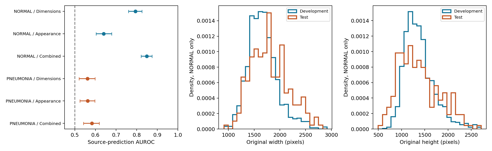

# Herkunftsaudit: Warum versagt die Übertragung bei Normalbildern?

Explorative Nachanalyse vom 11. November 2026. Ausgangspunkt ist die dokumentierte Spezifitätslücke des unveränderten 512px-Modells. Die Analyse prüft Unterschiede zwischen Teilbeständen; sie trainiert keine neue medizinische Diagnose und erklärt Fehler nicht kausal.

## Ergebnis

| Klinische Bildklasse | Merkmale | Herkunfts-AUROC [95 %] |
|---|---|---:|
| NORMAL | dimensions | 0.794 [0.760; 0.826] |
| NORMAL | appearance | 0.640 [0.603; 0.679] |
| NORMAL | combined | 0.849 [0.822; 0.875] |
| PNEUMONIA | dimensions | 0.562 [0.521; 0.598] |
| PNEUMONIA | appearance | 0.562 [0.525; 0.597] |
| PNEUMONIA | combined | 0.583 [0.543; 0.618] |

**Das sind AUROCs für die Herkunft eines Bildes, nicht für Pneumonie.** Positive Herkunft bedeutet offizieller Test, negative Herkunft bedeutet ursprünglicher Trainingsbestand einschließlich Modellwahl/Kalibrierung. Die klinische Klasse wird konstant gehalten; unterschiedliche Pneumonie-Anteile können den Unterschied daher nicht allein erklären.



Normalbilder zeigen eine deutlich stärkere Trennbarkeit der Teilbestände als Pneumoniebilder. Das ist mit der ungleichen Übertragung von Sensitivität und Spezifität vereinbar. Es beweist weder eine bestimmte Ursache noch, dass der Bildklassifikator diese Merkmale als Abkürzung verwendet. Insbesondere wird die Originalgröße dem medizinischen Modell nicht als Zahlenwert gegeben; Bildgeometrie, Abtastung und Bildinhalt können damit zusammenhängen.

## Durchführung

- Unverändert 5.371 bereinigte Bilder; 1.579 NORMAL und 3.792 PNEUMONIA. Keine neuen Bilder und keine neue Aufteilung des medizinischen Tests.
- Drei festgelegte Merkmalsgruppen: logarithmierte Originalbreite/-höhe; sieben Erscheinungsmerkmale; deren Kombination. Keine IDs, Dateinamen oder medizinischen Modellvorhersagen als Eingaben der Herkunftsklassifikatoren.
- Erscheinungsmerkmale: Mittelwert, Standardabweichung, 5./95. Perzentil, Mittelwerte am äußeren 10%-Rand und im zentralen 50%-Rechteck sowie mittlere benachbarte Grauwertdifferenzen. Schwarzes Padding wird anhand der bekannten Geometrie entfernt; echte schwarze Bildpixel bleiben erhalten.
- Je klinischer Klasse fünf gruppierte Folds. Standardisierung ausschließlich im Trainingsfold. Logistische Regression mit festem C=1 und ausgeglichenen Herkunftsklassengewichten. Jede gespeicherte Vorhersage stammt von einem Modell, das diese Dateinamen-Gruppe nicht zum Fit verwendet hat.
- 2.000 nach Herkunft stratifizierte Gruppen-Bootstraps der festen Out-of-fold-Vorhersagen. Keine erneute Modellanpassung im Bootstrap: Intervalle enthalten keine vollständige CV-/Trainingsunsicherheit. Überlappende Trainingsfolds und unvollständig bekannte Identitäten begrenzen die Schlussfolgerungen.

Die Herkunftsmodelle verwenden absichtlich Bilder aus beiden Ursprüngen zur gruppierten Kreuzvalidierung. Das ist eine Diagnose des Datensatzes, kein unabhängiger externer Test des medizinischen Modells. Der bekannte Testbestand wird dadurch nicht wieder unberührt.

## Zusammenhang mit falsch positiven Normalbildern

Alle vorab benannten Merkmale werden berichtet; keine Auswahl nur günstiger Zusammenhänge. Spearman-Korrelation mit dem festen medizinischen Logit innerhalb der 231 Test-Normalbilder, rein deskriptiv. Mediane bei Log-Breite/-Höhe liegen auf der logarithmischen Skala; die übrigen Größen beziehen sich auf Graustufen 0–1.

| Merkmal | Spearman mit Pneumonie-Logit | Median falsch positiv | Median richtig negativ |
|---|---:|---:|---:|
| log_width | -0.417 | 7.3677 | 7.5281 |
| log_height | -0.471 | 6.9698 | 7.2630 |
| mean | -0.013 | 0.4797 | 0.4922 |
| std | -0.030 | 0.2390 | 0.2376 |
| p05 | -0.252 | 0.0000 | 0.0137 |
| p95 | -0.181 | 0.8039 | 0.8078 |
| rim_mean | -0.082 | 0.3618 | 0.3793 |
| center_mean | +0.126 | 0.5630 | 0.5512 |
| edge_energy | -0.042 | 0.0133 | 0.0140 |

Diese Zusammenhänge können durch andere Bildmerkmale oder Fallmischung erklärt sein. Kein kausaler Nachweis, keine klinische Erklärung und kein Anlass, die Entscheidungsschwelle auf den bekannten Testfällen nachzustellen.

## Konsequenz für das Projekt

Die nächste belastbare Verbesserung benötigt eine besser passende, unabhängig erhobene Validierungs-/Kalibrierungskohorte und gezielte, vorab festgelegte Prüfungen der Bildvorverarbeitung. Mehr Epochen oder Parameter allein adressieren die beobachtete Herkunftslücke nicht nachweislich. Die bestehenden Diagnosemodelle, Schwellen, Vorhersagen und das Core-ML-Paket bleiben unverändert.

## Nachprüfbarkeit

[Protokoll](../../../configs/original_source_audit.json), vor der Auswertung als `81c94b1` versioniert. [Zusammenfassung](summary.json) · [Merkmale und OOF-Vorhersagen](features_and_oof.npz) · [Fold-Modelle](fold_models.npz) · [Verteilungen](distributions.csv) · [Bootstrap](bootstrap.npz) · [Unabhängiger Prüfer](verification.json).

```bash
python experiments/original_source_audit.py
python scripts/verify_original_source_audit.py
python scripts/report_original_source_audit.py
```

Den Experimentlauf in einer frischen Arbeitskopie ausführen; der Ergebnisordner wird nicht überschrieben. Voraussetzung ist die vollständig vorbereitete Originalbild-Studie.
