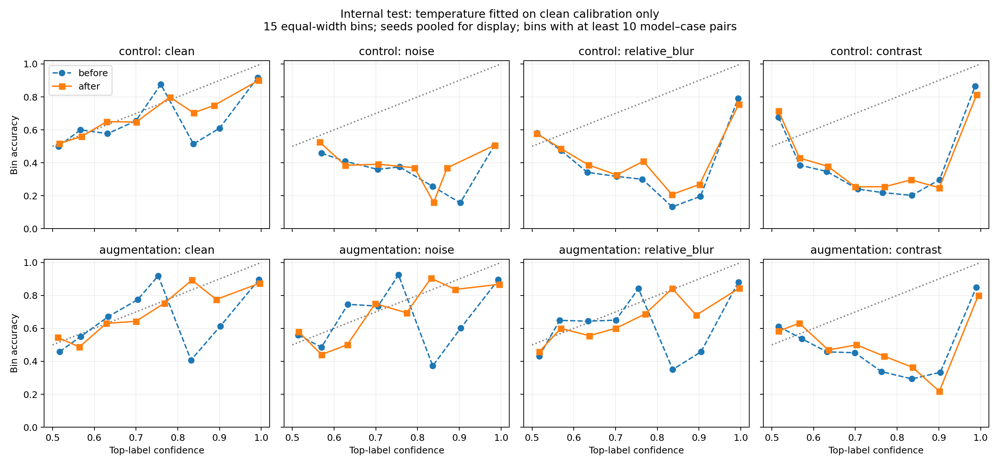

# Temperature Scaling: bessere Kalibrierung ist nicht garantiert

Explorative Nachanalyse vom 10. November 2026. Sechs eingefrorene 28px-Modelle, 262 bestehende Kalibrierungsfälle, 621 interne Testrepräsentanten. Temperatur pro Modell ausschließlich auf unveränderten Kalibrierungsbildern durch Minimierung der binären Log-Loss bestimmt. Auswertungsplan vor dem Fit festgehalten, aber der Benchmark war bereits untersucht; keine neue konfirmatorische Studie.

## Ergebnisse

| Modell / Bedingung | NLL vorher → nachher | Differenz NLL [95%-Bootstrap] | Brier vorher → nachher | ECE vorher → nachher |
|---|---:|---:|---:|---:|
| control / clean | 0.505 → 0.585 | +0.080 [+0.056; +0.108] | 0.129 → 0.132 | 0.109 → 0.103 |
| control / noise | 1.272 → 1.416 | +0.144 [+0.131; +0.156] | 0.409 → 0.451 | 0.411 → 0.460 |
| control / relative_blur | 1.111 → 1.398 | +0.287 [+0.243; +0.332] | 0.262 → 0.275 | 0.266 → 0.276 |
| control / contrast | 0.768 → 0.949 | +0.181 [+0.154; +0.211] | 0.232 → 0.250 | 0.235 → 0.252 |
| augmentation / clean | 0.599 → 0.808 | +0.209 [+0.142; +0.287] | 0.136 → 0.138 | 0.122 → 0.112 |
| augmentation / noise | 0.595 → 0.799 | +0.204 [+0.140; +0.278] | 0.136 → 0.138 | 0.130 → 0.127 |
| augmentation / relative_blur | 0.698 → 0.964 | +0.266 [+0.195; +0.347] | 0.164 → 0.170 | 0.136 → 0.143 |
| augmentation / contrast | 0.799 → 1.113 | +0.314 [+0.255; +0.378] | 0.221 → 0.242 | 0.206 → 0.232 |

Kleinere Werte sind bei allen drei Kennzahlen besser. Mittel über drei Seeds je Arm. Intervalle: 2.000 gepaarte Wiederziehungen der Testrepräsentanten; feste Modelle und bereits angepasste Temperaturen, keine Unsicherheit des Temperatur-Fits oder Trainings. ECE verwendet 15 gleich breite Konfidenzbins; sie ist binabhängig und kein Ersatz für proper scoring rules wie NLL und Brier.

**Befund:** Die NLL steigt auf dem internen Test in allen acht Modellarm/Bedingung-Kombinationen. Bei clean sinkt die ECE etwas, ihre Differenzintervalle umfassen jedoch null. Eine isolierte ECE-Verbesserung würde die Verschlechterung der NLL verdecken. Keine Temperatur wird anhand dieser Ergebnisse nachoptimiert.

## Fit und Grenzen

| Arm | Seed | Temperatur | Kalibrierungs-NLL vorher → nachher |
|---|---:|---:|---:|
| control | 17 | 0.986 | 0.131 → 0.131 |
| control | 42 | 0.636 | 0.158 → 0.145 |
| control | 83 | 0.800 | 0.175 → 0.172 |
| augmentation | 17 | 0.579 | 0.169 → 0.152 |
| augmentation | 42 | 0.581 | 0.157 → 0.139 |
| augmentation | 83 | 0.798 | 0.159 → 0.156 |

Die Positivanteile betragen 74.4% auf der Kalibrierung und 62.3% auf dem Test. Alle Temperaturen liegen unter 1 und schärfen damit die Konfidenz; kein Fit liegt an den vorgegebenen Grenzen 0,05 oder 20. Die Kalibrierungs-NLL ist eine optimierte Trainingsgröße, keine unabhängige Validierung. Kleine Kalibrierungsstichprobe, Fallmix und Übertragungsprobleme sind mögliche Erklärungen, hier nicht kausal getrennt.

Positive Temperatur erhält mathematisch Klassenentscheidung und Konfidenz-Rangfolge. Mit entsprechend transformierter Annahmeschwelle bleiben auch akzeptierte Fälle und deren Fehlerrate identisch; dies wurde in Logit-Darstellung geprüft, um numerische Sättigung zu vermeiden. Eine unveränderte numerische Wahrscheinlichkeitsschwelle würde eine andere Auswahlregel definieren. Temperature Scaling allein verbessert daher in diesem binären Modell nicht die Risk-Coverage-Rangfolge.

Externe RSNA-Vorhersagen wurden nicht neu kalibriert. Einige gespeicherte Float32-Wahrscheinlichkeiten sind exakt 1; ihre ursprünglichen Logits sind daraus nicht eindeutig rekonstruierbar. Für eine exakte externe NLL nach Temperature Scaling wären originale Logits oder eine erneute Inferenz nötig. Die historische externe Primärauswertung bleibt unverändert.



Darstellung: Seeds gepoolt; Bins mit mindestens zehn Modell-Fall-Paaren. Kennzahlen in der Tabelle sind dagegen Mittel der pro Seed berechneten Werte. Keine unabhängigen Beobachtungen durch Pooling vervielfacht.

## Reproduzieren

```bash
python scripts/fetch_data.py
python experiments/temperature_scaling.py --output /tmp/temperature-reproduction
```

Der Ausgabeordner muss neu sein. [Plan](../../configs/temperature_scaling.json) · [Kennzahlen und Intervalle](summary.json) · [Pro Seed](results.csv) · [Exakte Kalibrierungs- und Testlogits](logits.npz) · [PDF](reliability.pdf). Gewichte, Archiv und alte Vorhersagen werden vor der Auswertung geprüft.

## Empfindlichkeit gegenüber dem Temperatur-Fit

Nach Sichtung der ersten Ergebnisse wurde ein weiterer [Auswertungsplan](../../configs/temperature_sensitivity.json) festgehalten: 2.000 unabhängige Wiederziehungen aus Kalibrierungs- und Testpool, gekoppelt über alle sechs Modelle. Jede Temperatur wird erneut ausschließlich auf den gezogenen clean-Kalibrierungsfällen angepasst; anschließend wird die NLL-Differenz auf den gezogenen clean-Testfällen bestimmt. Modelle bleiben fest.

| Arm | Ursprüngliche NLL-Differenz | Empirischer 2,5–97,5%-Bereich mit Refit | Anteil Ziehungen mit höherer NLL |
|---|---:|---:|---:|
| control | +0.080 | [-0.022; +0.346] | 92.70% |
| augmentation | +0.209 | [+0.009; +0.765] | 98.05% |

Die Einbeziehung des Fits verbreitert den Bereich deutlich. Bei der Kontrolle umfasst er null: Die ursprüngliche konditionale Auswertung allein erlaubt somit keine robuste positive NLL-Differenz gegenüber Variationen des Kalibrierungspools. Bei Augmentation liegt der zentrale Bereich weiter oberhalb null. Die Anteile sind weder p-Werte noch posteriorische Wahrscheinlichkeiten; die Bereiche sind empirische Sensitivität unter festen Modellen und beobachteten Pools, ohne unbekannte Patientenkorrelation oder Trainingsunsicherheit.

[Ergebnisse und Temperaturverteilungen](sensitivity/summary.json) · [Bootstrap-Werte](sensitivity/bootstrap.npz). Reproduktion: `python experiments/temperature_sensitivity.py --output /tmp/temperature-sensitivity`. Keine neue Schwelle, keine weitere Modellwahl und keine Anpassung am externen Test.
